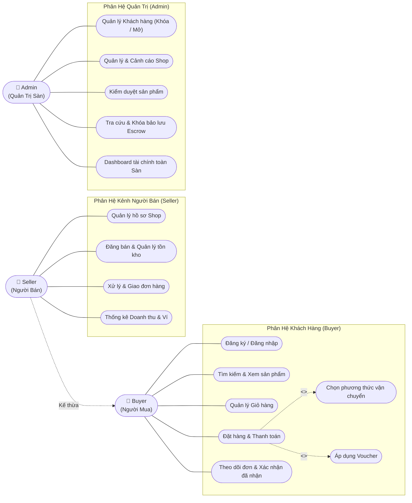

# 🛍️ JML STORE - MULTI-VENDOR MARKETPLACE PLATFORM
> **Hệ thống Sàn Thương Mại Điện Tử Đa Nhà Bán Hàng & Quản Trị Trung Gian Bảo Đảm (Escrow Protection)**  
> **Kiến trúc:** Modular Monorepo chuẩn hóa (FastAPI + MySQL 8.0 + Modern Frontend)

---

## 📑 Bảng Mục Lục
1. [Giới Thiệu Dự Án](#-giới-thiệu-dự-án)
2. [Sơ Đồ Use Case Tổng Quan](#-sơ-đồ-use-case-tổng-quan)
3. [Cấu Trúc Thư Mục Dự Án (Monorepo)](#-cấu-trúc-thư-mục-dự-án-monorepo)
4. [Các Phân Hệ Giao Diện (Actors)](#-các-phân-hệ-giao-diện-actors)
5. [Hướng Dẫn Cài Đặt & Khởi Chạy](#-hướng-dẫn-cài-đặt--khởi-chạy)
6. [Tài Liệu Đồ Án & API Docs](#-tài-liệu-đồ-án--api-docs)

---

## 🌟 Giới Thiệu Dự Án
**JML Store** là nền tảng Sàn TMĐT đa nhà bán hàng mô phỏng theo mô hình Shopee / Tiki:
- **Người mua (Buyer):** Mua sắm sản phẩm từ nhiều cửa hàng, chọn hình thức vận chuyển, áp dụng mã voucher giảm giá, theo dõi đơn và xác nhận nhận hàng.
- **Người bán (Seller):** Kênh người bán (Seller Center) để quản lý kho hàng, upload sản phẩm mới, xử lý và cập nhật tiến độ giao đơn hàng.
- **Quản trị viên (Admin):** Quản lý toàn bộ cửa hàng, kiểm duyệt sản phẩm mới, kiểm soát tiền trung gian (Escrow), xử lý tranh chấp khiếu nại và khóa tài khoản vi phạm.

---

## 🎯 Sơ Đồ Use Case Tổng Quan



---

## 📂 Cấu Trúc Thư Mục Dự Án (Monorepo)

```text
shopee-clone/
├── backend/
│   ├── src/
│   │   ├── config/             # Cấu hình kết nối MySQL và biến môi trường
│   │   ├── middlewares/        # Kiểm tra phân quyền RBAC, headers an toàn
│   │   ├── utils/              # Các hàm định dạng tiền tệ, mã vận đơn, thời gian
│   │   └── modules/            # Chia nhỏ theo từng nghiệp vụ chuẩn RESTful
│   │       ├── auth/           # Đăng ký, đăng nhập đa vai trò
│   │       ├── user/           # Quản lý hồ sơ và địa chỉ giao hàng
│   │       ├── category/       # Danh mục 4 ngành hàng chính
│   │       ├── product/        # Danh sách, lọc, chi tiết sản phẩm Flash Sale
│   │       ├── seller/         # Dashboard người bán, đăng sản phẩm, giao hàng
│   │       ├── cart/           # Kiểm tra tồn kho trước khi thanh toán
│   │       ├── order/          # Đặt hàng checkout, trừ tồn kho, cập nhật đã bán
│   │       ├── payment/        # Danh sách phương thức COD / Escrow
│   │       ├── review/         # Đánh giá & nhận xét sản phẩm
│   │       ├── voucher/        # Quản lý mã giảm giá (FREESHIP, JML50K, GIAM10...)
│   │       └── admin/          # Quản trị cửa hàng, khách hàng, duyệt sản phẩm
│   ├── db/
│   │   ├── schema.sql          # File DDL khởi tạo toàn bộ 6 bảng MySQL
│   │   ├── migrations/         # Lịch sử cập nhật cấu trúc database
│   │   └── seeds/              # Dữ liệu mẫu khởi tạo các Shop, Sản phẩm, Tài khoản
│   ├── tests/                  # Bộ test tự động (unittest) kiểm tra API
│   ├── requirements.txt        # Thư viện Python phụ thuộc
│   ├── Dockerfile              # Dockerfile đóng gói backend
│   └── main.py                 # File khởi chạy chính FastAPI Server
├── frontend/
│   ├── shared/                 # Thành phần dùng chung cho toàn bộ giao diện
│   │   ├── css/shared.css      # Định dạng màu sắc, thanh cuộn, toast chung
│   │   ├── js/api.js           # Client bọc fetch tự động gắn token & Base URL
│   │   ├── js/auth.js          # Controller kiểm tra phiên đăng nhập và phân quyền
│   │   └── components/         # Header, footer dùng chung
│   ├── buyer/                  # Giao diện Khách hàng mua sắm (hoặc /user/)
│   ├── seller/                 # Giao diện Kênh người bán (Seller Center)
│   └── admin/                  # Giao diện Trang quản trị tối cao của Admin
├── docs/                       # Thư mục lưu trữ tài liệu kỹ thuật đồ án
│   ├── api/                    # Tài liệu chi tiết các API endpoints
│   ├── erd/                    # Sơ đồ thực thể mối quan hệ cơ sở dữ liệu (ERD)
│   ├── wireframes/             # Bản thiết kế phác thảo các màn hình giao diện
│   ├── report/                 # Đề cương và nội dung báo cáo đồ án
│   └── test/                   # Kế hoạch và kịch bản test cases
├── .github/
│   ├── workflows/ci.yml        # CI Pipeline tự động kiểm thử trên GitHub Actions
│   └── PULL_REQUEST_TEMPLATE.md
├── docker-compose.yml          # Triển khai trọn gói MySQL + Backend chỉ với 1 lệnh
├── .env.example                # File mẫu cấu hình biến môi trường
└── README.md                   # Hướng dẫn chi tiết dự án
```

---

## 💻 Các Phân Hệ Giao Diện (Actors)

1. **Khách hàng (Buyer):**
   - URL: `http://127.0.0.1:5500/frontend/buyer/index.html` (hoặc `/frontend/user/index.html`)
   - Tính năng: Xem Flash Sale, giỏ hàng, đặt hàng chọn 3 đơn vị vận chuyển, áp dụng voucher, theo dõi đơn.

2. **Kênh Người Bán (Seller Center):**
   - URL: `http://127.0.0.1:5500/frontend/seller/index.html`
   - Tài khoản mẫu: `trungshop` (hoặc `dung36`) / mật khẩu: `123456`
   - Tính năng: Theo dõi GMV, tiền thực nhận 93%, đơn hàng của shop, cập nhật trạng thái vận chuyển, đăng sản phẩm mới.

3. **Trang Quản Trị Tối Cao (Admin):**
   - URL: `http://127.0.0.1:5500/frontend/admin/index.html`
   - Tài khoản mẫu: `admin` / mật khẩu: `123456`
   - Tính năng: Quản lý cửa hàng (xem đơn đã bán), khóa khách hàng vi phạm, bảo lãnh tiền Escrow, duyệt sản phẩm chờ bán.

---

## 🚀 Hướng Dẫn Cài Đặt & Khởi Chạy

### Cách 1: Chạy trực tiếp (Local Machine)
1. **Khởi động MySQL Server:**
   - Đảm bảo MySQL đang chạy trên cổng `3306` (Database: `jml_marketplace`, user: `root`, pass: `123456`).
   - Khởi tạo cấu trúc bằng file `backend/db/schema.sql`.

2. **Cài đặt thư viện Python:**
   ```bash
   pip install -r backend/requirements.txt
   ```

3. **Chạy FastAPI Backend Server:**
   ```bash
   python -m uvicorn backend.main:app --host 127.0.0.1 --port 8000 --reload
   ```

4. **Mở giao diện Web:**
   - Mở Live Server cổng `5500` hoặc mở trực tiếp các file HTML trong thư mục `frontend/`.

### Cách 2: Chạy bằng Docker Compose
```bash
docker-compose up -d --build
```

---

## 📚 Tài Liệu Đồ Án & API Docs
- **Swagger UI tương tác trực tiếp:** [http://127.0.0.1:8000/docs](http://127.0.0.1:8000/docs)
- **Tài liệu API chi tiết:** [`docs/api/api_specification.md`](docs/api/api_specification.md)
- **Sơ đồ cơ sở dữ liệu ERD:** [`docs/erd/erd_diagram.md`](docs/erd/erd_diagram.md)
- **Đề cương báo cáo đồ án tốt nghiệp:** [`docs/report/project_report.md`](docs/report/project_report.md)
- **Kế hoạch kiểm thử & Test cases:** [`docs/test/test_plan.md`](docs/test/test_plan.md)
