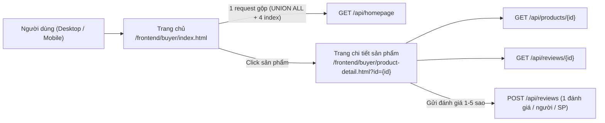
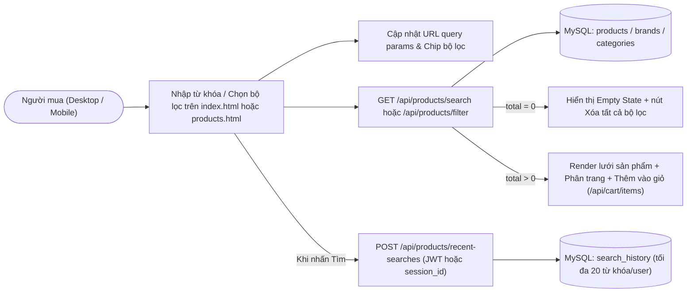
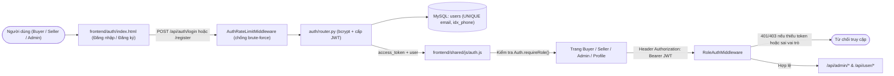

# 🛍️ JML STORE - MULTI-VENDOR MARKETPLACE PLATFORM

> **Hệ thống Sàn Thương Mại Điện Tử Đa Nhà Bán Hàng & Quản Trị Trung Gian Bảo Đảm (Escrow Protection)**  
> **Repository:** [https://github.com/nducanhh0402/JML](https://github.com/nducanhh0402/JML.git)  
> **Kiến trúc:** Modular Monorepo (FastAPI + MySQL 8.0 + Multi-Role Frontend)

---

## 📑 Bảng Mục Lục
1. [Giới Thiệu Dự Án](#1-giới-thiệu-dự-án)
2. [Bản Demo Trực Tuyến (Vercel Live Demo)](#2-bản-demo-trực-tuyến-vercel-live-demo)
3. [Sơ Đồ Use Case Tổng Quan](#3-sơ-đồ-use-case-tổng-quan)
4. [Cấu Trúc Thư Mục Dự Án](#4-cấu-trúc-thư-mục-dự-án)
5. [Các Phân Hệ Giao Diện & Tài Khoản Mẫu](#5-các-phân-hệ-giao-diện--tài-khoản-mẫu)
6. [Hướng Dẫn Cài Đặt & Khởi Chạy](#6-hướng-dẫn-cài-đặt--khởi-chạy)
7. [Kiểm Thử & Tài Liệu API (Swagger)](#7-kiểm-thử--tài-liệu-api-swagger)
8. [Module Trang Chủ, Chi Tiết Sản Phẩm, Đánh Giá & Tối Ưu Hiệu Năng (Vũ Dũng - B25DTCN161)](#8-module-trang-chủ-chi-tiết-sản-phẩm-đánh-giá--tối-ưu-hiệu-năng-vũ-dũng---b25dtcn161)
9. [Module Tìm Kiếm, Bộ Lọc & Tích Hợp Mua Hàng (TF16BE9)](#9-module-tìm-kiếm-bộ-lọc--tích-hợp-mua-hàng-tf16be9)
10. [Module Xác Thực, Phân Quyền (Auth & RBAC), Hồ Sơ Cá Nhân, Tích Hợp & Demo Vercel (TF16BE3)](#10-module-xác-thực-phân-quyền-auth--rbac-hồ-sơ-cá-nhân-tích-hợp--demo-vercel-tf16be3)

---

## 1. Giới Thiệu Dự Án

**JML Store** là nền tảng Sàn Thương mại Điện tử đa nhà bán hàng (Multi-Vendor Marketplace), mô phỏng quy trình giao dịch bảo đảm qua ví trung gian **Escrow**:

- **Người mua (Buyer / User):** Tìm kiếm và lọc sản phẩm theo danh mục/từ khóa, quản lý giỏ hàng, chọn phương thức vận chuyển, áp dụng mã giảm giá (Voucher), đặt hàng và theo dõi tiến độ giao nhận.
- **Người bán (Seller Center):** Quản lý hồ sơ cửa hàng, đăng bán và cập nhật tồn kho sản phẩm, xử lý đơn hàng và theo dõi doanh thu (GMV) / số dư thực nhận.
- **Quản trị viên (Admin):** Quản lý toàn bộ cửa hàng (Shop/Seller), kiểm duyệt sản phẩm, kiểm soát tài khoản khách hàng, đối soát phí sàn và xử lý đơn hàng trung gian (Escrow).

---

## 2. Bản Demo Trực Tuyến (Vercel Live Demo)

Giao diện tĩnh (`frontend/`) được cấu hình sẵn bằng [`vercel.json`](./vercel.json) (`outputDirectory: "frontend"`, rewrite `/frontend/:path* -> /:path*`) để triển khai trực tiếp lên **Vercel**, tương thích hiển thị cả **Máy tính (Desktop)** và **Điện thoại (Mobile)**.

- **Link Demo trực tuyến (Vercel Production):** [https://jml-teal.vercel.app](https://jml-teal.vercel.app)
- **Triển khai nhanh lên Vercel:** [](https://vercel.com/new/clone?repository-url=https%3A%2F%2Fgithub.com%2Fnducanhh0402%2FJML)

### Danh sách các trang chính kiểm tra trên Desktop & Mobile

| Phân hệ / Trang chính | Đường dẫn Demo trực tuyến trên Vercel | Kiểm tra Desktop (1440px) | Kiểm tra Mobile (375px) |
| :--- | :--- | :---: | :---: |
| **Cổng Demo tổng hợp (Landing)** | [https://jml-teal.vercel.app/](https://jml-teal.vercel.app/) | ✅ | ✅ |
| **Trang chủ Người mua (Buyer)** | [https://jml-teal.vercel.app/buyer/index.html](https://jml-teal.vercel.app/buyer/index.html) | ✅ | ✅ |
| **Danh sách & Bộ lọc sản phẩm** | [https://jml-teal.vercel.app/buyer/products.html](https://jml-teal.vercel.app/buyer/products.html) | ✅ | ✅ |
| **Chi tiết sản phẩm & Đánh giá** | [https://jml-teal.vercel.app/buyer/product-detail.html?id=101](https://jml-teal.vercel.app/buyer/product-detail.html?id=101) | ✅ | ✅ |
| **Giỏ hàng & Mã giảm giá** | [https://jml-teal.vercel.app/buyer/cart.html](https://jml-teal.vercel.app/buyer/cart.html) | ✅ | ✅ |
| **Đặt hàng (Checkout)** | [https://jml-teal.vercel.app/user/checkout.html](https://jml-teal.vercel.app/user/checkout.html) | ✅ | ✅ |
| **Lịch sử & Trạng thái đơn hàng** | [https://jml-teal.vercel.app/user/orders.html](https://jml-teal.vercel.app/user/orders.html) | ✅ | ✅ |
| **Hồ sơ cá nhân & Đổi mật khẩu** | [https://jml-teal.vercel.app/user/profile.html](https://jml-teal.vercel.app/user/profile.html) | ✅ | ✅ |
| **Sổ địa chỉ nhận hàng** | [https://jml-teal.vercel.app/user/addresses.html](https://jml-teal.vercel.app/user/addresses.html) | ✅ | ✅ |
| **Đăng nhập / Đăng ký** | [https://jml-teal.vercel.app/auth/index.html](https://jml-teal.vercel.app/auth/index.html) | ✅ | ✅ |
| **Kênh Người bán (Seller Center)** | [https://jml-teal.vercel.app/seller/index.html](https://jml-teal.vercel.app/seller/index.html) | ✅ | ✅ |
| **Quản trị Sàn (Admin Portal)** | [https://jml-teal.vercel.app/admin/index.html](https://jml-teal.vercel.app/admin/index.html) | ✅ | ✅ |
| **Quản lý Danh mục & Thương hiệu** | [https://jml-teal.vercel.app/admin/categories_brands.html](https://jml-teal.vercel.app/admin/categories_brands.html) | ✅ | ✅ |
| **Quản lý Sản phẩm Admin** | [https://jml-teal.vercel.app/admin/products.html](https://jml-teal.vercel.app/admin/products.html) | ✅ | ✅ |

---

## 3. Sơ Đồ Use Case Tổng Quan


---

## 4. Cấu Trúc Thư Mục Dự Án

```text
JML/
├── backend/
│   ├── src/
│   │   ├── config/
│   │   │   └── database.py                             # Cấu hình kết nối MySQL (PyMySQL wrapper)
│   │   ├── middlewares/
│   │   │   └── auth_middleware.py                      # Security headers & middleware xác thực
│   │   ├── utils/
│   │   │   └── helpers.py                              # Hàm tiện ích dùng chung
│   │   └── modules/                                    # Các router API theo từng nghiệp vụ
│   │       ├── admin/router.py                         # Quản trị Shop, Khách hàng, Duyệt SP, Escrow
│   │       ├── auth/router.py                          # Đăng ký, Đăng nhập đa vai trò
│   │       ├── cart/router.py                          # Kiểm tra giỏ hàng & tồn kho
│   │       ├── category/router.py                      # Danh mục ngành hàng & Thương hiệu
│   │       ├── homepage/router.py                      # API Trang chủ tối ưu (Banner, Nổi bật, Mới nhất, Danh mục - UNION ALL)
│   │       ├── order/router.py                         # Tạo đơn, theo dõi, cập nhật trạng thái đơn
│   │       ├── payment/router.py                       # Phương thức thanh toán (COD / Ví Escrow)
│   │       ├── product/router.py                       # Danh sách, tìm kiếm, lọc, chi tiết sản phẩm
│   │       ├── review/router.py                        # Đánh giá & nhận xét sản phẩm
│   │       ├── seller/router.py                        # Kênh người bán, đăng SP, quản lý đơn Shop
│   │       ├── user/router.py                          # Hồ sơ người dùng
│   │       └── voucher/router.py                       # Danh sách mã giảm giá (Voucher)
│   ├── db/
│   │   ├── schema.sql                                  # DDL khởi tạo bảng cốt lõi (shops, products, customers, orders, order_items, users)
│   │   ├── migrations/
│   │   │   ├── 001_create_orders_tables.sql            # Bảng orders, order_items, payments, order_status_history
│   │   │   ├── 002_create_carts_tables.sql             # Bảng carts, cart_items
│   │   │   ├── 003_create_users_and_roles_schema.sql   # Bảng roles, users_v2 & tài khoản mẫu
│   │   │   ├── 004_create_catalog_tables_and_seed.sql  # Bảng categories, brands, product_images & 21 SP mẫu
│   │   │   ├── 005_add_order_query_indexes.sql         # Index tối ưu truy vấn đơn hàng
│   │   │   ├── 006_users_email_unique_index.sql        # Ràng buộc unique email cho bảng users
│   │   │   ├── 007_create_user_addresses_table.sql     # Bảng sổ địa chỉ nhận hàng
│   │   │   ├── 008_create_vouchers_table.sql           # Bảng mã giảm giá
│   │   │   └── 009_optimize_homepage_indexes.sql       # 4 composite index tối ưu trang chủ (TF175BC)
│   │   └── seeds/
│   │       └── seed.sql                                # Dữ liệu mẫu Shop và Tài khoản (Admin, Seller, Buyer)
│   ├── tests/
│   │   └── test_api.py                                 # Bộ kiểm thử API bằng Python unittest
│   ├── database.py                                     # Khởi tạo bảng & tự động đồng bộ MySQL khi startup
│   ├── schemas.py                                      # Pydantic schemas cho request/response
│   ├── main.py                                         # Khởi chạy FastAPI Server (cổng 8000)
│   ├── requirements.txt                                # Các thư viện Python phụ thuộc
│   └── Dockerfile                                      # Dockerfile đóng gói Backend
├── frontend/
│   ├── buyer/                                          # Giao diện Khách hàng mua sắm (index.html, products.html, style.css)
│   ├── user/                                           # Giao diện Storefront Người dùng (index.html, products.html, style.css)
│   ├── seller/                                         # Giao diện Kênh Người Bán (index.html)
│   ├── admin/                                          # Giao diện Quản trị Sàn (index.html, script.js, style.css, mobile-responsive.*)
│   └── shared/                                         # Tài nguyên dùng chung
│       ├── components/header.html
│       ├── css/shared.css
│       └── js/                                         # api.js, auth.js
├── .env.example                                        # Mẫu biến môi trường kết nối MySQL & JWT
├── .gitignore
├── docker-compose.yml                                  # Triển khai MySQL 8.0 + FastAPI Backend bằng Docker
└── README.md                                           # Tài liệu hướng dẫn dự án
```

---

## 5. Các Phân Hệ Giao Diện & Tài Khoản Mẫu

| Phân hệ | Đường dẫn mở trên Live Server (`:5500`) | Tài khoản mẫu (`seed.sql`) | Chức năng chính |
| :--- | :--- | :--- | :--- |
| **Người mua (Buyer / User)** | `/frontend/buyer/index.html` hoặc `/frontend/user/index.html` | `buyer` / `123456` | Xem Flash Sale, tìm kiếm & lọc sản phẩm, giỏ hàng, đặt hàng, áp dụng voucher |
| **Kênh Người Bán (Seller)** | `/frontend/seller/index.html` | `trungshop` hoặc `dung36` / `123456` | Quản lý sản phẩm, tồn kho, xử lý đơn hàng của Shop, xem doanh thu |
| **Quản trị Sàn (Admin)** | `/frontend/admin/index.html` | `admin` / `123456` | Quản lý Shop/Seller, duyệt sản phẩm, quản lý khách hàng, theo dõi đơn Escrow |

---

## 6. Hướng Dẫn Cài Đặt & Khởi Chạy

### Cách 1: Chạy trực tiếp trên máy (Local Machine)

1. **Clone repository và tạo file cấu hình `.env`:**
   ```bash
   git clone https://github.com/nducanhh0402/JML.git
   cd JML
   cp .env.example .env
   ```
   *(Kiểm tra lại thông số `MYSQL_HOST`, `MYSQL_PORT=3306`, `MYSQL_USER=root`, `MYSQL_PASSWORD=123456`, `MYSQL_DB=jml_marketplace` trong `.env`).*

2. **Khởi tạo cơ sở dữ liệu MySQL 8.0:**
   - Đảm bảo MySQL Server đang chạy trên cổng `3306`.
   - Chạy lần lượt các file SQL theo thứ tự:
     1. `backend/db/schema.sql`
     2. `backend/db/migrations/001_create_orders_tables.sql`
     3. `backend/db/migrations/002_create_carts_tables.sql`
     4. `backend/db/migrations/003_create_users_and_roles_schema.sql`
     5. `backend/db/migrations/004_create_catalog_tables_and_seed.sql`
     6. `backend/db/seeds/seed.sql`

3. **Cài đặt thư viện Python:**
   ```bash
   pip install -r backend/requirements.txt
   ```

4. **Khởi chạy FastAPI Backend Server:**
   ```bash
   python -m uvicorn backend.main:app --host 127.0.0.1 --port 8000 --reload
   ```

5. **Mở giao diện Web:**
   - Dùng VS Code **Live Server** (cổng `5500`) mở các trang trong thư mục `frontend/buyer/`, `frontend/user/`, `frontend/seller/`, hoặc `frontend/admin/`.

### Cách 2: Chạy bằng Docker Compose

```bash
docker-compose up -d --build
```
- **MySQL 8.0 Container (`jml_mysql_db`):** cổng `3306` (tự động chạy lần đầu `schema.sql`, các migration `004`, `002`, `003` và `seed.sql`).
- **FastAPI Container (`jml_backend_api`):** cổng `8000`.

---

## 7. Kiểm Thử & Tài Liệu API (Swagger)

Sau khi chạy Backend Server ở cổng `8000`, truy cập trực tiếp các đường dẫn sau:

- **Swagger UI (Tài liệu & Test API trực tiếp):** [http://127.0.0.1:8000/docs](http://127.0.0.1:8000/docs)
- **ReDoc API Documentation:** [http://127.0.0.1:8000/redoc](http://127.0.0.1:8000/redoc)
- **OpenAPI JSON Schema:** [http://127.0.0.1:8000/openapi.json](http://127.0.0.1:8000/openapi.json)

Chạy bộ kiểm thử tự động (`unittest`) khi Backend đang chạy:
```bash
python -m unittest backend/tests/test_api.py -v
```

---

## 8. Module Trang Chủ, Chi Tiết Sản Phẩm, Đánh Giá & Tối Ưu Hiệu Năng (Vũ Dũng - B25DTCN161)

### 8.1. Tổng quan chức năng đã triển khai

| Nhóm / Task | Phạm vi | Thành phần chính & Mô tả |
| :--- | :--- | :--- |
| **Trang chủ Buyer & API** (`TF17398`, `TF17330`, `TF1745E`) | BE + FE | - **Backend** ([`backend/src/modules/homepage/router.py`](./backend/src/modules/homepage/router.py)): cung cấp `GET /api/homepage`, `/banners`, `/featured-products`, `/latest-products`, `/categories`.<br>- **Frontend** ([`frontend/buyer/index.html`](./frontend/buyer/index.html), [`buyer-index.js`](./frontend/buyer/buyer-index.js), [`index.css`](./frontend/buyer/index.css)): hero slider banner, danh mục ngành hàng, Flash Sale, Gợi ý hôm nay, Sản phẩm mới nhất kèm trạng thái **Loading (Skeleton) / Empty / Error (Retry)**. |
| **Chi tiết sản phẩm** (`TF17478`, `TF174A4`) | BE + FE | - **Backend** ([`backend/src/modules/product/router.py`](./backend/src/modules/product/router.py)): `GET /api/products/{product_id}` trả đầy đủ thư viện ảnh đa góc, mô tả, thương hiệu, giá/giảm giá, trạng thái tồn kho (`in_stock`, `low_stock`, `out_of_stock`) và danh sách sản phẩm liên quan.<br>- **Frontend** ([`frontend/buyer/product-detail.html`](./frontend/buyer/product-detail.html), [`product-detail.js`](./frontend/buyer/product-detail.js)): thư viện ảnh + lightbox phóng to, bộ chọn số lượng theo tồn kho, thêm vào giỏ hàng & mua ngay. |
| **Đánh giá & Gợi ý SP** (`TF174F6`, `TF17554`) | BE + FE | - API đánh giá `POST /api/reviews` và `GET /api/reviews/{product_id}` (chấm 1–5 sao, nhận xét, tính điểm trung bình, lọc sao, chặn mỗi người tối đa 1 đánh giá/sản phẩm trả `409 Conflict`).<br>- Giao diện khu vực đánh giá, form gửi nhận xét & lưới 4 sản phẩm gợi ý cùng danh mục trên trang chi tiết. |
| **Tối ưu truy vấn trang chủ** (`TF175BC`) | BE + DB | - Thêm 4 composite index ([`009_optimize_homepage_indexes.sql`](./backend/db/migrations/009_optimize_homepage_indexes.sql), [`backend/database.py`](./backend/database.py)): `idx_banners_active_sort`, `idx_products_status_rating_sold`, `idx_products_status_id`, `idx_products_status_category`.<br>- Gom 4 câu `SELECT` + 1 DDL trong `get_homepage()` thành **1 câu SQL `UNION ALL` duy nhất** và bỏ cột `description` TEXT nặng khỏi payload đọc DB. |
| **Kiểm thử API & Responsive** (`TF17520`, `TF17588`) | QA | - Bộ test API trang chủ, chi tiết sản phẩm, đánh giá ([`test_api_tf17520.py`](./backend/tests/test_api_tf17520.py), [`TEST_CASES_API_TF17520.md`](./backend/tests/TEST_CASES_API_TF17520.md)).<br>- Bộ test & báo cáo benchmark trước/sau tối ưu ([`test_homepage_optimization_tf175bc.py`](./backend/tests/test_homepage_optimization_tf175bc.py), [`benchmark_homepage_tf175bc.py`](./backend/tests/benchmark_homepage_tf175bc.py), [`BENCHMARK_HOMEPAGE_TF175BC.md`](./backend/tests/BENCHMARK_HOMEPAGE_TF175BC.md)). |

### 8.2. Luồng hoạt động chính



### 8.3. Hướng dẫn chạy nhanh phân hệ Trang chủ, Chi tiết & Kiểm thử

1. **Khởi chạy Backend API (cổng `8000`):**
   ```bash
   pip install -r backend/requirements.txt
   python -m uvicorn backend.main:app --host 127.0.0.1 --port 8000 --reload
   ```
2. **Mở Frontend bằng HTTP Server (hoặc Live Server cổng `5500`):**
   ```bash
   python -m http.server 5500
   ```
   - Trang chủ Buyer: `http://127.0.0.1:5500/frontend/buyer/index.html`
   - Trang chi tiết sản phẩm: `http://127.0.0.1:5500/frontend/buyer/product-detail.html?id=1`
3. **Chạy các bộ kiểm thử & benchmark không cần MySQL ngoài:**
   ```bash
   # Kiểm thử tối ưu truy vấn trang chủ (TF175BC) & API Trang chủ/Chi tiết (TF17520)
   python -m unittest backend.tests.test_homepage_optimization_tf175bc backend.tests.test_product_detail -v

   # Đo thời gian trước/sau tối ưu trang chủ trên 10.000 sản phẩm SQLite (TF175BC)
   python -m backend.tests.benchmark_homepage_tf175bc
   ```

### 8.4. Kịch bản Demo & Minh chứng (`TF16BE7`)

| Bước | Thời lượng | Nội dung trình diễn trong Video Demo | API / Màn hình minh họa |
| :---: | :---: | :--- | :--- |
| **1** | `0:00 – 0:25` | Mở Trang chủ Buyer trên Desktop (`1280×900`), giới thiệu Hero Slider, Danh mục, Flash Sale, Sản phẩm nổi bật & Mới nhất, trạng thái tải dữ liệu từ API. | `frontend/buyer/index.html` ← `GET /api/homepage` |
| **2** | `0:25 – 0:50` | Thu hẹp trình duyệt sang khung Mobile (`390×844`) kiểm tra responsive lưới 2 cột, banner không tràn ngang, dropdown tìm kiếm gọn gàng. | `frontend/buyer/index.css` |
| **3** | `0:50 – 1:25` | Click vào sản phẩm để mở Trang Chi tiết sản phẩm: đổi góc chụp thư viện ảnh, mở Lightbox phóng to, kiểm tra tồn kho/giá, chọn số lượng và bấm Thêm vào giỏ. | `frontend/buyer/product-detail.html` ← `GET /api/products/{id}` |
| **4** | `1:25 – 1:55` | Cuộn xuống khu vực Đánh giá & Sản phẩm liên quan: lọc đánh giá theo số sao, gửi nhận xét mới 1–5 sao, thử gửi trùng để hiện cảnh báo `409`, click SP gợi ý cùng danh mục. | `GET/POST /api/reviews` |
| **5** | `1:55 – 2:20` | Chạy nhanh `unittest` & `benchmark_homepage_tf175bc.py` trên terminal cho thấy giảm từ 5 xuống 1 câu SQL (`~15x` nhanh hơn) và toàn bộ test pass. | `backend/tests/benchmark_homepage_tf175bc.py` |

> **Link Demo Web trực tiếp để quay video (không cần cài DB local):**
> - Trang chủ Buyer: https://jml-teal.vercel.app/buyer/index.html
> - Trang Chi tiết sản phẩm & Đánh giá: https://jml-teal.vercel.app/buyer/product-detail.html?id=101
>
> *(Ghi chú nộp bài `TF16BE7`: tự quay video màn hình ngắn ~2 phút theo 5 bước kịch bản trên bằng OBS / Xbox Game Bar `Win + G` / Loom, sau đó đính kèm link video hoặc file video cùng link nhánh/Pull Request này.)*

### 8.5. Minh chứng nộp TF16BEF

- **Kịch bản quay chi tiết:** [`backend/tests/DEMO_SCRIPT_TF16BEF.md`](./backend/tests/DEMO_SCRIPT_TF16BEF.md)
- **Nhánh thực hiện:** [`feature/tf16bef-hoan-thien-readme-va-demo`](https://github.com/nducanhh0402/JML/tree/feature/tf16bef-hoan-thien-readme-va-demo)
- **Video Demo:** đính kèm link YouTube/Loom hoặc file MP4 tại mục Pull Request khi hoàn tất quay màn hình.

#### Checklist trước khi quay

- [ ] Backend chạy tại `127.0.0.1:8000` và Swagger mở được.
- [ ] Frontend chạy tại `127.0.0.1:5500` hoặc Vercel Live Demo.
- [ ] Trình duyệt ở desktop 1280×900, sau đó chuyển sang mobile 390×844.
- [ ] Tài khoản demo Admin/Buyer/Seller đã đăng nhập nếu cần chức năng tương ứng.
- [ ] Terminal hiển thị kết quả test hoặc benchmark rõ ràng ở cuối video.

---

## 9. Module Tìm Kiếm, Bộ Lọc & Tích Hợp Mua Hàng (TF16BE9)

> **Phụ trách:** Trịnh Quốc Trung (`B25DTCN263`)  
> **Phạm vi:** Tìm kiếm sản phẩm, lưu từ khóa gần đây, bộ lọc/sắp xếp/phân trang API + URL, chip bộ lọc & Empty State, giao diện Mobile Responsive, và kiểm thử tích hợp luồng mua hàng E2E.

### 9.1. Mô tả các chức năng đã xây dựng

| Mã Task | Phân hệ | Chức năng & Tệp liên quan |
| :--- | :--- | :--- |
| **TF16E89** | Test & QA | Kiểm thử API tìm kiếm (`GET /api/products/search`) & lọc/phân trang (`GET /api/products/filter`): chống LIKE wildcard (`%`, `_`), SQL injection, từ khóa rỗng, phân trang & biên giá (`backend/tests/test_search_and_filter_api_tf16e89.py`, `TEST_CASES_SEARCH_FILTER_TF16E89.md`). |
| **TF16E55** | Frontend + API | Nối bộ lọc danh mục, thương hiệu, khoảng giá, đánh giá, Flash Sale, Chính hãng, sắp xếp và phân trang trang `frontend/buyer/products.html` với `/api/products/filter` & `/api/products/facets`; đồng bộ trạng thái bộ lọc lên URL query params (`frontend/buyer/buyer-products.js`). |
| **TF16EBF** | Frontend | Hiển thị các bộ lọc đang áp dụng dưới dạng **Chip** có nút `×` xóa từng bộ lọc, nút **Xóa tất cả**, và màn hình **Empty State** khi không có sản phẩm phù hợp (`frontend/buyer/products.html`, `frontend/buyer/buyer-products.js`). |
| **TF16ED9** | Mobile UI & QA | Kiểm thử & tối ưu giao diện tìm kiếm/lọc trên điện thoại (`375px`): ô tìm kiếm không tràn/zoom (`font-size: 16px`), **Filter Drawer** trượt dùng `100dvh` + sticky footer, đóng drawer bằng `Esc`/resize, phân trang thu gọn (`...`), kèm test tự động `backend/tests/test_mobile_search_filter_tf16ed9.py`. |
| **TF16EF3** | Backend + FE | Tạo bảng `search_history` (`backend/db/migrations/010_create_search_history_table.sql`) và API `GET/POST/DELETE /api/products/recent-searches`; tự động ghi nhận khi tìm trên `/api/products/search`, giới hạn 20 từ khóa/người dùng, khử trùng lặp, hỗ trợ tiền tố `prefix`, cô lập theo JWT `user_id` hoặc `session_id` khách; nối gợi ý "Tìm gần đây" trên `buyer-index.js` & `buyer-products.js`. |
| **TF16B8B** | Tích hợp All | Ghép module tìm kiếm/lọc/gần đây lên nhánh tích hợp; sửa lỗi liên kết `user_id` & `product_id` khi đặt hàng ở `checkout.html` + `backend/src/modules/order/router.py`; sửa tương thích cột bảng `banners` ở `homepage/router.py`; sửa điều hướng `cart.html` & đồng bộ `/api/cart/items` ở `buyer-products.js`; kiểm thử luồng E2E từ Đăng nhập → Tìm kiếm/Gần đây → Lọc → Giỏ hàng → Đặt hàng → Admin xử lý → Đánh giá/Hủy đơn (`backend/tests/test_integration_e2e_tf16b8b.py`). |

### 9.2. Luồng hoạt động Tìm kiếm, Lọc & Từ khóa gần đây



### 9.3. Hướng dẫn chạy & kiểm thử nhanh phần module này

1. **Chạy Migration bảng lịch sử tìm kiếm (nếu DB chưa tự khởi tạo):**
   ```bash
   mysql -u root -p123456 jml_marketplace < backend/db/migrations/010_create_search_history_table.sql
   ```
   *(Ngoài ra, Backend cũng tự động kiểm tra và tạo bảng `search_history` khi gọi endpoint `/api/products/recent-searches` hoặc khi khởi động `init_db()`).*

2. **Khởi động Backend (cổng `8000`) & Frontend (cổng `5500`):**
   ```bash
   # Terminal 1 - Backend FastAPI
   python -m uvicorn backend.main:app --host 127.0.0.1 --port 8000 --reload

   # Terminal 2 - Frontend tĩnh
   python -m http.server 5500 --bind 127.0.0.1 --directory frontend
   ```
   Sau đó mở trình duyệt tại:
   - Trang chủ tìm kiếm & gợi ý gần đây: `http://127.0.0.1:5500/buyer/index.html`
   - Trang danh sách, lọc, chip & mobile drawer: `http://127.0.0.1:5500/buyer/products.html`

3. **Chạy bộ test kiểm chứng module & tích hợp E2E:**
   ```bash
   python -m unittest backend.tests.test_integration_e2e_tf16b8b backend.tests.test_recent_searches_tf16ef3 backend.tests.test_product_search backend.tests.test_product_filter_sort_pagination backend.tests.test_mobile_search_filter_tf16ed9 -v
   ```

### 9.4. Video Demo & Minh chứng kiểm thử (TF16BE9)

- **Video Demo màn hình thực tế (`Screen Recording 2026-11-23 211728.mp4`):** [`minh_chung_nop_bai/Screen Recording 2026-11-23 211728.mp4`](./minh_chung_nop_bai/Screen%20Recording%202026-11-23%20211728.mp4)
- **Bảng Test Case & Ảnh chụp minh chứng trong kho mã nguồn:**
  - Bảng Test Case API Tìm kiếm & Lọc: [`backend/tests/TEST_CASES_SEARCH_FILTER_TF16E89.md`](./backend/tests/TEST_CASES_SEARCH_FILTER_TF16E89.md)
  - Bảng Test Case Giao diện Tìm kiếm & Lọc trên Mobile: [`backend/tests/TEST_CASES_MOBILE_SEARCH_FILTER_TF16ED9.md`](./backend/tests/TEST_CASES_MOBILE_SEARCH_FILTER_TF16ED9.md)
  - Ảnh chụp minh chứng kiểm thử API & Mobile: [`backend/tests/MINH_CHUNG_TF16E89_BANG_TEST_CASE.png`](./backend/tests/MINH_CHUNG_TF16E89_BANG_TEST_CASE.png), [`backend/tests/MINH_CHUNG_TF16ED9_MOBILE_TIM_KIEM_LOC.png`](./backend/tests/MINH_CHUNG_TF16ED9_MOBILE_TIM_KIEM_LOC.png)

---

## 10. Module Xác Thực, Phân Quyền (Auth & RBAC), Hồ Sơ Cá Nhân, Tích Hợp & Demo Vercel (TF16BE3)

> **Phụ trách:** Nguyễn Đức Anh (`B25DTCN220`)  
> **Phạm vi:** Dựng khung dự án Modular Monorepo, CSDL nền `users` & index/ràng buộc, Đăng ký/Đăng nhập JWT (`bcrypt`), Middleware & Frontend RBAC, Hồ sơ cá nhân & đổi mật khẩu, Kiểm thử tự động Auth/Validate/RBAC, Tích hợp E2E (`TF16B85`), Triển khai Vercel (`TF16FD3`) và Chế độ vận hành thực tế (`APP_ENV=production`).

### 10.1. Danh sách chức năng & Task đã triển khai

| Mã Task | Phân hệ | Chức năng & Tệp liên quan |
| :--- | :--- | :--- |
| **Khung dự án** | Backend + Git | Dựng cấu trúc Modular Monorepo (`backend/main.py`, `backend/database.py`, `backend/schemas.py`, `backend/src/config/database.py`), quy ước Git & Docker Compose. |
| **CSDL Users & Index** | Database | Tạo bảng `users`, migration roles (`003_create_users_and_roles_schema.sql`), ràng buộc `UNIQUE` email (`006_users_email_unique_index.sql`), index SĐT và seed tài khoản `admin` (`backend/tests/test_users_constraints.py`). |
| **Auth JWT & Form** | BE + FE | API `POST /api/auth/register` & `POST /api/auth/login` (`backend/src/modules/auth/router.py`), băm mật khẩu `bcrypt`, đăng nhập bằng Username/Email/SĐT, cấp JWT, giao diện hợp nhất tại `frontend/auth/index.html`. |
| **RBAC Middleware & FE** | BE + FE | `RoleAuthMiddleware` & `SecurityHeadersMiddleware` (`backend/src/middlewares/auth_middleware.py`) bảo vệ `/api/admin/*` (`401`/`403`); `Auth.requireRole()` trong `frontend/shared/js/auth.js` chặn truy cập trái phép, ẩn hiện menu theo vai trò & đăng xuất. |
| **Hồ sơ & Đổi mật khẩu** | BE + FE | API `GET/PUT /api/user/me` & `PUT /api/user/change-password` (`backend/src/modules/user/router.py`), trang `frontend/user/profile.html`, kèm `backend/tests/test_user_profile_password.py`. |
| **Tích hợp E2E (`TF16B85`)** | Tích hợp All | Kiểm thử ghép luồng liên thông từ Đăng ký → Đăng nhập → Giỏ hàng → Đặt hàng → Admin xử lý (`backend/tests/test_integration_e2e_tf16b85.py`). |
| **Vercel Demo (`TF16FD3`)** | Frontend | Cấu hình `vercel.json`, cổng tổng hợp `frontend/index.html`, kiểm tra 15 trang Desktop/Mobile (`backend/tests/test_vercel_demo_tf16fd3.py`). |
| **Production Mode** | Bảo mật | Cấu hình `APP_ENV=production` (`backend/src/config/settings.py`, `.env.production.example`): chặn tự đăng ký `admin`, ép `JWT_SECRET_KEY` mạnh, giới hạn CORS, Rate Limiting (`429`) & ẩn thông tin nội bộ (`backend/tests/test_production_mode.py`). |

### 10.2. Sơ đồ luồng Xác thực & Phân quyền (Auth & RBAC)



### 10.3. Hướng dẫn chạy & kiểm thử nhanh phần module này

1. **Khởi động MySQL & chạy máy chủ Backend + Frontend:**
   ```powershell
   # Terminal 1 - Backend FastAPI (tự động init_db & seed admin nếu chưa có)
   .\.venv\Scripts\python.exe -m uvicorn backend.main:app --host 127.0.0.1 --port 8000 --reload

   # Terminal 2 - Frontend tĩnh
   .\.venv\Scripts\python.exe -m http.server 5500 --bind 127.0.0.1 --directory frontend
   ```
   Mở các màn hình chính của module:
   - Đăng nhập / Đăng ký: `http://127.0.0.1:5500/auth/index.html`
   - Hồ sơ cá nhân & Đổi mật khẩu: `http://127.0.0.1:5500/user/profile.html`
   - Quản trị Sàn (bị chặn nếu chưa có quyền Admin): `http://127.0.0.1:5500/admin/index.html`
   - Tài liệu API Swagger: `http://127.0.0.1:8000/docs`

2. **Chạy toàn bộ 155 bài test tự động của phân hệ Auth, RBAC, Hồ sơ, Tích hợp, Vercel & Production:**
   ```powershell
   .\.venv\Scripts\python.exe -m pytest backend/tests/test_auth_register_login.py backend/tests/test_auth_rbac.py backend/tests/test_fe_rbac_guards.py backend/tests/test_user_profile_password.py backend/tests/test_users_constraints.py backend/tests/test_auth_validation_pytest.py backend/tests/test_integration_e2e_tf16b85.py backend/tests/test_vercel_demo_tf16fd3.py backend/tests/test_production_mode.py backend/tests/test_readme_demo_tf16be3.py -v
   ```

### 10.4. Video Demo & Minh chứng kiểm thử (`TF16BE3`)

| Bước | Thời lượng | Nội dung trình diễn trong Video Demo | Màn hình / API minh họa |
| :---: | :---: | :--- | :--- |
| **1** | `0:00 – 0:25` | Giới thiệu kiến trúc dự án & cổng Demo trên Desktop (`1280×900`) và Mobile (`390×844`). | `frontend/index.html`, `README.md` |
| **2** | `0:25 – 0:55` | Demo Đăng ký (validate lỗi đầu vào + tạo tài khoản thành công) và Đăng nhập đa định danh (Username/Email/SĐT). | `frontend/auth/index.html` ← `/api/auth/*` |
| **3** | `0:55 – 1:20` | Demo cập nhật Hồ sơ cá nhân và Đổi mật khẩu, kiểm tra đăng nhập lại bằng mật khẩu mới. | `frontend/user/profile.html` ← `/api/user/*` |
| **4** | `1:20 – 1:50` | Demo RBAC: Buyer vào `/admin/index.html` bị chặn; Swagger test `/api/admin/*` trả `401`/`403` vs Admin `200`. | `auth.js`, `RoleAuthMiddleware` |
| **5** | `1:50 – 2:10` | Trình bày cơ chế bảo mật khi vận hành thật `APP_ENV=production` & `/api/health`. | `backend/src/config/settings.py` |
| **6** | `2:10 – 2:35` | Chạy `pytest` trên terminal chứng minh toàn bộ **155 test** của module PASS 100%. | `backend/tests/test_*` |

- **Kịch bản quay Video Demo chi tiết:** [`backend/tests/DEMO_SCRIPT_TF16BE3.md`](./backend/tests/DEMO_SCRIPT_TF16BE3.md)
- **Bảng tổng hợp 155 Test Case & Sơ đồ Sequence:** [`backend/tests/TEST_CASES_AUTH_RBAC_TF16BE3.md`](./backend/tests/TEST_CASES_AUTH_RBAC_TF16BE3.md)
- **Video Demo màn hình (`TF16BE3`):** [Xem Video Demo trên Google Drive](https://drive.google.com/file/d/1t-XQzuHnHSxzVhezwbtGveCdZiSESl0S/view?usp=drive_link)
