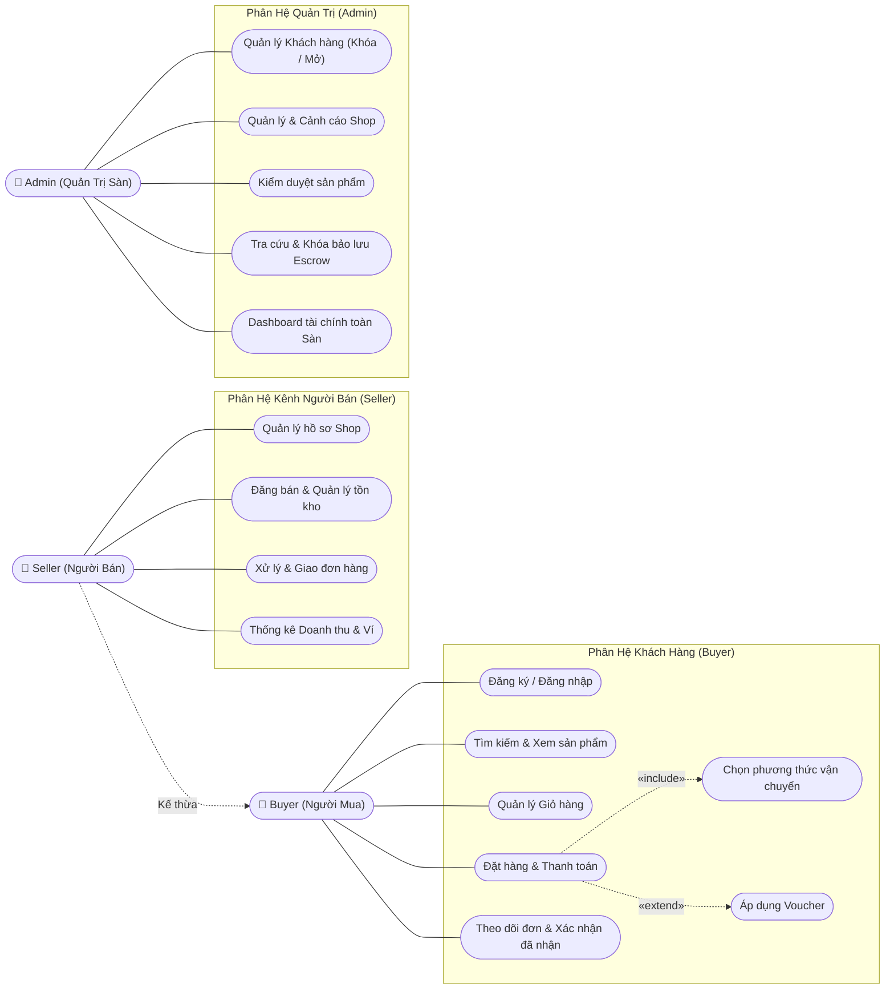

# 🛍️ JML STORE - MULTI-VENDOR MARKETPLACE PLATFORM

> **Hệ thống Sàn Thương Mại Điện Tử Đa Nhà Bán Hàng & Quản Trị Trung Gian Bảo Đảm (Escrow Protection)**  
> **Repository:** [https://github.com/nducanhh0402/JML](https://github.com/nducanhh0402/JML.git)  
> **Kiến trúc:** Modular Monorepo (FastAPI + MySQL 8.0 + Multi-Role Frontend)

---

## 📑 Bảng Mục Lục
1. [Giới Thiệu Dự Án](#1-giới-thiệu-dự-án)
2. [Bản Demo Trực Tuyến (Vercel Live Demo)](#2-bản-demo-trực-tuyến-vercel-live-demo)
3. [Sơ Đồ Use Case Tổng Quan](#3-sơ-đồ-use-case-tổng-quan)
4. [Cấu Trúc Thư Mục Dự Án](#4-cấu-trúc-thư-mục-dự-án)
5. [Các Phân Hệ Giao Diện & Tài Khoản Mẫu](#5-các-phân-hệ-giao-diện--tài-khoản-mẫu)
6. [Hướng Dẫn Cài Đặt & Khởi Chạy](#6-hướng-dẫn-cài-đặt--khởi-chạy)
7. [Kiểm Thử & Tài Liệu API (Swagger)](#7-kiểm-thử--tài-liệu-api-swagger)
8. [Module Tìm Kiếm, Bộ Lọc & Tích Hợp Mua Hàng (TF16BE9)](#8-module-tìm-kiếm-bộ-lọc--tích-hợp-mua-hàng-tf16be9)

---

## 1. Giới Thiệu Dự Án

**JML Store** là nền tảng Sàn Thương mại Điện tử đa nhà bán hàng (Multi-Vendor Marketplace), mô phỏng quy trình giao dịch bảo đảm qua ví trung gian **Escrow**:

- **Người mua (Buyer / User):** Tìm kiếm và lọc sản phẩm theo danh mục/từ khóa, quản lý giỏ hàng, chọn phương thức vận chuyển, áp dụng mã giảm giá (Voucher), đặt hàng và theo dõi tiến độ giao nhận.
- **Người bán (Seller Center):** Quản lý hồ sơ cửa hàng, đăng bán và cập nhật tồn kho sản phẩm, xử lý đơn hàng và theo dõi doanh thu (GMV) / số dư thực nhận.
- **Quản trị viên (Admin):** Quản lý toàn bộ cửa hàng (Shop/Seller), kiểm duyệt sản phẩm, kiểm soát tài khoản khách hàng, đối soát phí sàn và xử lý đơn hàng trung gian (Escrow).

---

## 2. Bản Demo Trực Tuyến (Vercel Live Demo)

Giao diện tĩnh (`frontend/`) được cấu hình sẵn bằng [`vercel.json`](./vercel.json) (`outputDirectory: "frontend"`, rewrite `/frontend/:path* -> /:path*`) để triển khai trực tiếp lên **Vercel**, tương thích hiển thị cả **Máy tính (Desktop)** và **Điện thoại (Mobile)**.

- **Link Demo trực tuyến (Vercel Production):** [https://jml-teal.vercel.app](https://jml-teal.vercel.app)
- **Triển khai nhanh lên Vercel:** [](https://vercel.com/new/clone?repository-url=https%3A%2F%2Fgithub.com%2Fnducanhh0402%2FJML)

### Danh sách các trang chính kiểm tra trên Desktop & Mobile

| Phân hệ / Trang chính | Đường dẫn Demo trực tuyến trên Vercel | Kiểm tra Desktop (1440px) | Kiểm tra Mobile (375px) |
| :--- | :--- | :---: | :---: |
| **Cổng Demo tổng hợp (Landing)** | [https://jml-teal.vercel.app/](https://jml-teal.vercel.app/) | ✅ | ✅ |
| **Trang chủ Người mua (Buyer)** | [https://jml-teal.vercel.app/buyer/index.html](https://jml-teal.vercel.app/buyer/index.html) | ✅ | ✅ |
| **Danh sách & Bộ lọc sản phẩm** | [https://jml-teal.vercel.app/buyer/products.html](https://jml-teal.vercel.app/buyer/products.html) | ✅ | ✅ |
| **Chi tiết sản phẩm & Đánh giá** | [https://jml-teal.vercel.app/buyer/product-detail.html?id=101](https://jml-teal.vercel.app/buyer/product-detail.html?id=101) | ✅ | ✅ |
| **Giỏ hàng & Mã giảm giá** | [https://jml-teal.vercel.app/buyer/cart.html](https://jml-teal.vercel.app/buyer/cart.html) | ✅ | ✅ |
| **Đặt hàng (Checkout)** | [https://jml-teal.vercel.app/user/checkout.html](https://jml-teal.vercel.app/user/checkout.html) | ✅ | ✅ |
| **Lịch sử & Trạng thái đơn hàng** | [https://jml-teal.vercel.app/user/orders.html](https://jml-teal.vercel.app/user/orders.html) | ✅ | ✅ |
| **Hồ sơ cá nhân & Đổi mật khẩu** | [https://jml-teal.vercel.app/user/profile.html](https://jml-teal.vercel.app/user/profile.html) | ✅ | ✅ |
| **Sổ địa chỉ nhận hàng** | [https://jml-teal.vercel.app/user/addresses.html](https://jml-teal.vercel.app/user/addresses.html) | ✅ | ✅ |
| **Đăng nhập / Đăng ký 3D** | [https://jml-teal.vercel.app/auth/index.html](https://jml-teal.vercel.app/auth/index.html) | ✅ | ✅ |
| **Kênh Người bán (Seller Center)** | [https://jml-teal.vercel.app/seller/index.html](https://jml-teal.vercel.app/seller/index.html) | ✅ | ✅ |
| **Quản trị Sàn (Admin Portal)** | [https://jml-teal.vercel.app/admin/index.html](https://jml-teal.vercel.app/admin/index.html) | ✅ | ✅ |
| **Quản lý Danh mục & Thương hiệu** | [https://jml-teal.vercel.app/admin/categories_brands.html](https://jml-teal.vercel.app/admin/categories_brands.html) | ✅ | ✅ |
| **Quản lý Sản phẩm Admin** | [https://jml-teal.vercel.app/admin/products.html](https://jml-teal.vercel.app/admin/products.html) | ✅ | ✅ |

---

## 3. Sơ Đồ Use Case Tổng Quan



---

## 4. Cấu Trúc Thư Mục Dự Án

```text
JML/
├── backend/
│   ├── src/
│   │   ├── config/
│   │   │   └── database.py                             # Cấu hình kết nối MySQL (PyMySQL wrapper)
│   │   ├── middlewares/
│   │   │   └── auth_middleware.py                      # Security headers & middleware xác thực
│   │   ├── utils/
│   │   │   └── helpers.py                              # Hàm tiện ích dùng chung
│   │   └── modules/                                    # Các router API theo từng nghiệp vụ
│   │       ├── admin/router.py                         # Quản trị Shop, Khách hàng, Duyệt SP, Escrow
│   │       ├── auth/router.py                          # Đăng ký, Đăng nhập đa vai trò
│   │       ├── cart/router.py                          # Kiểm tra giỏ hàng & tồn kho
│   │       ├── category/router.py                      # Danh mục ngành hàng & Thương hiệu
│   │       ├── order/router.py                         # Tạo đơn, theo dõi, cập nhật trạng thái đơn
│   │       ├── payment/router.py                       # Phương thức thanh toán (COD / Ví Escrow)
│   │       ├── product/router.py                       # Danh sách, tìm kiếm, lọc, chi tiết sản phẩm
│   │       ├── review/router.py                        # Đánh giá & nhận xét sản phẩm
│   │       ├── seller/router.py                        # Kênh người bán, đăng SP, quản lý đơn Shop
│   │       ├── user/router.py                          # Hồ sơ người dùng
│   │       └── voucher/router.py                       # Danh sách mã giảm giá (Voucher)
│   ├── db/
│   │   ├── schema.sql                                  # DDL khởi tạo bảng cốt lõi (shops, products, customers, orders, order_items, users)
│   │   ├── migrations/
│   │   │   ├── 001_create_orders_tables.sql            # Bảng orders, order_items, payments, order_status_history
│   │   │   ├── 002_create_carts_tables.sql             # Bảng carts, cart_items
│   │   │   ├── 003_create_users_and_roles_schema.sql   # Bảng roles, users_v2 & tài khoản mẫu
│   │   │   └── 004_create_catalog_tables_and_seed.sql  # Bảng categories, brands, product_images & 21 SP mẫu
│   │   └── seeds/
│   │       └── seed.sql                                # Dữ liệu mẫu Shop và Tài khoản (Admin, Seller, Buyer)
│   ├── tests/
│   │   └── test_api.py                                 # Bộ kiểm thử API bằng Python unittest
│   ├── database.py                                     # Khởi tạo bảng & tự động đồng bộ MySQL khi startup
│   ├── schemas.py                                      # Pydantic schemas cho request/response
│   ├── main.py                                         # Khởi chạy FastAPI Server (cổng 8000)
│   ├── requirements.txt                                # Các thư viện Python phụ thuộc
│   └── Dockerfile                                      # Dockerfile đóng gói Backend
├── frontend/
│   ├── buyer/                                          # Giao diện Khách hàng mua sắm (index.html, products.html, style.css)
│   ├── user/                                           # Giao diện Storefront Người dùng (index.html, products.html, style.css)
│   ├── seller/                                         # Giao diện Kênh Người Bán (index.html)
│   ├── admin/                                          # Giao diện Quản trị Sàn (index.html, script.js, style.css, mobile-responsive.*)
│   └── shared/                                         # Tài nguyên dùng chung
│       ├── components/header.html
│       ├── css/shared.css
│       └── js/                                         # api.js, auth.js
├── .env.example                                        # Mẫu biến môi trường kết nối MySQL & JWT
├── .gitignore
├── docker-compose.yml                                  # Triển khai MySQL 8.0 + FastAPI Backend bằng Docker
└── README.md                                           # Tài liệu hướng dẫn dự án
```

---

## 5. Các Phân Hệ Giao Diện & Tài Khoản Mẫu

| Phân hệ | Đường dẫn mở trên Live Server (`:5500`) | Tài khoản mẫu (`seed.sql`) | Chức năng chính |
| :--- | :--- | :--- | :--- |
| **Người mua (Buyer / User)** | `/frontend/buyer/index.html` hoặc `/frontend/user/index.html` | `buyer` / `123456` | Xem Flash Sale, tìm kiếm & lọc sản phẩm, giỏ hàng, đặt hàng, áp dụng voucher |
| **Kênh Người Bán (Seller)** | `/frontend/seller/index.html` | `trungshop` hoặc `dung36` / `123456` | Quản lý sản phẩm, tồn kho, xử lý đơn hàng của Shop, xem doanh thu |
| **Quản trị Sàn (Admin)** | `/frontend/admin/index.html` | `admin` / `123456` | Quản lý Shop/Seller, duyệt sản phẩm, quản lý khách hàng, theo dõi đơn Escrow |

---

## 6. Hướng Dẫn Cài Đặt & Khởi Chạy

### Cách 1: Chạy trực tiếp trên máy (Local Machine)

1. **Clone repository và tạo file cấu hình `.env`:**
   ```bash
   git clone https://github.com/nducanhh0402/JML.git
   cd JML
   cp .env.example .env
   ```
   *(Kiểm tra lại thông số `MYSQL_HOST`, `MYSQL_PORT=3306`, `MYSQL_USER=root`, `MYSQL_PASSWORD=123456`, `MYSQL_DB=jml_marketplace` trong `.env`).*

2. **Khởi tạo cơ sở dữ liệu MySQL 8.0:**
   - Đảm bảo MySQL Server đang chạy trên cổng `3306`.
   - Chạy lần lượt các file SQL theo thứ tự:
     1. `backend/db/schema.sql`
     2. `backend/db/migrations/001_create_orders_tables.sql`
     3. `backend/db/migrations/002_create_carts_tables.sql`
     4. `backend/db/migrations/003_create_users_and_roles_schema.sql`
     5. `backend/db/migrations/004_create_catalog_tables_and_seed.sql`
     6. `backend/db/seeds/seed.sql`

3. **Cài đặt thư viện Python:**
   ```bash
   pip install -r backend/requirements.txt
   ```

4. **Khởi chạy FastAPI Backend Server:**
   ```bash
   python -m uvicorn backend.main:app --host 127.0.0.1 --port 8000 --reload
   ```

5. **Mở giao diện Web:**
   - Dùng VS Code **Live Server** (cổng `5500`) mở các trang trong thư mục `frontend/buyer/`, `frontend/user/`, `frontend/seller/`, hoặc `frontend/admin/`.

### Cách 2: Chạy bằng Docker Compose

```bash
docker-compose up -d --build
```
- **MySQL 8.0 Container (`jml_mysql_db`):** cổng `3306` (tự động chạy lần đầu `schema.sql`, các migration `004`, `002`, `003` và `seed.sql`).
- **FastAPI Container (`jml_backend_api`):** cổng `8000`.

---

## 7. Kiểm Thử & Tài Liệu API (Swagger)

Sau khi chạy Backend Server ở cổng `8000`, truy cập trực tiếp các đường dẫn sau:

- **Swagger UI (Tài liệu & Test API trực tiếp):** [http://127.0.0.1:8000/docs](http://127.0.0.1:8000/docs)
- **ReDoc API Documentation:** [http://127.0.0.1:8000/redoc](http://127.0.0.1:8000/redoc)
- **OpenAPI JSON Schema:** [http://127.0.0.1:8000/openapi.json](http://127.0.0.1:8000/openapi.json)

Chạy bộ kiểm thử tự động (`unittest`) khi Backend đang chạy:
```bash
python -m unittest backend/tests/test_api.py -v
```

---

## 8. Module Tìm Kiếm, Bộ Lọc & Tích Hợp Mua Hàng (TF16BE9)

> **Phụ trách:** Trịnh Quốc Trung (`B25DTCN263`)  
> **Phạm vi:** Tìm kiếm sản phẩm, lưu từ khóa gần đây, bộ lọc/sắp xếp/phân trang API + URL, chip bộ lọc & Empty State, giao diện Mobile Responsive, và kiểm thử tích hợp luồng mua hàng E2E.

### 8.1. Mô tả các chức năng đã xây dựng

| Mã Task | Phân hệ | Chức năng & Tệp liên quan |
| :--- | :--- | :--- |
| **TF16E89** | Test & QA | Kiểm thử API tìm kiếm (`GET /api/products/search`) & lọc/phân trang (`GET /api/products/filter`): chống LIKE wildcard (`%`, `_`), SQL injection, từ khóa rỗng, phân trang & biên giá (`backend/tests/test_search_and_filter_api_tf16e89.py`, `TEST_CASES_SEARCH_FILTER_TF16E89.md`). |
| **TF16E55** | Frontend + API | Nối bộ lọc danh mục, thương hiệu, khoảng giá, đánh giá, Flash Sale, Chính hãng, sắp xếp và phân trang trang `frontend/buyer/products.html` với `/api/products/filter` & `/api/products/facets`; đồng bộ trạng thái bộ lọc lên URL query params (`frontend/buyer/buyer-products.js`). |
| **TF16EBF** | Frontend | Hiển thị các bộ lọc đang áp dụng dưới dạng **Chip** có nút `×` xóa từng bộ lọc, nút **Xóa tất cả**, và màn hình **Empty State** khi không có sản phẩm phù hợp (`frontend/buyer/products.html`, `frontend/buyer/buyer-products.js`). |
| **TF16ED9** | Mobile UI & QA | Kiểm thử & tối ưu giao diện tìm kiếm/lọc trên điện thoại (`375px`): ô tìm kiếm không tràn/zoom (`font-size: 16px`), **Filter Drawer** trượt dùng `100dvh` + sticky footer, đóng drawer bằng `Esc`/resize, phân trang thu gọn (`...`), kèm test tự động `backend/tests/test_mobile_search_filter_tf16ed9.py`. |
| **TF16EF3** | Backend + FE | Tạo bảng `search_history` (`backend/db/migrations/010_create_search_history_table.sql`) và API `GET/POST/DELETE /api/products/recent-searches`; tự động ghi nhận khi tìm trên `/api/products/search`, giới hạn 20 từ khóa/người dùng, khử trùng lặp, hỗ trợ tiền tố `prefix`, cô lập theo JWT `user_id` hoặc `session_id` khách; nối gợi ý "Tìm gần đây" trên `buyer-index.js` & `buyer-products.js`. |
| **TF16B8B** | Tích hợp All | Ghép module tìm kiếm/lọc/gần đây lên nhánh tích hợp; sửa lỗi liên kết `user_id` & `product_id` khi đặt hàng ở `checkout.html` + `backend/src/modules/order/router.py`; sửa tương thích cột bảng `banners` ở `homepage/router.py`; sửa điều hướng `cart.html` & đồng bộ `/api/cart/items` ở `buyer-products.js`; kiểm thử luồng E2E từ Đăng nhập → Tìm kiếm/Gần đây → Lọc → Giỏ hàng → Đặt hàng → Admin xử lý → Đánh giá/Hủy đơn (`backend/tests/test_integration_e2e_tf16b8b.py`). |

### 8.2. Luồng hoạt động Tìm kiếm, Lọc & Từ khóa gần đây


### 8.3. Hướng dẫn chạy & kiểm thử nhanh phần module này

1. **Chạy Migration bảng lịch sử tìm kiếm (nếu DB chưa tự khởi tạo):**
   ```bash
   mysql -u root -p123456 jml_marketplace < backend/db/migrations/010_create_search_history_table.sql
   ```
   *(Ngoài ra, Backend cũng tự động kiểm tra và tạo bảng `search_history` khi gọi endpoint `/api/products/recent-searches` hoặc khi khởi động `init_db()`).*

2. **Khởi động Backend (cổng `8000`) & Frontend (cổng `5500`):**
   ```bash
   # Terminal 1 - Backend FastAPI
   python -m uvicorn backend.main:app --host 127.0.0.1 --port 8000 --reload

   # Terminal 2 - Frontend tĩnh
   python -m http.server 5500 --bind 127.0.0.1 --directory frontend
   ```
   Sau đó mở trình duyệt tại:
   - Trang chủ tìm kiếm & gợi ý gần đây: `http://127.0.0.1:5500/buyer/index.html`
   - Trang danh sách, lọc, chip & mobile drawer: `http://127.0.0.1:5500/buyer/products.html`

3. **Chạy bộ test kiểm chứng module & tích hợp E2E:**
   ```bash
   python -m unittest backend.tests.test_integration_e2e_tf16b8b backend.tests.test_recent_searches_tf16ef3 backend.tests.test_product_search backend.tests.test_product_filter_sort_pagination backend.tests.test_mobile_search_filter_tf16ed9 -v
   ```

### 8.4. Video Demo & Minh chứng kiểm thử (TF16BE9)

- **Video Demo màn hình thực tế (`Screen Recording 2026-11-23 211728.mp4`):** [`minh_chung_nop_bai/Screen Recording 2026-11-23 211728.mp4`](./minh_chung_nop_bai/Screen%20Recording%202026-11-23%20211728.mp4)
- **Bảng Test Case & Ảnh chụp minh chứng trong kho mã nguồn:**
  - Bảng Test Case API Tìm kiếm & Lọc: [`backend/tests/TEST_CASES_SEARCH_FILTER_TF16E89.md`](./backend/tests/TEST_CASES_SEARCH_FILTER_TF16E89.md)
  - Bảng Test Case Giao diện Tìm kiếm & Lọc trên Mobile: [`backend/tests/TEST_CASES_MOBILE_SEARCH_FILTER_TF16ED9.md`](./backend/tests/TEST_CASES_MOBILE_SEARCH_FILTER_TF16ED9.md)
  - Ảnh chụp minh chứng kiểm thử API & Mobile: [`backend/tests/MINH_CHUNG_TF16E89_BANG_TEST_CASE.png`](./backend/tests/MINH_CHUNG_TF16E89_BANG_TEST_CASE.png), [`backend/tests/MINH_CHUNG_TF16ED9_MOBILE_TIM_KIEM_LOC.png`](./backend/tests/MINH_CHUNG_TF16ED9_MOBILE_TIM_KIEM_LOC.png)


