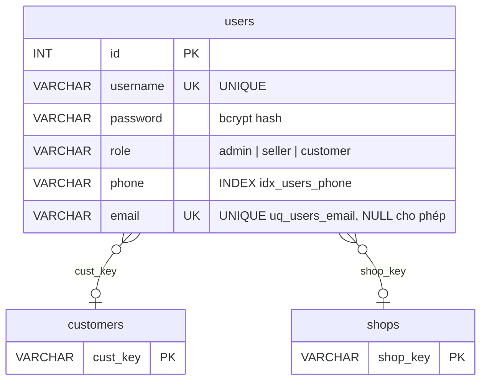

# TF16EA5 - Index và ràng buộc bảng `users`, dữ liệu tài khoản mẫu

## 1. Thay đổi

| Hạng mục | File |
|---|---|
| Migration index/ràng buộc (chạy tay / Docker) | `backend/db/migrations/006_users_email_unique_index.sql` |
| Tự áp dụng khi backend khởi động (idempotent) | `backend/database.py` → `ensure_users_constraints()` |
| Script thêm tài khoản mẫu | `backend/db/seeds/seed_sample_users.py` |
| Đăng ký lưu email rỗng = `NULL`, bắt `IntegrityError` → 400 | `backend/src/modules/auth/router.py` |
| Test (9 test case) | `backend/tests/test_users_constraints.py` |

Sơ đồ ràng buộc bảng `users`:



Lưu ý thiết kế: email rỗng (`''`) được chuyển thành `NULL` vì `UNIQUE` coi hai chuỗi rỗng là trùng nhau,
trong khi nhiều `NULL` thì được phép. Dữ liệu cũ trùng email: giữ tài khoản `id` nhỏ nhất,
các tài khoản còn lại được đặt `email = NULL` (có in cảnh báo khi chạy).

## 2. Cách chạy

```bash
# Áp dụng index (cách 1: tự động khi chạy backend; cách 2: chạy tay)
mysql -uroot -p jml_marketplace < backend/db/migrations/006_users_email_unique_index.sql

# Thêm tài khoản mẫu (có thể chạy lại nhiều lần)
python -m backend.db.seeds.seed_sample_users

# Chạy test
python -m unittest backend.tests.test_users_constraints -v
```

## 3. Tài khoản mẫu

| Username | Vai trò | Email | Mật khẩu |
|---|---|---|---|
| `sample_admin` | admin | sample.admin@jml.vn | `Admin@123` |
| `sample_seller` | seller | sample.seller@jml.vn | `Seller@123` |
| `sample_customer1` | customer | sample.customer1@jml.vn | `Customer@123` |
| `sample_customer2` | customer | sample.customer2@jml.vn | `Customer@123` |

Mật khẩu được lưu dạng bcrypt hash. Chỉ dùng cho môi trường phát triển.

## 4. Bảng test case

| Mã | Mô tả | Kết quả mong đợi |
|---|---|---|
| TC-DB-01 | Kiểm tra UNIQUE index `email` và index `phone` tồn tại | Có index |
| TC-DB-02 | `EXPLAIN SELECT ... WHERE email = ?` | Dùng `key = uq_users_email` |
| TC-DB-03 | Chèn 2 user cùng email | `IntegrityError` (database từ chối) |
| TC-DB-04 | Chèn email chỉ khác hoa/thường | `IntegrityError` |
| TC-DB-05 | Chèn nhiều user có email `NULL` | Thành công |
| TC-DB-06 | Đăng ký 2 tài khoản không nhập email | Cả hai 200 |
| TC-DB-07 | Đăng ký trùng email qua API | 400 |
| TC-DB-08 | Chạy script mẫu 2 lần | Lần 2 toàn `skipped`, mỗi email 1 bản ghi, mật khẩu là bcrypt hash, đủ 3 vai trò |
| TC-DB-09 | Đăng nhập bằng các tài khoản mẫu | 200 và đúng vai trò |

Kết quả chạy trên MySQL 8.0.44: **9/9 pass**.
