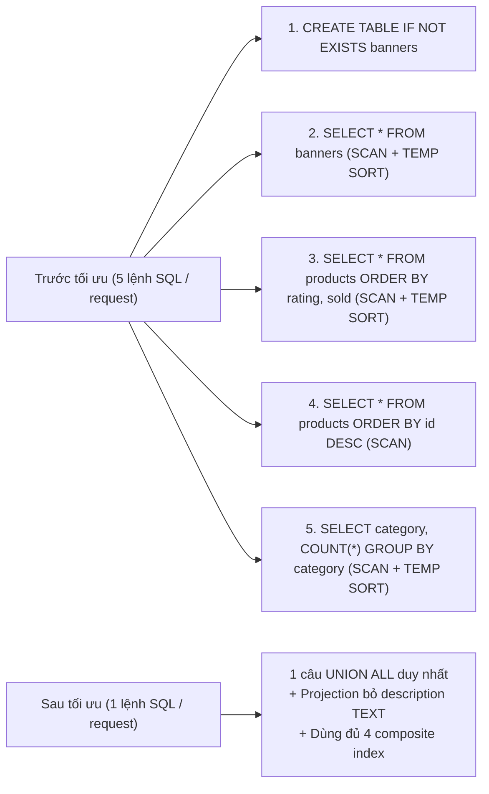

# Báo Cáo Tối Ưu Truy Vấn Trang Chủ (TF175BC)

- **Mã task:** `TF175BC`
- **Tiêu đề:** `[BE] Tối ưu truy vấn trang chủ`
- **Mô tả:** `Thêm index và gom truy vấn để trang chủ tải nhanh; đo thời gian trước và sau.`
- **Sprint:** `Sprint 4 · 01/12–07/12` | **Hạn:** `25/11/2026` | **Người nhận:** `Vũ Dũng (B25DTCN161)`
- **Các file chính:**
  - [`backend/db/migrations/009_optimize_homepage_indexes.sql`](../db/migrations/009_optimize_homepage_indexes.sql)
  - [`backend/database.py`](../database.py) & [`backend/db/schema.sql`](../db/schema.sql)
  - [`backend/src/modules/homepage/router.py`](../src/modules/homepage/router.py)
  - [`backend/tests/benchmark_homepage_tf175bc.py`](./benchmark_homepage_tf175bc.py)
  - [`backend/tests/test_homepage_optimization_tf175bc.py`](./test_homepage_optimization_tf175bc.py)

---

## 1. Các Thay Đổi Tối Ưu

### 1.1. Bổ sung 4 Composite Index
1. `idx_banners_active_sort ON banners (is_active, sort_order)`: phục vụ lọc `is_active = 1` và sắp xếp `sort_order ASC` mà không cần `Temp B-Tree / Filesort`.
2. `idx_products_status_rating_sold ON products (status, rating, sold)`: phục vụ truy vấn sản phẩm nổi bật (`WHERE status = 'approved' ORDER BY rating DESC, sold DESC LIMIT ?`).
3. `idx_products_status_id ON products (status, id)`: phục vụ truy vấn sản phẩm mới nhất (`WHERE status = 'approved' ORDER BY id DESC LIMIT ?`).
4. `idx_products_status_category ON products (status, category)`: **covering index** cho thống kê danh mục (`WHERE status = 'approved' GROUP BY category`).

### 1.2. Gom truy vấn & loại bỏ DDL / `SELECT *` trên hot path


---

## 2. Kết Quả Đo Thời Gian Trước & Sau

> Dữ liệu đo thực tế bằng [`benchmark_homepage_tf175bc.py`](./benchmark_homepage_tf175bc.py) trên SQLite với **10.000 sản phẩm** (mỗi sản phẩm có trường `description` ~500 bytes) và **50 banner**, đo **50 lượt chạy liên tiếp** (sau 3 lượt warmup).

| Chỉ số | Trước tối ưu (`Before`) | Sau tối ưu (`After`) | Mức cải thiện |
|--------|-------------------------|-----------------------|---------------|
| Số câu lệnh SQL / request | `5` (1 DDL + 4 `SELECT *`) | **`1`** (1 `UNION ALL` gộp) | Giảm **80%** số lượt thực thi SQL |
| Thời gian trung bình (`avg_ms`) | `17.586 ms` | **`1.167 ms`** | Nhanh hơn **15.07x** (giảm **93.4%**) |
| Thời gian nhỏ nhất (`min_ms`) | `15.554 ms` | **`1.070 ms`** | Nhanh hơn **14.54x** |
| Phân vị 95% (`p95_ms`) | `21.883 ms` | **`1.499 ms`** | Nhanh hơn **14.60x** |
| Tổng thời gian 50 lượt (`total_ms`) | `879.286 ms` | **`58.357 ms`** | Tiết kiệm `820.929 ms` |

---

## 3. So Sánh `EXPLAIN QUERY PLAN`

### Trước tối ưu
```text
[banners]    SCAN banners
[banners]    USE TEMP B-TREE FOR ORDER BY
[featured]   SCAN products
[featured]   USE TEMP B-TREE FOR ORDER BY
[latest]     SCAN products
[categories] SCAN products
[categories] USE TEMP B-TREE FOR GROUP BY
```

### Sau tối ưu
```text
[consolidated] COMPOUND QUERY
[consolidated] LEFT-MOST SUBQUERY
[consolidated] SEARCH banners USING INDEX idx_banners_active_sort (is_active=?)
[consolidated] UNION ALL
[consolidated] CO-ROUTINE f
[consolidated] SEARCH products USING INDEX idx_products_status_rating_sold (status=?)
[consolidated] SCAN f
[consolidated] UNION ALL
[consolidated] CO-ROUTINE l
[consolidated] SEARCH products USING INDEX idx_products_status_id (status=?)
[consolidated] SCAN l
[consolidated] UNION ALL
[consolidated] SEARCH products USING COVERING INDEX idx_products_status_category (status=?)
```

---

## 4. Kết Quả Kiểm Thử Tự Động

```text
python -m unittest backend.tests.test_homepage_optimization_tf175bc backend.tests.test_api_tf17520 -v
...
Ran 29 tests in 0.013s

OK
```
