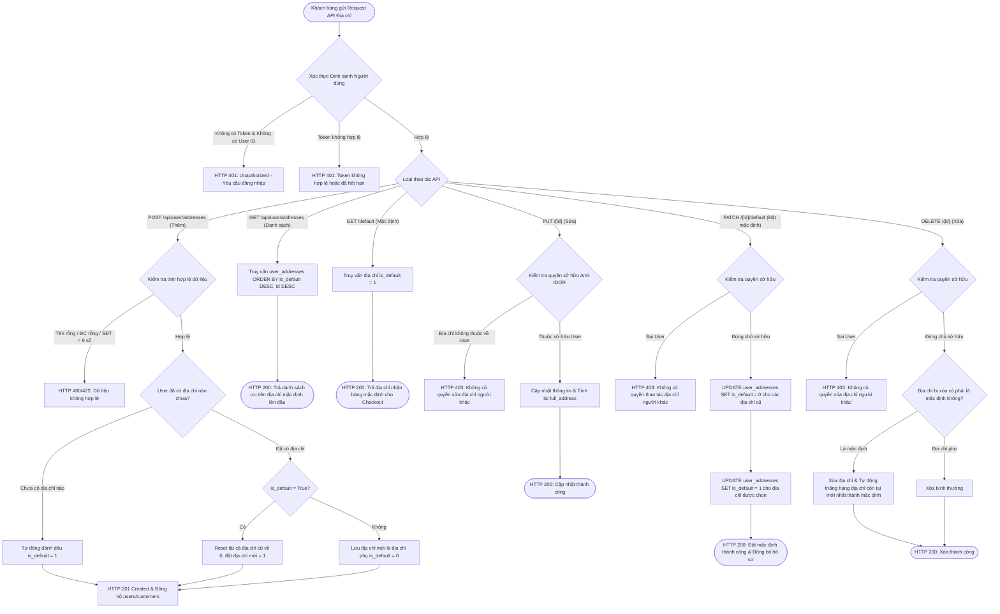

# Bảng Test Case: [BE] API Địa Chỉ Nhận Hàng

**Mã task:** TF170FF  
**Sprint:** Sprint 3 · 24/11–30/11/2026  
**Người thực hiện:** Nguyễn Công Trường (B25DTCN212)  
**File router:** `backend/src/modules/address/router.py`  
**File test:** `backend/tests/test_address_api_tf170ff.py`  
**Lệnh chạy kiểm thử:** `python -m unittest backend/tests/test_address_api_tf170ff.py -v`  
**Trạng thái kiểm thử:** **18/18 Test Cases PASS (100%)**

---

## I. Sơ đồ Luồng Nghiệp Vụ API Địa Chỉ Nhận Hàng (Mermaid Flowchart)



---

## II. Chi Tiết Danh Sách 18 Test Cases

### 1. Nhóm 1: Thêm Địa Chỉ Nhận Hàng (`POST /api/user/addresses`)

| Mã TC | Tên Test Case | Mô tả & Mục đích | Input Data | Kết quả Kỳ vọng (Expected) | Status Code | Kết quả Thực tế |
|---|---|---|---|---|---|---|
| **TC-01** | Thêm địa chỉ đầu tiên tự động mặc định | Địa chỉ đầu tiên tạo ra của người dùng được tự động gán `is_default = 1` | `user_id=1, recipient_name="Nguyễn Văn A", is_default=False` | `address.is_default == True`, lưu vào DB thành công | **201** | **PASS** |
| **TC-02** | Thêm địa chỉ thứ 2 không mặc định | Thêm địa chỉ phụ mới, địa chỉ thứ nhất vẫn giữ nguyên là địa chỉ mặc định | `user_id=1, is_default=False, tag="Văn phòng"` | Địa chỉ mới có `is_default == False`, địa chỉ 1 vẫn là mặc định | **201** | **PASS** |
| **TC-03** | Thêm địa chỉ mới chỉ định mặc định | Thêm địa chỉ mới với `is_default = True` -> Hệ thống tự động chuyển địa chỉ cũ về 0 | `user_id=1, is_default=True` | Địa chỉ mới có `is_default = 1`, toàn bộ địa chỉ cũ chuyển thành `0` | **201** | **PASS** |
| **TC-04** | Validate thiếu tên người nhận | Chặn tạo địa chỉ khi `recipient_name` để trống | `recipient_name=""` | `ValidationError: String should have at least 1 character` | **422** | **PASS** |
| **TC-05** | Validate số điện thoại không hợp lệ | Chặn số điện thoại quá ngắn hoặc chứa ký tự sai định dạng | `phone="123"` hoặc `"091-234"` | Báo lỗi SĐT không hợp lệ, yêu cầu tối thiểu 9 chữ số | **400/422** | **PASS** |
| **TC-06** | Validate thiếu số nhà / tên đường | Chặn tạo địa chỉ khi `street_address` để trống | `street_address=""` | `ValidationError: String should have at least 1 character` | **422** | **PASS** |
| **TC-07** | Tự động sinh `full_address` | Khi client không truyền `full_address`, tự động ghép từ các cấp hành chính | `street="Số 1 Đại Cồ Việt", ward="Bách Khoa", district="Hai Bà Trưng", city="Hà Nội"` | `full_address = "Số 1 Đại Cồ Việt, Bách Khoa, Hai Bà Trưng, Hà Nội"` | **201** | **PASS** |

---

### 2. Nhóm 2: Lấy Danh Sách & Chi Tiết Địa Chỉ (`GET /api/user/addresses`)

| Mã TC | Tên Test Case | Mô tả & Mục đích | Input Data | Kết quả Kỳ vọng (Expected) | Status Code | Kết quả Thực tế |
|---|---|---|---|---|---|---|
| **TC-08** | Sắp xếp ưu tiên địa chỉ mặc định | Lấy toàn bộ danh sách địa chỉ, địa chỉ có `is_default = 1` luôn ở vị trí `[0]` | `user_id=1` (có 3 địa chỉ, địa chỉ 2 là mặc định) | Trả về đủ 3 địa chỉ, phần tử đầu tiên luôn là địa chỉ mặc định | **200** | **PASS** |
| **TC-09** | Lấy địa chỉ mặc định (`/default`) | Endpoint chuyên dụng phục vụ điền nhanh vào form checkout | `GET /api/user/addresses/default?user_id=1` | Trả về đúng thông tin địa chỉ đang được đặt `is_default = 1` | **200** | **PASS** |
| **TC-10** | Lấy chi tiết địa chỉ theo ID | Xem thông tin một địa chỉ cụ thể của người dùng | `GET /api/user/addresses/{address_id}?user_id=1` | Trả về đầy đủ metadata địa chỉ: họ tên, SĐT, số nhà, tỉnh thành... | **200** | **PASS** |
| **TC-11** | Tra cứu địa chỉ không tồn tại | Gọi xem chi tiết địa chỉ với ID không có trong cơ sở dữ liệu | `GET /api/user/addresses/9999` | Báo lỗi `"Không tìm thấy địa chỉ nhận hàng"` | **404** | **PASS** |

---

### 3. Nhóm 3: Sửa Thông Tin Địa Chỉ Nhận Hàng (`PUT /api/user/addresses/{id}`)

| Mã TC | Tên Test Case | Mô tả & Mục đích | Input Data | Kết quả Kỳ vọng (Expected) | Status Code | Kết quả Thực tế |
|---|---|---|---|---|---|---|
| **TC-12** | Cập nhật thông tin thành công | Thay đổi họ tên người nhận, số điện thoại, địa chỉ cụ thể | `PUT /{id}`, `recipient_name="Tên Mới", phone="0988888888"` | Dữ liệu được cập nhật thành công, `full_address` tự động tính lại | **200** | **PASS** |
| **TC-13** | Đổi địa chỉ phụ thành mặc định | Khi sửa một địa chỉ phụ và chọn `is_default = True` | `PUT /{id}`, `is_default=True` | Địa chỉ này thành mặc định (`1`), các địa chỉ khác chuyển về `0` | **200** | **PASS** |
| **TC-14** | Sửa địa chỉ không tồn tại | Gửi request cập nhật ID địa chỉ không có trong hệ thống | `PUT /9999` | Báo lỗi `"Không tìm thấy địa chỉ nhận hàng"` | **404** | **PASS** |

---

### 4. Nhóm 4: Đặt Mặc Định & Xóa Địa Chỉ Nhận Hàng (`PATCH /default` & `DELETE`)

| Mã TC | Tên Test Case | Mô tả & Mục đích | Input Data | Kết quả Kỳ vọng (Expected) | Status Code | Kết quả Thực tế |
|---|---|---|---|---|---|---|
| **TC-15** | Đặt làm mặc định qua API riêng | Đổi địa chỉ mặc định qua endpoint `PATCH /{address_id}/default` | `PATCH /{addr2_id}/default`, `user_id=1` | Địa chỉ 2 thành mặc định (`1`), địa chỉ 1 chuyển về `0`, đồng bộ users | **200** | **PASS** |
| **TC-16** | Xóa địa chỉ phụ | Xóa một địa chỉ thông thường không phải là mặc định | `DELETE /{addr2_id}`, `user_id=1` | Xóa thành công, danh sách giảm 1, địa chỉ mặc định không bị ảnh hưởng | **200** | **PASS** |
| **TC-17** | Xóa địa chỉ mặc định (Auto-fallback) | Khi xóa địa chỉ đang là mặc định, hệ thống tự động thăng hạng địa chỉ còn lại | `DELETE /{addr1_default_id}`, `user_id=1` | Địa chỉ còn lại mới nhất tự động được cập nhật thành `is_default = 1` | **200** | **PASS** |

---

### 5. Nhóm 5: Bảo Mật Phân Quyền & Chặn Thao Tác Chéo (Anti-IDOR)

| Mã TC | Tên Test Case | Mô tả & Mục đích | Input Data | Kết quả Kỳ vọng (Expected) | Status Code | Kết quả Thực tế |
|---|---|---|---|---|---|---|
| **TC-18** | Chặn can thiệp địa chỉ người khác | User 1 cố tình xem, sửa, xóa hoặc đặt mặc định địa chỉ thuộc về User 2 | `user_id=1` thao tác trên `address_id` của `User 2` | Bị chặn toàn bộ, trả về lỗi `HTTP 403 Forbidden`: "Bạn không có quyền..." | **403** | **PASS** |

---

## III. Minh Chứng Chạy Test Thực Tế

```text
> .\.venv\Scripts\python -m unittest backend/tests/test_address_api_tf170ff.py -v

test_tc01_create_first_address_auto_default (backend.tests.test_address_api_tf170ff.TestAddressApiTF170FF.test_tc01_create_first_address_auto_default)
TC-01: Địa chỉ đầu tiên của người dùng được tự động đặt làm mặc định (is_default = 1). ... ok
test_tc02_create_second_address_not_default (backend.tests.test_address_api_tf170ff.TestAddressApiTF170FF.test_tc02_create_second_address_not_default)
TC-02: Thêm địa chỉ thứ 2 với is_default = False -> Giữ nguyên địa chỉ 1 là mặc định. ... ok
test_tc03_create_new_address_as_default (backend.tests.test_address_api_tf170ff.TestAddressApiTF170FF.test_tc03_create_new_address_as_default)
TC-03: Thêm địa chỉ mới với is_default = True -> Tự động chuyển địa chỉ mới thành mặc định. ... ok
test_tc04_create_address_missing_recipient_name (backend.tests.test_address_api_tf170ff.TestAddressApiTF170FF.test_tc04_create_address_missing_recipient_name)
TC-04: Báo lỗi khi họ và tên người nhận để trống. ... ok
test_tc05_create_address_invalid_short_phone (backend.tests.test_address_api_tf170ff.TestAddressApiTF170FF.test_tc05_create_address_invalid_short_phone)
TC-05: Báo lỗi khi số điện thoại quá ngắn hoặc không đúng định dạng. ... ok
test_tc06_create_address_missing_street_address (backend.tests.test_address_api_tf170ff.TestAddressApiTF170FF.test_tc06_create_address_missing_street_address)
TC-06: Báo lỗi khi địa chỉ cụ thể bị để trống. ... ok
test_tc07_build_full_address_automatic (backend.tests.test_address_api_tf170ff.TestAddressApiTF170FF.test_tc07_build_full_address_automatic)
TC-07: Tự động ghép chuỗi full_address chuẩn từ các cấp hành chính. ... ok
test_tc08_get_user_addresses_sorted_default_first (backend.tests.test_address_api_tf170ff.TestAddressApiTF170FF.test_tc08_get_user_addresses_sorted_default_first)
TC-08: Danh sách địa chỉ luôn ưu tiên đưa địa chỉ mặc định lên đầu. ... ok
test_tc09_get_default_address (backend.tests.test_address_api_tf170ff.TestAddressApiTF170FF.test_tc09_get_default_address)
TC-09: Lấy địa chỉ nhận hàng mặc định (GET /default). ... ok
test_tc10_get_address_detail_success (backend.tests.test_address_api_tf170ff.TestAddressApiTF170FF.test_tc10_get_address_detail_success)
TC-10: Lấy chi tiết một địa chỉ theo ID hợp lệ. ... ok
test_tc11_get_address_not_found (backend.tests.test_address_api_tf170ff.TestAddressApiTF170FF.test_tc11_get_address_not_found)
TC-11: Tra cứu ID địa chỉ không tồn tại trả về HTTP 404. ... ok
test_tc12_update_address_info_success (backend.tests.test_address_api_tf170ff.TestAddressApiTF170FF.test_tc12_update_address_info_success)
TC-12: Cập nhật họ tên, SĐT, địa chỉ chi tiết thành công. ... ok
test_tc13_update_address_switch_to_default (backend.tests.test_address_api_tf170ff.TestAddressApiTF170FF.test_tc13_update_address_switch_to_default)
TC-13: Chuyển địa chỉ phụ thành địa chỉ mặc định qua PUT. ... ok
test_tc14_update_address_not_found (backend.tests.test_address_api_tf170ff.TestAddressApiTF170FF.test_tc14_update_address_not_found)
TC-14: Cập nhật địa chỉ không tồn tại trả về HTTP 404. ... ok
test_tc15_set_default_address_via_patch (backend.tests.test_address_api_tf170ff.TestAddressApiTF170FF.test_tc15_set_default_address_via_patch)
TC-15: Đặt làm mặc định qua API PATCH /{id}/default. ... ok
test_tc16_delete_non_default_address (backend.tests.test_address_api_tf170ff.TestAddressApiTF170FF.test_tc16_delete_non_default_address)
TC-16: Xóa địa chỉ phụ, địa chỉ mặc định không bị ảnh hưởng. ... ok
test_tc17_delete_default_address_auto_promotes_fallback (backend.tests.test_address_api_tf170ff.TestAddressApiTF170FF.test_tc17_delete_default_address_auto_promotes_fallback)
TC-17: Xóa địa chỉ mặc định -> Tự động thăng hạng địa chỉ còn lại mới nhất làm mặc định. ... ok
test_tc18_prevent_cross_user_address_manipulation_idor (backend.tests.test_address_api_tf170ff.TestAddressApiTF170FF.test_tc18_prevent_cross_user_address_manipulation_idor)
TC-18: Chặn User 1 xem, sửa, xóa hoặc đặt mặc định địa chỉ của User 2 (Anti-IDOR: HTTP 403 Forbidden). ... ok

----------------------------------------------------------------------
Ran 18 tests in 0.011s

OK
```
