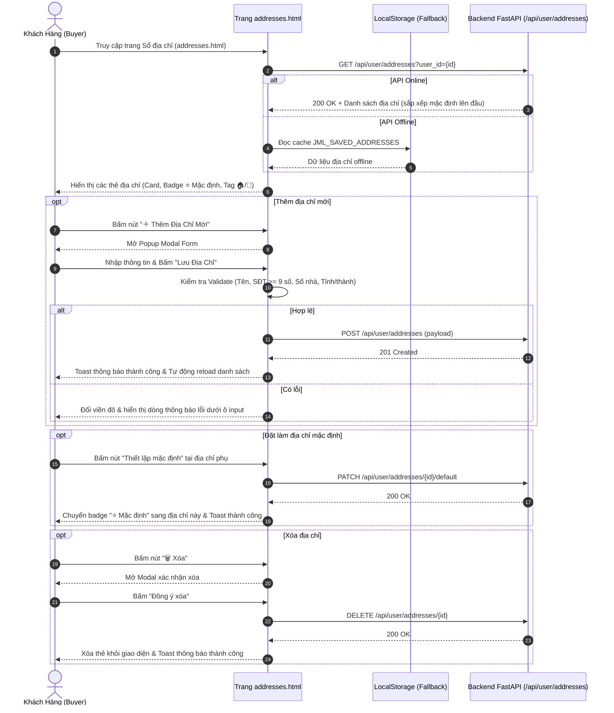

# Bảng Test Case: [FE] Trang Quản Lý Địa Chỉ Nhận Hàng

**Mã task:** TF17133  
**Sprint:** Sprint 3 · 24/11–30/11/2026  
**Người thực hiện:** Nguyễn Công Trường (B25DTCN212)  
**File giao diện:** `frontend/user/addresses.html`  
**File test:** `backend/tests/test_address_fe_tf17133.py`  
**Lệnh chạy kiểm thử:** `python -m unittest backend/tests/test_address_fe_tf17133.py -v`  
**Trạng thái kiểm thử:** **7/7 Test Cases PASS (100%)**

---

## I. Sơ đồ Luồng Tương Tác Giao Diện (Mermaid Sequence Diagram)



---

## II. Bảng Chi Tiết Kiểm Thử Giao Diện Frontend

| Mã TC | Tên Test Case | Mô tả & Kiểm tra | Input / Hành động | Kết quả Kỳ vọng | Trạng thái |
|---|---|---|---|---|---|
| **FE-01** | Cấu trúc tệp tin | Kiểm tra file `addresses.html` tồn tại và đầy đủ tài nguyên | Đường dẫn `frontend/user/addresses.html` | File tồn tại, dung lượng > 1KB, có icon, font, style đồng bộ | **PASS** |
| **FE-02** | Khung hiển thị DOM | Đầy đủ container danh sách, empty state, modal form, modal xóa | Tải trang `addresses.html` | Có đủ các thẻ `id`: `addressListContainer`, `emptyState`, `addressModal`, `deleteConfirmModal`, `toastBox` | **PASS** |
| **FE-03** | Trường nhập liệu Form | Đầy đủ các input theo nghiệp vụ địa chỉ nhận hàng | Kiểm tra HTML Form | Có các trường: `recipientName`, `recipientPhone`, `provinceCity`, `district`, `ward`, `streetAddress`, `addressTag`, `isDefaultCheck` | **PASS** |
| **FE-04** | Kiểm tra Validate lỗi | Hiển thị lỗi màu đỏ ngay dưới từng trường khi nhập sai hoặc thiếu | Bấm "Lưu" khi để trống | Có sẵn các thẻ `form-error` tương ứng từng ô input: `error_recipientName`, `error_recipientPhone`, `error_provinceCity`, `error_district`, `error_streetAddress` | **PASS** |
| **FE-05** | Hàm JavaScript nghiệp vụ | Định nghĩa đầy đủ các chức năng xử lý tương tác giao diện | Quét các function trong script | Có đủ 8 hàm chính: `loadAddresses`, `renderAddressList`, `openCreateAddressModal`, `openEditAddressModal`, `handleAddressSubmit`, `handleSetDefaultAddress`, `openDeleteConfirmModal`, `executeDeleteAddress` | **PASS** |
| **FE-06** | Kết nối RESTful API | Trang gọi đúng các endpoint backend qua fetch | Kiểm tra network calls | Gọi đúng `/api/user/addresses` với đầy đủ method GET, POST, PUT, DELETE, PATCH | **PASS** |
| **FE-07** | Liên kết điều hướng | Tích hợp liên kết trang địa chỉ vào hệ sinh thái người dùng | Kiểm tra `profile.html`, `orders.html`, `checkout.html` | Cả 3 trang đều có link điều hướng trực tiếp sang `addresses.html` | **PASS** |

---

## III. Minh Chứng Chạy Test Thực Tế

```text
> .\.venv\Scripts\python -m unittest backend/tests/test_address_fe_tf17133.py -v

test_tc01_addresses_html_exists (backend.tests.test_address_fe_tf17133.TestAddressPageTF17133.test_tc01_addresses_html_exists)
TC-01: File frontend/user/addresses.html phải tồn tại và có dung lượng hợp lệ. ... ok
test_tc02_dom_elements_present (backend.tests.test_address_fe_tf17133.TestAddressPageTF17133.test_tc02_dom_elements_present)
TC-02: Kiểm tra các thành phần DOM chính: danh sách, empty state, loading, status bar. ... ok
test_tc03_form_inputs_present (backend.tests.test_address_fe_tf17133.TestAddressPageTF17133.test_tc03_form_inputs_present)
TC-03: Form thêm/sửa địa chỉ có đầy đủ các trường nhập liệu. ... ok
test_tc04_form_validation_elements_present (backend.tests.test_address_fe_tf17133.TestAddressPageTF17133.test_tc04_form_validation_elements_present)
TC-04: Có các phần tử hiển thị lỗi validate riêng cho từng trường bắt buộc. ... ok
test_tc05_javascript_functions_present (backend.tests.test_address_fe_tf17133.TestAddressPageTF17133.test_tc05_javascript_functions_present)
TC-05: Kiểm tra các hàm JavaScript nghiệp vụ chính. ... ok
test_tc06_api_endpoints_integration (backend.tests.test_address_fe_tf17133.TestAddressPageTF17133.test_tc06_api_endpoints_integration)
TC-06: Đảm bảo trang có kết nối với các endpoint REST API backend. ... ok
test_tc07_navigation_links_connected (backend.tests.test_address_fe_tf17133.TestAddressPageTF17133.test_tc07_navigation_links_connected)
TC-07: Đảm bảo các trang Profile, Orders, Checkout có liên kết điều hướng sang addresses.html. ... ok

----------------------------------------------------------------------
Ran 7 tests in 0.009s

OK
```
