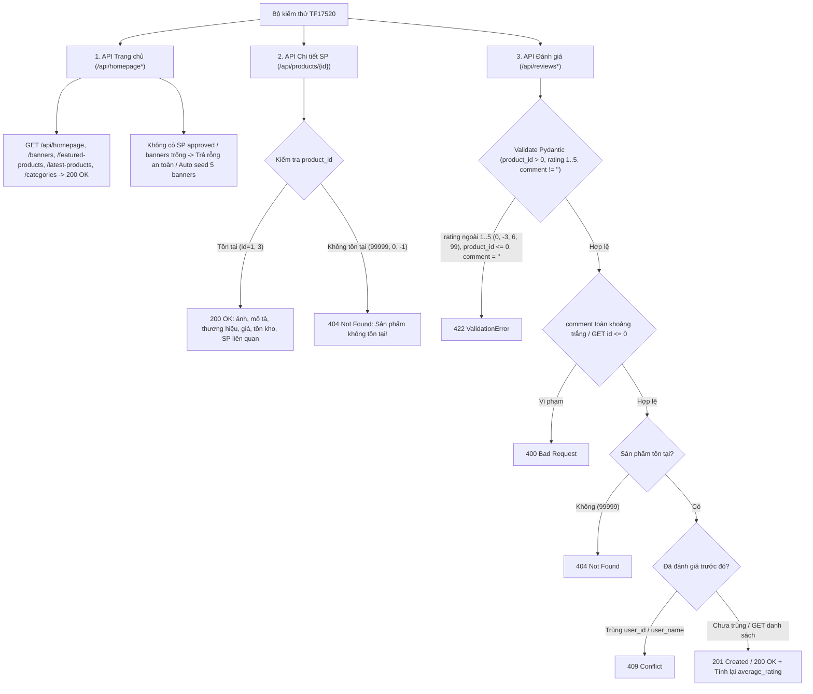

# Báo Cáo Kiểm Thử API Trang Chủ, Chi Tiết Sản Phẩm & Đánh Giá (TF17520)

- **Mã task:** `TF17520`
- **Tiêu đề:** `[Kiểm thử] Test API trang chủ, chi tiết sản phẩm, đánh giá`
- **Sprint:** `Sprint 3 · 24/11–30/11`
- **Hạn:** `20/11/2026`
- **Người thực hiện:** `Vũ Dũng (B25DTCN161)`
- **File test tự động:** [`backend/tests/test_api_tf17520.py`](./test_api_tf17520.py) (chạy cùng [`test_product_detail.py`](./test_product_detail.py) và [`test_reviews.py`](./test_reviews.py))
- **Lệnh chạy kiểm thử (Mock DB):** `python -m unittest backend.tests.test_api_tf17520 backend.tests.test_product_detail backend.tests.test_reviews -v`

---

## 1. Sơ Đồ Luồng Kiểm Thử (Trang Chủ · Chi Tiết Sản Phẩm · Đánh Giá)



---

## 2. Bảng Test Case — Phần A: API Trang Chủ (`/api/homepage*`)

| Mã TC | Tên Test Case | Endpoint & Đầu vào | Kết quả mong đợi | Kết quả thực tế | Trạng thái |
|-------|---------------|--------------------|------------------|------------------|------------|
| **TC-HP-01** | Tổng hợp trang chủ với dữ liệu đúng | `GET /api/homepage?featured_limit=2&latest_limit=2` | Trả 2 banner active (sort tăng dần), 2 SP nổi bật (`[3, 1]`), 2 SP mới nhất (`[3, 2]`), 2 danh mục, `summary` khớp | Đúng thứ tự & `summary`: `total_banners=2`, `total_featured=2`, `total_latest=2`, `total_categories=2` | **PASS** |
| **TC-HP-02** | Danh sách banner & tự nạp mẫu khi trống | `GET /api/homepage/banners` | Lọc `is_active=1`, sắp xếp `sortOrder=[1, 2]`; khi bảng trống tự nạp 5 banner | Lần 1 `total=2` (`[1, 2]`); khi rỗng tự nạp và trả `total=5` | **PASS** |
| **TC-HP-03** | SP nổi bật & mới nhất tôn trọng `limit` và `approved` | `get_featured_products(limit=10)`, `get_latest_products(limit=2)` | Bỏ qua SP `pending` (`id=4`), giữ đúng thứ tự và `limit` | Featured `[3, 1, 2]` (đều `approved`), Latest `[3, 2]` | **PASS** |
| **TC-HP-04** | Danh mục trang chủ gom nhóm đúng số lượng | `GET /api/homepage/categories` | Gom nhóm SP `approved`: `audio` (2), `tech` (1) | `total=2`, `audio=2`, `tech=1` | **PASS** |
| **TC-HP-05** | Trang chủ khi không có sản phẩm đã duyệt | Không có SP `status='approved'` | Trả mảng rỗng an toàn, `total_featured=0` | `featured_products=[]`, `latest_products=[]`, `categories=[]`, `total_featured=0` | **PASS** |

---

## 3. Bảng Test Case — Phần B: API Chi Tiết Sản Phẩm (`/api/products/{id}`)

| Mã TC | Tên Test Case | Endpoint & Đầu vào | Kết quả mong đợi | Kết quả thực tế | Trạng thái |
|-------|---------------|--------------------|------------------|------------------|------------|
| **TC-PD-01** | Xem chi tiết sản phẩm hợp lệ | `GET /api/products/1` | Trả đầy đủ ảnh, mô tả, thương hiệu (`Sony`), giá (`7490000`), tồn kho (`16`, `in_stock`), SP liên quan | Khớp toàn bộ trường dữ liệu, `len(images)=2`, `len(relatedProducts)=1` | **PASS** |
| **TC-PD-02** | Sản phẩm hết hàng (`stock=0`) | `GET /api/products/3` | `stock=0`, `inStock=False`, `stockStatus='out_of_stock'` | Trả `stock=0`, `inStock=False`, `stockStatus='out_of_stock'` | **PASS** |
| **TC-PD-03** | ID sản phẩm không tồn tại | `GET /api/products/99999` | Báo lỗi `404 Not Found` | Raise `HTTPException(status_code=404, detail="Sản phẩm không tồn tại!")` | **PASS** |
| **TC-PD-04** | ID sản phẩm `<= 0` (`0`, `-1`) | `GET /api/products/0`, `GET /api/products/-1` | Báo lỗi `404 Not Found` | Cả `0` và `-1` đều raise `HTTPException(status_code=404)` | **PASS** |

---

## 4. Bảng Test Case — Phần C: API Đánh Giá (`/api/reviews*`)

| Mã TC | Nhóm | Tên Test Case | Đầu vào | Kết quả mong đợi | Kết quả thực tế | Trạng thái |
|-------|------|---------------|---------|------------------|------------------|------------|
| **TC-RV-01** | Dữ liệu đúng | Gửi đánh giá 5 sao hợp lệ | `product_id=1`, `user_id=10`, `rating=5`, `comment="Chất âm tuyệt vời, đóng gói kỹ!"` | `201`, `avg=5.0`, `total=1` | `rating=5`, `user_name="Nguyễn Đức Anh"`, `avg=5.0`, `total=1` | **PASS** |
| **TC-RV-02** | Dữ liệu đúng | Biên hợp lệ 1 sao & 5 sao | 2 đánh giá: `rating=5` và `rating=1` | Chấp nhận cả 1 & 5, `avg=3.0` | `average_rating=3.0`, `total_reviews=2` | **PASS** |
| **TC-RV-03** | Dữ liệu đúng | Nhiều đánh giá cập nhật trung bình & phân bố | 3 đánh giá: `5, 4, 4` | `avg=4.3`, cập nhật `products.rating=4.3` | `avg=4.3`, `breakdown["5"]=1`, `breakdown["4"]=2`, `products[1].rating=4.3` | **PASS** |
| **TC-RV-04** | Dữ liệu đúng | Xem danh sách đánh giá (có & chưa có review) | `GET /api/reviews/1` và `GET /api/reviews/3` | SP 1 có 1 review; SP 3 rỗng `avg=0.0` | SP 1 `total=1`; SP 3 `reviews=[]`, `avg=0.0` | **PASS** |
| **TC-RV-05** | Dữ liệu đúng | Lọc theo số sao & phân trang | `GET /api/reviews/1?rating=4&page=1&page_size=1` | `total_reviews=3`, `pagination.total=2`, trả 1 item | Khớp `total=2`, `total_pages=2`, `len(reviews)=1` | **PASS** |
| **TC-RV-06** | ID không tồn tại | `POST` đánh giá với `product_id=99999` | `product_id=99999`, `user_id=10`, `rating=5` | `404 Not Found` | `HTTPException(404, "Sản phẩm không tồn tại!")` | **PASS** |
| **TC-RV-07** | ID không tồn tại | `GET` danh sách đánh giá với `product_id=99999` | `GET /api/reviews/99999` | `404 Not Found` | `HTTPException(404)` | **PASS** |
| **TC-RV-08** | ID không hợp lệ | `GET` với `product_id=0` hoặc `-5` | `GET /api/reviews/0`, `-5` | `400 Bad Request` | `HTTPException(400)` | **PASS** |
| **TC-RV-09** | ID không hợp lệ | `POST` với `product_id=0` hoặc `-1` | `ReviewCreate(product_id=0/-1, ...)` | Lỗi validate (`422`) | Raise `ValidationError` | **PASS** |
| **TC-RV-10** | Đánh giá trùng | Cùng `user_id` gửi lần 2 cùng sản phẩm | `product_id=1`, `user_id=10` lần 2 | `409 Conflict`, giữ nguyên 1 review | `HTTPException(409)`, `total_reviews=1`, `avg=5.0` | **PASS** |
| **TC-RV-11** | Đánh giá trùng | Cùng `user_name` khách (khác hoa/thường) | `"Nguyễn Văn A"` rồi `"  nguyễn văn a  "` | `409 Conflict` | `HTTPException(409)` | **PASS** |
| **TC-RV-12** | Đánh giá hợp lệ | Cùng `user_id` đánh giá sản phẩm khác | `user_id=10` gửi cho SP `1` và SP `2` | Cả 2 thành công (`201`) | Đều tạo thành công cho `product_id=1` và `2` | **PASS** |
| **TC-RV-13** | Sao ngoài khoảng | Điểm sao `0` (nhỏ hơn 1) | `rating=0` | Từ chối (`422`) | Raise `ValidationError` | **PASS** |
| **TC-RV-14** | Sao ngoài khoảng | Điểm sao âm (`-3`) | `rating=-3` | Từ chối (`422`) | Raise `ValidationError` | **PASS** |
| **TC-RV-15** | Sao ngoài khoảng | Điểm sao lớn hơn 5 (`6`, `99`) | `rating=6`, `rating=99` | Từ chối (`422`) | Raise `ValidationError` cho cả 6 và 99 | **PASS** |
| **TC-RV-16** | Dữ liệu không hợp lệ | Nhận xét rỗng hoặc toàn khoảng trắng | `comment=""` và `comment="     "` | `""` -> `422`; `"     "` -> `400` | `ValidationError` và `HTTPException(400)` | **PASS** |

---

## 5. Tổng Kết Thực Thi Tự Động

| Bộ kiểm thử | Số lượng test | Passed | Failed |
|-------------|---------------|--------|--------|
| `test_api_tf17520.py` (`TestHomepageAPITF17520`, `TestProductDetailAPITF17520`, `TestReviewsAPITF17520`) | 25 | 25 | 0 |
| `test_product_detail.py` (`TestProductDetailAPI`) | 5 | 5 | 0 |
| `test_reviews.py` (`TestReviewsAPI`) | 3 | 3 | 0 |
| **Tổng cộng** | **33** | **33** | **0** |

```text
python -m unittest backend.tests.test_api_tf17520 backend.tests.test_product_detail backend.tests.test_reviews -v
...
Ran 33 tests in 0.018s

OK
```
