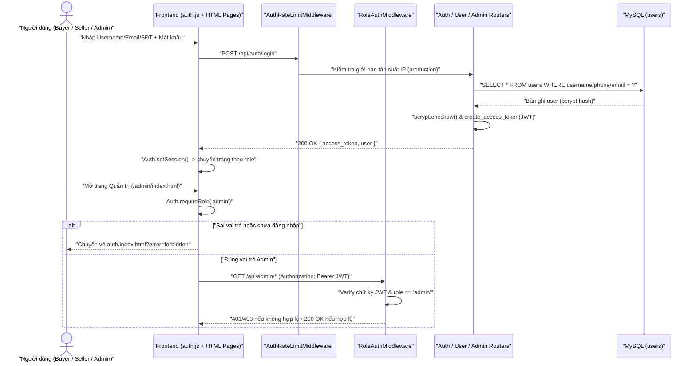

# Minh Chứng Kiểm Thử & Sơ Đồ Kiến Trúc Module Auth, RBAC, Hồ Sơ & Tích Hợp (`TF16BE3`)

- **Sinh viên thực hiện:** Nguyễn Đức Anh (`B25DTCN220`)
- **Mã task tổng hợp README & Demo:** `TF16BE3`
- **Link Video Demo:** [Google Drive](https://drive.google.com/file/d/1t-XQzuHnHSxzVhezwbtGveCdZiSESl0S/view?usp=drive_link)
- **Phạm vi module:** Khung dự án Modular Monorepo, CSDL `users` & ràng buộc, Đăng ký/Đăng nhập JWT (`bcrypt`), Middleware & Frontend RBAC, Hồ sơ cá nhân & Đổi mật khẩu, Ghép tích hợp E2E (`TF16B85`), Triển khai Vercel (`TF16FD3`) và Chế độ vận hành `APP_ENV=production`.

---

## 1. Tổng hợp các Task đã hoàn thành (Sprint 1 → Sprint 4)

| Sprint | Mã / Tên Task | Tệp mã nguồn & kiểm thử chính |
| :---: | :--- | :--- |
| Sprint 1 | Dựng khung project: repo Git, Frontend + Backend, README chức năng | `backend/main.py`, `backend/database.py`, `backend/schemas.py`, `README.md` |
| Sprint 1 | Tạo CSDL nền: bảng `users`, `roles` và dữ liệu mẫu | `backend/db/schema.sql`, `backend/db/migrations/003_create_users_and_roles_schema.sql`, `backend/db/seeds/seed.sql` |
| Sprint 1 | API đăng ký, đăng nhập (JWT) | `backend/src/modules/auth/router.py` |
| Sprint 2 | Form đăng ký, đăng nhập trên giao diện | `frontend/auth/index.html` |
| Sprint 2 | Middleware phân quyền Admin / Client | `backend/src/middlewares/auth_middleware.py` (`RoleAuthMiddleware`, `SecurityHeadersMiddleware`) |
| Sprint 2 | Chặn trang quản trị, ẩn hiện menu theo vai trò, đăng xuất | `frontend/shared/js/auth.js`, `frontend/admin/index.html`, `frontend/admin/script.js` |
| Sprint 2 | Test API đăng ký, đăng nhập, phân quyền | `backend/tests/test_auth_register_login.py`, `backend/tests/test_auth_rbac.py`, `backend/tests/test_fe_rbac_guards.py` |
| Sprint 3 | Index và ràng buộc bảng `users`, dữ liệu admin mẫu | `backend/db/migrations/006_users_email_unique_index.sql`, `backend/database.py`, `backend/tests/test_users_constraints.py` |
| Sprint 3 | API hồ sơ cá nhân và đổi mật khẩu | `backend/src/modules/user/router.py` |
| Sprint 3 | Trang hồ sơ cá nhân và đổi mật khẩu | `frontend/user/profile.html`, `backend/tests/test_user_profile_password.py` |
| Sprint 3 | Viết test tự động cho đăng nhập và validate dữ liệu đầu vào | `backend/tests/test_auth_validation_pytest.py` |
| Sprint 4 | Ghép các module và sửa lỗi tích hợp (`TF16B85`) | `backend/tests/test_integration_e2e_tf16b85.py` |
| Sprint 4 | Đưa giao diện lên Vercel để demo (`TF16FD3`) | `vercel.json`, `frontend/index.html`, `backend/tests/test_vercel_demo_tf16fd3.py` |
| Sprint 4 | Chuẩn bị vận hành thực tế (`APP_ENV=production`) | `backend/src/config/settings.py`, `backend/tests/test_production_mode.py` |

---

## 2. Sơ đồ Kiến trúc Xác thực & Phân quyền (Auth + RBAC)



---

## 3. Bảng tổng hợp kết quả Kiểm thử Tự động (100% PASS)

| STT | Tệp kiểm thử | Nhóm nội dung kiểm thử | Số Test Case | Kết quả |
| :---: | :--- | :--- | :---: | :---: |
| 1 | `backend/tests/test_auth_register_login.py` | Đăng ký, kiểm tra trùng username/email/SĐT, đăng nhập đa định danh, băm `bcrypt`, cấp JWT | **22** | ✅ PASS |
| 2 | `backend/tests/test_auth_rbac.py` | Middleware RBAC chặn `/api/admin/*` thiếu token (`401`), sai vai trò (`403`), token hết hạn/giả mạo | **16** | ✅ PASS |
| 3 | `backend/tests/test_fe_rbac_guards.py` | Bảo vệ trang Frontend `Auth.requireRole`, ẩn/hiện menu theo role, đăng xuất & guard admin UI | **10** | ✅ PASS |
| 4 | `backend/tests/test_user_profile_password.py` | API & giao diện xem/cập nhật hồ sơ cá nhân (`/api/user/me`), đổi mật khẩu (`/api/user/change-password`) | **7** | ✅ PASS |
| 5 | `backend/tests/test_users_constraints.py` | Ràng buộc `UNIQUE` email (`uq_users_email`), index `phone`, seed tài khoản `admin` mặc định | **9** | ✅ PASS |
| 6 | `backend/tests/test_auth_validation_pytest.py` | Validate đầu vào Pydantic (email, SĐT, độ dài mật khẩu, khoảng trắng username, XSS/SQL payload) | **75** | ✅ PASS |
| 7 | `backend/tests/test_integration_e2e_tf16b85.py` | Kịch bản tích hợp E2E: Đăng ký → Đăng nhập → Giỏ hàng → Đặt hàng → Admin xử lý đơn | **1** | ✅ PASS |
| 8 | `backend/tests/test_vercel_demo_tf16fd3.py` | Cấu hình `vercel.json`, kiểm tra 15 trang chính Desktop/Mobile không lỗi link/asset, `README.md` | **5** | ✅ PASS |
| 9 | `backend/tests/test_production_mode.py` | Cấu hình `APP_ENV=production`: secret JWT, CORS, chặn tự đăng ký Admin, bảo vệ route, rate-limit `429` | **7** | ✅ PASS |
| 10 | `backend/tests/test_readme_demo_tf16be3.py` | Kiểm tra đầy đủ tài liệu `README.md`, kịch bản demo & bảng test case `TF16BE3` | **3** | ✅ PASS |
| **Tổng** | **10 tệp kiểm thử** | **Toàn bộ phân hệ do Nguyễn Đức Anh phụ trách** | **155** | ✅ **100% PASS** |

---

## 4. Lệnh chạy lại toàn bộ bộ test kiểm chứng

```powershell
.\.venv\Scripts\python.exe -m pytest `
  backend/tests/test_auth_register_login.py `
  backend/tests/test_auth_rbac.py `
  backend/tests/test_fe_rbac_guards.py `
  backend/tests/test_user_profile_password.py `
  backend/tests/test_users_constraints.py `
  backend/tests/test_auth_validation_pytest.py `
  backend/tests/test_integration_e2e_tf16b85.py `
  backend/tests/test_vercel_demo_tf16fd3.py `
  backend/tests/test_production_mode.py `
  backend/tests/test_readme_demo_tf16be3.py -v
```
