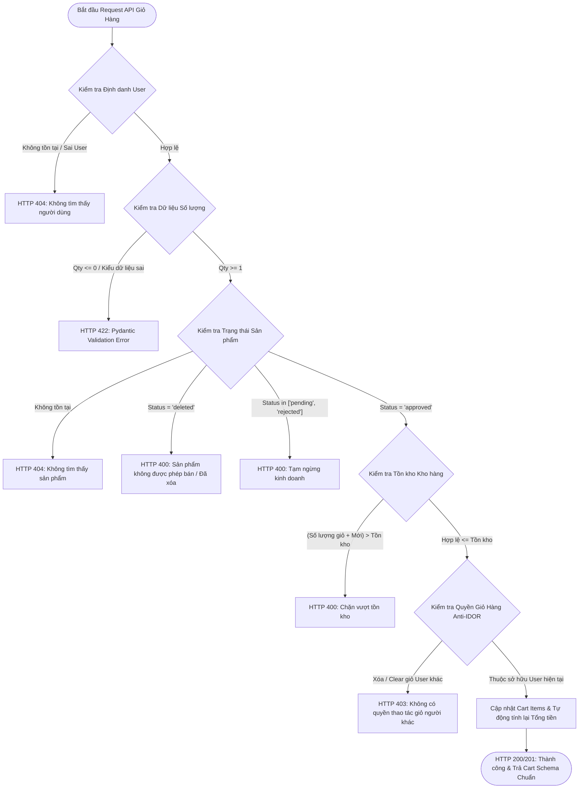

# Bảng Test Case: [Kiểm thử] Test API Giỏ Hàng

**Mã task:** TF170CB  
**Sprint:** Sprint 3 · 24/11–30/11/2026  
**Người thực hiện:** Nguyễn Công Trường (B25DTCN212)  
**File test:** `backend/tests/test_cart_api_tf170cb.py`  
**Lệnh chạy kiểm thử:** `python -m unittest backend/tests/test_cart_api_tf170cb.py -v`  
**Trạng thái kiểm thử:** **18/18 Test Cases PASS (100%)**

---

## I. Sơ đồ Luồng Kiểm Thử API Giỏ Hàng (Mermaid Flowchart)



---

## II. Chi Tiết Danh Sách 18 Test Cases

### 1. Nhóm 1: Kiểm thử Số lượng 0, Số lượng âm và Không hợp lệ

| Mã TC | Tên Test Case | Mô tả & Mục đích | Input Data | Kết quả Kỳ vọng (Expected) | Status Code | Kết quả Thực tế |
|---|---|---|---|---|---|---|
| **TC-01** | Thêm món số lượng 0 | Chặn thêm sản phẩm vào giỏ khi `quantity = 0` | `CartItemCreate(user_id=1, product_id=101, quantity=0)` | `ValidationError`: `Input should be greater than 0` | **422** | **PASS** |
| **TC-02** | Thêm món số lượng âm | Chặn thêm sản phẩm khi `quantity < 0` (số âm) | `CartItemCreate(user_id=1, product_id=101, quantity=-5)` | `ValidationError`: `Input should be greater than 0` | **422** | **PASS** |
| **TC-03** | Thêm món số lượng chữ | Chặn request thêm món khi `quantity` không phải số nguyên | `{"user_id": 1, "product_id": 101, "quantity": "hai"}` | `ValidationError`: `Input should be a valid integer` | **422** | **PASS** |
| **TC-04** | Cập nhật số lượng 0 | Chặn đổi số lượng sản phẩm về 0 qua API cập nhật | `CartItemQuantityUpdate(user_id=1, quantity=0)` | `ValidationError`: `Input should be greater than 0` | **422** | **PASS** |
| **TC-05** | Cập nhật số lượng âm | Chặn đổi số lượng sản phẩm thành số âm | `CartItemQuantityUpdate(user_id=1, quantity=-1)` | `ValidationError`: `Input should be greater than 0` | **422** | **PASS** |

---

### 2. Nhóm 2: Kiểm thử Chặn Vượt Tồn Kho (Stock Boundary Limit)

| Mã TC | Tên Test Case | Mô tả & Mục đích | Input Data | Kết quả Kỳ vọng (Expected) | Status Code | Kết quả Thực tế |
|---|---|---|---|---|---|---|
| **TC-06** | Thêm món vượt tồn kho lần đầu | Sản phẩm chỉ còn tồn kho 5 chiếc, người dùng yêu cầu thêm 6 chiếc | `user_id=1, product_id=101, quantity=6` (tồn kho: 5) | Báo lỗi `"Sản phẩm 'Tai Nghe Sony' chỉ còn 5 chiếc trong kho"` | **400** | **PASS** |
| **TC-07** | Cộng dồn nhiều lần vượt tồn kho | Đã có 4 chiếc trong giỏ (tồn kho 5), yêu cầu thêm tiếp 2 chiếc (tổng 6) | Đã có: 4; Thêm: `quantity=2` | Báo lỗi `"chỉ còn 5 chiếc trong kho (hiện trong giỏ: 4)"` | **400** | **PASS** |
| **TC-08** | Cập nhật số lượng vượt tồn kho | Đổi số lượng trong giỏ từ 1 lên 10 chiếc trong khi kho chỉ có 5 | `PATCH /items/101`, `quantity=10` | Báo lỗi `"Sản phẩm 'Tai Nghe Sony' chỉ còn 5 chiếc trong kho"` | **400** | **PASS** |
| **TC-09** | Validate giỏ trước Checkout vượt kho | API `/validate` kiểm tra giỏ hàng có món vượt quá tồn kho thực tế | `POST /validate`, `items=[{product_id: 101, qty: 10}]` | `valid: False`, danh sách `errors` báo vượt tồn kho | **200** | **PASS** |

---

### 3. Nhóm 3: Kiểm thử Sản phẩm Đã Xóa, Chưa Duyệt và Không Hợp Lệ

| Mã TC | Tên Test Case | Mô tả & Mục đích | Input Data | Kết quả Kỳ vọng (Expected) | Status Code | Kết quả Thực tế |
|---|---|---|---|---|---|---|
| **TC-10** | Thêm sản phẩm không tồn tại | Gọi API thêm sản phẩm với ID không có trong cơ sở dữ liệu | `product_id=9999` (không tồn tại) | Báo lỗi `"Không tìm thấy sản phẩm"` | **404** | **PASS** |
| **TC-11** | Thêm sản phẩm đã xóa | Chặn thêm sản phẩm có cờ trạng thái `status = 'deleted'` | `product_id=103` (`deleted`) | Báo lỗi `"Sản phẩm hiện không được phép bán hoặc đang tạm ngừng kinh doanh"` | **400** | **PASS** |
| **TC-12** | Thêm sản phẩm chờ duyệt | Chặn thêm sản phẩm chưa được Admin phê duyệt (`status = 'pending'`) | `product_id=104` (`pending`) | Báo lỗi `"Sản phẩm hiện không được phép bán..."` | **400** | **PASS** |
| **TC-13** | Thêm sản phẩm ngừng bán | Chặn thêm sản phẩm bị từ chối / ngừng bán (`status = 'rejected'`) | `product_id=105` (`rejected`) | Báo lỗi `"Sản phẩm hiện không được phép bán..."` | **400** | **PASS** |
| **TC-14** | Xóa sản phẩm không có trong giỏ | Thử xóa sản phẩm hợp lệ trên sàn nhưng không có trong giỏ người dùng | `DELETE /items/102`, `user_id=1` | Báo lỗi `"Sản phẩm không có trong giỏ hàng"` | **404** | **PASS** |

---

### 4. Nhóm 4: Kiểm thử Phân Lập Giỏ Hàng & Chặn Can Thiệp Người Khác (Anti-IDOR)

| Mã TC | Tên Test Case | Mô tả & Mục đích | Input Data | Kết quả Kỳ vọng (Expected) | Status Code | Kết quả Thực tế |
|---|---|---|---|---|---|---|
| **TC-15** | Thao tác trên User không tồn tại | Gọi API giỏ hàng với `user_id` không tồn tại trong bảng `users` | `GET /api/cart/999` | Báo lỗi `"Không tìm thấy người dùng"` | **404** | **PASS** |
| **TC-16** | Phân lập dữ liệu giữa 2 User | User 1 thêm món 101, User 2 thêm món 102; kiểm tra tính độc lập | `User 1: item 101; User 2: item 102` | Giỏ User 1 chỉ có 101 (tổng tiền 15tr); Giỏ User 2 chỉ có 102 (tổng tiền 12tr), không lẫn lộn | **200** | **PASS** |
| **TC-17** | Chặn xóa món trong giỏ người khác | User 1 cố tình gửi request xóa món hoặc `cart_item_id` của User 2 | `DELETE /items/{item_u2}`, `user_id=1` | Báo lỗi chặn truy cập trái phép: `403 Forbidden` / `404 Not Found` | **403/404** | **PASS** |
| **TC-18** | Chặn làm trống (clear) giỏ người khác | User 1 gửi request gọi API `clear` trên `cart_id` của User 2 | `DELETE /{cart_user_2}/clear`, `user_id=1` | Chặn Anti-IDOR: `"Bạn không có quyền thao tác giỏ hàng của người khác"` | **403** | **PASS** |

---

## III. Minh Chứng Chạy Test Thực Tế

```text
> .\.venv\Scripts\python -m unittest backend/tests/test_cart_api_tf170cb.py -v

test_tc01_add_cart_quantity_zero_validation_error (backend.tests.test_cart_api_tf170cb.TestCartApiTF170CB.test_tc01_add_cart_quantity_zero_validation_error)
TC-01: Chặn thêm vào giỏ sản phẩm với số lượng = 0. ... ok
test_tc02_add_cart_quantity_negative_validation_error (backend.tests.test_cart_api_tf170cb.TestCartApiTF170CB.test_tc02_add_cart_quantity_negative_validation_error)
TC-02: Chặn thêm vào giỏ sản phẩm với số lượng âm (quantity < 0). ... ok
test_tc03_add_cart_quantity_string_validation_error (backend.tests.test_cart_api_tf170cb.TestCartApiTF170CB.test_tc03_add_cart_quantity_string_validation_error)
TC-03: Chặn thêm vào giỏ khi số lượng không phải số nguyên. ... ok
test_tc04_update_cart_quantity_zero_validation_error (backend.tests.test_cart_api_tf170cb.TestCartApiTF170CB.test_tc04_update_cart_quantity_zero_validation_error)
TC-04: Chặn cập nhật số lượng về 0. ... ok
test_tc05_update_cart_quantity_negative_validation_error (backend.tests.test_cart_api_tf170cb.TestCartApiTF170CB.test_tc05_update_cart_quantity_negative_validation_error)
TC-05: Chặn cập nhật số lượng là số âm. ... ok
test_tc06_add_cart_exceed_stock_forbidden (backend.tests.test_cart_api_tf170cb.TestCartApiTF170CB.test_tc06_add_cart_exceed_stock_forbidden)
TC-06: Chặn thêm vào giỏ hàng số lượng vượt quá tồn kho (HTTP 400). ... ok
test_tc07_accumulate_cart_quantity_exceed_stock (backend.tests.test_cart_api_tf170cb.TestCartApiTF170CB.test_tc07_accumulate_cart_quantity_exceed_stock)
TC-07: Chặn cộng dồn số lượng vượt quá tồn kho hiện có (HTTP 400). ... ok
test_tc08_update_quantity_exceed_stock (backend.tests.test_cart_api_tf170cb.TestCartApiTF170CB.test_tc08_update_quantity_exceed_stock)
TC-08: Chặn đổi số lượng vượt tồn kho qua PATCH/PUT (HTTP 400). ... ok
test_tc09_validate_cart_exceed_stock_returns_invalid (backend.tests.test_cart_api_tf170cb.TestCartApiTF170CB.test_tc09_validate_cart_exceed_stock_returns_invalid)
TC-09: API /validate phát hiện sản phẩm vượt tồn kho trước khi thanh toán. ... ok
test_tc10_add_non_existent_product_not_found (backend.tests.test_cart_api_tf170cb.TestCartApiTF170CB.test_tc10_add_non_existent_product_not_found)
TC-10: Thêm sản phẩm không tồn tại trả về HTTP 404. ... ok
test_tc11_add_deleted_product_forbidden (backend.tests.test_cart_api_tf170cb.TestCartApiTF170CB.test_tc11_add_deleted_product_forbidden)
TC-11: Chặn thêm sản phẩm đã bị xóa khỏi sàn (status='deleted'). ... ok
test_tc12_add_pending_product_forbidden (backend.tests.test_cart_api_tf170cb.TestCartApiTF170CB.test_tc12_add_pending_product_forbidden)
TC-12: Chặn thêm sản phẩm đang chờ duyệt (status='pending'). ... ok
test_tc13_add_rejected_product_forbidden (backend.tests.test_cart_api_tf170cb.TestCartApiTF170CB.test_tc13_add_rejected_product_forbidden)
TC-13: Chặn thêm sản phẩm bị từ chối / ngừng bán (status='rejected'). ... ok
test_tc14_remove_product_not_in_cart_not_found (backend.tests.test_cart_api_tf170cb.TestCartApiTF170CB.test_tc14_remove_product_not_in_cart_not_found)
TC-14: Xóa sản phẩm không có trong giỏ hàng trả về HTTP 404. ... ok
test_tc15_get_cart_non_existent_user_not_found (backend.tests.test_cart_api_tf170cb.TestCartApiTF170CB.test_tc15_get_cart_non_existent_user_not_found)
TC-15: Lấy giỏ của người dùng không tồn tại trả về HTTP 404. ... ok
test_tc16_cart_isolation_between_two_users (backend.tests.test_cart_api_tf170cb.TestCartApiTF170CB.test_tc16_cart_isolation_between_two_users)
TC-16: Đảm bảo tính phân lập giỏ hàng giữa 2 người dùng khác nhau. ... ok
test_tc17_remove_cart_item_other_user_isolation (backend.tests.test_cart_api_tf170cb.TestCartApiTF170CB.test_tc17_remove_cart_item_other_user_isolation)
TC-17: User 1 không thể xóa sản phẩm trong giỏ của User 2. ... ok
test_tc18_clear_cart_other_user_forbidden (backend.tests.test_cart_api_tf170cb.TestCartApiTF170CB.test_tc18_clear_cart_other_user_forbidden)
TC-18: Chặn người dùng xóa làm trống giỏ hàng của người khác (Anti-IDOR). ... ok

----------------------------------------------------------------------
Ran 18 tests in 0.009s

OK
```
