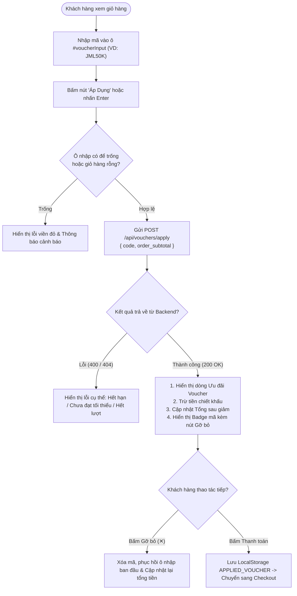

# TÀI LIỆU KIỂM THỬ: Ô NHẬP MÃ GIẢM GIÁ TRONG GIỎ HÀNG (FE)
**Mã Task**: `TF17271` - `[FE] Bonus: ô nhập mã giảm giá trong giỏ hàng`  
**Sprint**: Sprint 4 (01/12 – 07/12) | **Hạn nộp**: 25/11/2026 | **Điểm**: 4  
**Sinh viên thực hiện**: Nguyễn Công Trường (MSSV: `B25DTCN212`)  
**Repository**: `https://github.com/nducanhh0402/JML.git`  
**Nhánh thực hiện**: `feature/tf17271-o-nhap-ma-giam-gia-gio-hang`

---

## 1. YÊU CẦU ĐỀ BÀI VÀ GIẢI PHÁP TRIỂN KHAI

Theo mô tả đề bài Task `TF17271`:
> *"Thêm ô nhập mã, hiện tiền được giảm và tổng sau giảm, báo lỗi khi mã không hợp lệ. Minh chứng: nộp link nhánh hoặc Pull Request."*

### Các tính năng đã được hiện thực trong `frontend/buyer/cart.html`:
1. **Ô nhập mã giảm giá (`#voucherBox`)**:
   - Trường nhập liệu dạng `text-transform: uppercase`, tự động in hoa mã.
   - Nút **"Áp Dụng"** kích hoạt kiểm tra mã.
   - Hỗ trợ phím tắt **Enter** để gửi yêu cầu nhanh chóng.
2. **Kiểm tra và báo lỗi khi mã không hợp lệ**:
   - Khi để trống ô nhập: Hiển thị viền đỏ `.is-invalid`, thông báo lỗi `"⚠️ Vui lòng nhập mã giảm giá!"`.
   - Khi giỏ hàng trống: Báo lỗi `"⚠️ Giỏ hàng đang trống, không thể áp dụng mã!"`.
   - Khi mã sai, hết hạn, chưa đạt giá trị tối thiểu, hoặc hết lượt dùng: Gọi API `POST /api/vouchers/apply` và hiển thị nguyên nhân lỗi từ server (hoặc fallback offline nếu không có mạng).
3. **Hiển thị số tiền được giảm & Tổng tiền sau giảm**:
   - Khi áp dụng thành công: Thêm dòng chi tiết `🎟️ Mã [TÊN_MÃ]: -[TIỀN_GIẢM] ₫`.
   - Cập nhật số tiền tiết kiệm trong `savingsMsg`.
   - Tính toán lại tổng tiền sau giảm: `totalAfterDiscount = max(0, subtotal - voucherDiscount)` (đảm bảo không bị âm tiền).
   - Hiển thị nhãn huy hiệu (Badge) mã đã áp dụng với nút **"✕ Bỏ"** để khách hàng có thể gỡ mã bất kỳ lúc nào.
4. **Đồng bộ với luồng thanh toán**:
   - Lưu thông tin mã đã áp dụng vào `localStorage.setItem('APPLIED_VOUCHER', ...)` để khi chuyển sang `checkout.html`, mã tự động được ghi nhận.

---

## 2. SƠ ĐỒ LUỒNG HOẠT ĐỘNG Ô NHẬP MÃ GIẢM GIÁ (MERMAID)



---

## 3. MA TRẬN CA KIỂM THỬ (TEST CASE MATRIX)

| Mã TC | Hạng mục kiểm thử | Dữ liệu đầu vào | Kết quả mong đợi | Trạng thái |
|:---:|:---|:---|:---|:---:|
| **TC-01** | Kiểm tra thành phần DOM | Trang `cart.html` | Đầy đủ `#voucherBox`, `#voucherInput`, `#btnApplyVoucher`, `#voucherMsg`, `#voucherAppliedTag` | **PASS** |
| **TC-02** | Dòng hiển thị tiền giảm & Tổng sau giảm | Trang `cart.html` | Đầy đủ `#voucherDiscountRow`, `#appliedVoucherName`, `#summaryVoucherDiscount`, `#summaryTotal` | **PASS** |
| **TC-03** | Định dạng giao diện CSS | Trang `cart.html` | Tự động in hoa text-transform, class `.is-invalid` khi lỗi, badge `.voucher-applied-tag` | **PASS** |
| **TC-04** | Tích hợp gọi API Backend | Request Payload | Gọi đúng endpoint `/api/vouchers/apply` với `{ code, order_subtotal }` | **PASS** |
| **TC-05** | Thuật toán tính tiền giảm (Fixed & Percent) | Đơn 2M, mã 10% trần 100K | Tiền giảm tính đúng 100.000 ₫ (không vượt trần) | **PASS** |
| **TC-06** | Đảm bảo tổng tiền sau giảm không âm | Đơn 30K, mã giảm 50K | Tổng sau giảm = `max(0, 30000 - 50000) = 0 ₫` | **PASS** |
| **TC-07** | Bắt lỗi khi không nhập mã | Bấm "Áp Dụng" khi ô rỗng | Ô input viền đỏ `.is-invalid`, hiện thông báo lỗi | **PASS** |
| **TC-08** | Tính năng gỡ bỏ mã (Remove) | Bấm nút "✕ Bỏ" | Phục hồi ô nhập, gỡ badge, hoàn lại tổng tiền gốc | **PASS** |
| **TC-09** | Kích hoạt bằng phím Enter | Bấm phím `Enter` | Sự kiện `keydown` bắt trúng và tự động kích hoạt `handleApplyVoucher()` | **PASS** |
| **TC-10** | Đồng bộ sang trang Checkout | Bấm "Tiến Hành Thanh Toán" | `APPLIED_VOUCHER` được ghi vào `localStorage` trước khi chuyển trang | **PASS** |

---

## 4. BẰNG CHỨNG KẾT QUẢ THỰC THI KIỂM THỬ TỰ ĐỘNG

```text
PS D:\CNTT4\Thực hành RikkeiLab\JML-Store> .\.venv\Scripts\python -m unittest backend/tests/test_cart_voucher_input_tf17271.py -v
test_tc01_voucher_dom_elements_present (backend.tests.test_cart_voucher_input_tf17271.TestCartVoucherInputTF17271.test_tc01_voucher_dom_elements_present)
TC-01: Kiểm tra các phần tử DOM ô nhập voucher, nút bấm và badge đầy đủ. ... ok
test_tc02_voucher_discount_and_summary_row_present (backend.tests.test_cart_voucher_input_tf17271.TestCartVoucherInputTF17271.test_tc02_voucher_discount_and_summary_row_present)
TC-02: Dòng hiển thị tiền giảm từ voucher và tổng sau giảm hiện diện trong tóm tắt đơn. ... ok
test_tc03_voucher_css_styling_and_error_classes (backend.tests.test_cart_voucher_input_tf17271.TestCartVoucherInputTF17271.test_tc03_voucher_css_styling_and_error_classes)
TC-03: Kiểm tra CSS cho ô nhập mã (uppercase, is-invalid, voucher-applied-tag). ... ok
test_tc04_api_integration_call (backend.tests.test_cart_voucher_input_tf17271.TestCartVoucherInputTF17271.test_tc04_api_integration_call)
TC-04: Kiểm tra việc kết nối API backend POST /api/vouchers/apply. ... ok
test_tc05_discount_calculation_fixed_and_percent (backend.tests.test_cart_voucher_input_tf17271.TestCartVoucherInputTF17271.test_tc05_discount_calculation_fixed_and_percent)
TC-05: Kiểm thử thuật toán tính toán giảm giá (fixed và percent có giới hạn). ... ok
test_tc06_total_after_discount_never_negative (backend.tests.test_cart_voucher_input_tf17271.TestCartVoucherInputTF17271.test_tc06_total_after_discount_never_negative)
TC-06: Tổng tiền sau giảm không bao giờ bị âm (luôn >= 0). ... ok
test_tc07_empty_input_validation (backend.tests.test_cart_voucher_input_tf17271.TestCartVoucherInputTF17271.test_tc07_empty_input_validation)
TC-07: Kiểm tra xử lý validate khi người dùng không nhập mã (bấm Áp dụng trống). ... ok
test_tc08_remove_voucher_handler (backend.tests.test_cart_voucher_input_tf17271.TestCartVoucherInputTF17271.test_tc08_remove_voucher_handler)
TC-08: Kiểm tra hàm handleRemoveVoucher gỡ bỏ mã và phục hồi trạng thái ô nhập. ... ok
test_tc09_enter_key_listener (backend.tests.test_cart_voucher_input_tf17271.TestCartVoucherInputTF17271.test_tc09_enter_key_listener)
TC-09: Kiểm tra sự kiện bấm phím Enter kích hoạt áp dụng mã ngay lập tức. ... ok
test_tc10_checkout_localstorage_sync (backend.tests.test_cart_voucher_input_tf17271.TestCartVoucherInputTF17271.test_tc10_checkout_localstorage_sync)
TC-10: Kiểm tra việc lưu thông tin voucher vào LocalStorage để trang Checkout sử dụng. ... ok

----------------------------------------------------------------------
Ran 10 tests in 0.002s

OK
```
