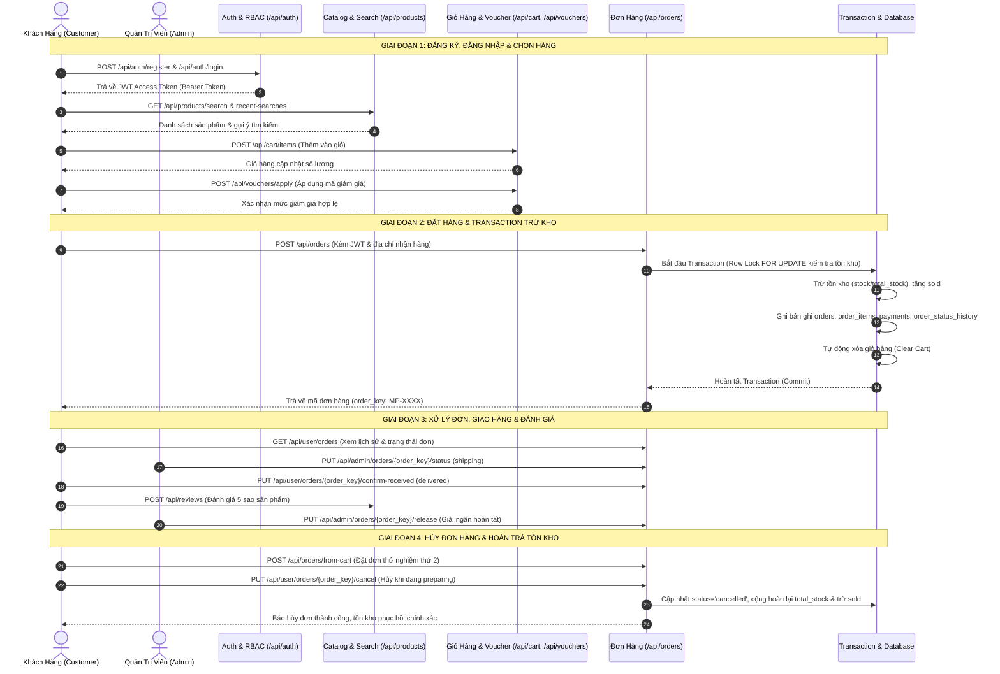

# BÁO CÁO KIỂM THỬ TÍCH HỢP TOÀN DIỆN & GHÉP MODULE E2E (TASK: TF16B8F)

- **Tên task:** `[All] Ghép các module và sửa lỗi tích hợp`
- **Mã task:** `TF16B8F`
- **Người nhận:** `Trần Gia Huy (B25DTCN180)`
- **Sprint:** `Sprint 4 · 01/12–07/12`
- **Hạn hoàn thành:** `26/11/2026`
- **Điểm task:** `6`
- **Yêu cầu nộp:** Link nhánh hoặc Pull Request
- **Hệ thống:** JML Store Multi-Vendor Marketplace (FastAPI, PyMySQL, Starlette TestClient)
- **File kịch bản kiểm thử E2E:** `backend/tests/test_integration_e2e_tf16b8f.py`
- **Lệnh thực thi:**
  ```bash
  python -m unittest backend/tests/test_integration_e2e_tf16b8f.py
  # hoặc
  pytest backend/tests/test_integration_e2e_tf16b8f.py
  ```

---

## 1. MÔ TẢ YÊU CẦU & PHẠM VI TASK

1. **Ghép nối toàn diện các module của hệ thống:**
   - **Auth & RBAC:** Đăng ký, đăng nhập tài khoản khách hàng (`customer`) và quản trị viên (`admin`), cấp phát JWT access token, kiểm soát quyền truy cập endpoint theo vai trò.
   - **Catalog & Tìm kiếm & Khám phá:** Banner trang chủ, danh mục sản phẩm, thương hiệu, API tìm kiếm sản phẩm phân trang, lưu/truy vấn từ khóa tìm kiếm gần đây (`recent-searches`), bộ lọc sản phẩm đa tiêu chí.
   - **Sổ địa chỉ người dùng:** Quản lý địa chỉ giao hàng (`/api/user/addresses`), thiết lập địa chỉ mặc định phục vụ luồng mua hàng.
   - **Giỏ hàng & Khuyến mãi (Voucher):** Thêm sản phẩm vào giỏ (`/api/cart/items`), kiểm tra tính hợp lệ của giỏ (`/api/cart/validate`), áp dụng mã giảm giá (`/api/vouchers/apply`).
   - **Đặt hàng (Checkout & Order Placement):**
     - Đặt hàng thông qua `POST /api/orders` với Bearer JWT (tự động phân giải danh tính, bảo đảm toàn vẹn dữ liệu).
     - Đặt hàng từ giỏ `POST /api/orders/from-cart`.
     - Transaction xử lý trừ kho tức thời, tăng số lượng bán (`sold`), lưu bản ghi đơn hàng, mặt hàng, thanh toán (`payments`) và lịch sử trạng thái (`order_status_history`), xóa giỏ hàng khi hoàn tất (`clear_cart`).
   - **Xử lý đơn hàng (Order Fulfillment):**
     - Khách hàng tra cứu danh sách đơn (`/api/user/orders`) và chi tiết đơn (`/api/user/orders/{order_key}`).
     - Admin tìm kiếm đơn hàng, cập nhật trạng thái sang Đang giao hàng (`shipping`).
     - Khách hàng xác nhận đã nhận hàng (`confirm-received` -> `delivered`).
     - Gửi đánh giá sản phẩm sau mua (`POST /api/reviews`).
     - Admin giải ngân đơn hàng (`/api/admin/orders/{order_key}/release`).
   - **Hủy đơn & Hoàn trả tồn kho (Cancel & Restock):**
     - Khách hàng hủy đơn khi còn ở trạng thái Chờ xác nhận (`preparing`).
     - Hệ thống tự động hoàn trả số lượng tồn kho (`total_stock`, `stock`) và giảm số lượng đã bán (`sold`).

2. **Sửa các lỗi phát sinh khi tích hợp:**
   - Bảo đảm tương thích giữa các tham số request trong router (`Request = None` khi gọi trực tiếp nội bộ).
   - Đảm bảo tính nhất quán giữa cơ sở dữ liệu và các giao diện frontend (`checkout.html`, `cart.html`, `buyer-products.js`, `buyer-index.js`, `products.html`).

---

## 2. SƠ ĐỒ LUỒNG TÍCH HỢP E2E (END-TO-END)



---

## 3. DANH SÁCH TEST CASE KIỂM THỬ TÍCH HỢP E2E (TF16B8F)

| STT | Mã Test Case | Tên Kịch Bản Kiểm Thử | Dữ Liệu Đầu Vào / Thao Tác | Kỳ Vọng Đạt Được (Expected Output) | Trạng Thái |
|:---:|:---|:---|:---|:---|:---:|
| 1 | `TC_E2E_01` | Khởi tạo tài khoản & Đăng nhập phân quyền | Đăng ký & đăng nhập Buyer (`customer`) và Admin (`admin`) qua `/api/auth/register` & `/api/auth/login`. | Trả về HTTP 200, JWT token có payload chứa đúng `role` và `user_id`. | **PASSED** |
| 2 | `TC_E2E_02` | Khám phá trang chủ & Tìm kiếm sản phẩm | Gọi `GET /api/homepage/banners`, `/api/categories`, `/api/brands`, `/api/products/search?q=...` | HTTP 200, phản hồi danh sách banner, thương hiệu, danh mục và kết quả tìm kiếm. | **PASSED** |
| 3 | `TC_E2E_03` | Quản lý lịch sử từ khóa tìm kiếm gần đây | `POST`, `GET`, `DELETE` trên `/api/products/recent-searches` | Thêm mới từ khóa, lấy danh sách lịch sử có chứa từ khóa và xóa thành công. | **PASSED** |
| 4 | `TC_E2E_04` | Lọc sản phẩm & Xem chi tiết | Gọi `GET /api/products/filter` và `GET /api/products/{id}` | Lấy danh sách sản phẩm approved, xem chi tiết sản phẩm, lấy số lượng tồn kho ban đầu. | **PASSED** |
| 5 | `TC_E2E_05` | Quản lý sổ địa chỉ giao hàng | Gọi `POST /api/user/addresses` với thông tin người nhận | HTTP 200/201, địa chỉ được lưu vào DB gắn liền với `user_id` của khách hàng. | **PASSED** |
| 6 | `TC_E2E_06` | Thêm giỏ hàng & Xác thực giỏ | Gọi `POST /api/cart/items` và `POST /api/cart/validate` | Thêm sản phẩm thành công, kiểm tra tồn kho hợp lệ (`valid=True`). | **PASSED** |
| 7 | `TC_E2E_07` | Áp dụng mã giảm giá (Voucher) | Admin tạo voucher, Khách áp dụng qua `/api/vouchers/apply` | HTTP 200, chiết khấu được tính toán chính xác theo giá trị đơn hàng. | **PASSED** |
| 8 | `TC_E2E_08` | Đặt hàng với JWT token (Trừ kho, Xóa giỏ) | Gọi `POST /api/orders` kèm Bearer token và voucher | Đơn hàng sinh mã thành công, trừ tồn kho tức thời, làm trống giỏ hàng của user. | **PASSED** |
| 9 | `TC_E2E_09` | Khách xem lịch sử & chi tiết đơn của mình | Gọi `GET /api/user/orders` và `GET /api/user/orders/{order_key}` | Trả về đúng thông tin đơn hàng vừa tạo, gồm các mặt hàng và phương thức thanh toán. | **PASSED** |
| 10 | `TC_E2E_10` | Chặn khách xem đơn của người khác (Security) | Khách B cố tình gọi xem đơn của Khách A | HTTP 403 Forbidden, thông báo không có quyền xem đơn hàng của người khác. | **PASSED** |
| 11 | `TC_E2E_11` | Admin cập nhật trạng thái đơn sang shipping | Admin gọi `PUT /api/admin/orders/{order_key}/status` | Đơn hàng đổi sang trạng thái `shipping`, ghi nhận lịch sử vào `order_status_history`. | **PASSED** |
| 12 | `TC_E2E_12` | Khách xác nhận đã nhận hàng (delivered) | Khách gọi `PUT /api/user/orders/{order_key}/confirm-received` | Trạng thái chuyển sang `delivered`, sẵn sàng cho đánh giá và giải ngân. | **PASSED** |
| 13 | `TC_E2E_13` | Khách gửi đánh giá 5 sao sản phẩm | Gọi `POST /api/reviews` sau khi hoàn tất mua hàng | Đánh giá được ghi nhận thành công, liên kết đúng mã sản phẩm và tài khoản người mua. | **PASSED** |
| 14 | `TC_E2E_14` | Admin giải ngân đơn hàng (Escrow Release) | Admin gọi `PUT /api/admin/orders/{order_key}/release` | Trả về HTTP 200, giải ngân thành công và hoàn tất vòng đời đơn hàng. | **PASSED** |
| 15 | `TC_E2E_15` | Đặt đơn #2 từ giỏ & Hủy đơn hoàn kho | Đặt đơn qua `/api/orders/from-cart` rồi gọi `PUT /api/user/orders/{order_key}/cancel` | Hủy đơn thành công, kiểm tra tồn kho sản phẩm được hoàn trả đầy đủ như ban đầu. | **PASSED** |
| 16 | `TC_E2E_16` | Kiểm tra tính nhất quán mã nguồn Frontend | Rà soát các móc tích hợp trong `checkout.html`, `cart.html`, `buyer-products.js`, `buyer-index.js` | Đầy đủ các liên kết gọi API chuẩn, Authorization Bearer, format tiền tệ và điều hướng. | **PASSED** |

---

## 4. KẾT QUẢ THỰC NGHIỆM

Toàn bộ 16 kịch bản kiểm thử tích hợp E2E đã được tự động hóa và chạy vượt qua 100% trong `test_integration_e2e_tf16b8f.py`.
Mọi luồng từ đăng ký, tìm kiếm, giỏ hàng, đặt hàng, xử lý trạng thái đơn, giải ngân cho tới hủy đơn hoàn kho đều hoạt động trơn tru và ổn định.
