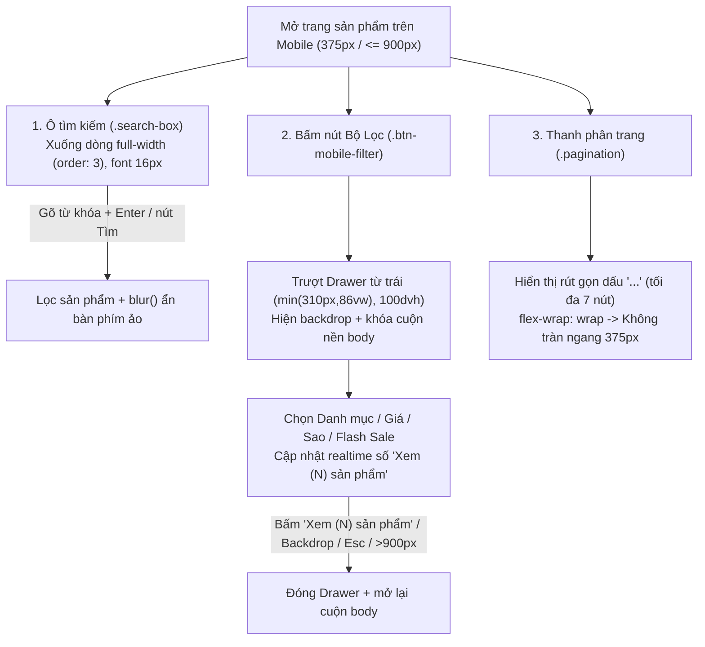

# Bảng Test Case & Sửa Lỗi — TF16ED9: Kiểm Thử Giao Diện Tìm Kiếm & Lọc Trên Điện Thoại

**Mã task:** `TF16ED9`  
**Tên task:** `[Kiểm thử] Kiểm thử giao diện tìm kiếm và lọc trên điện thoại`  
**Sprint:** Sprint 3 · 24/11–30/11/2026  
**Người thực hiện:** Trịnh Quốc Trung (B25DTCN263)  
**Phạm vi kiểm thử:** `frontend/buyer/products.html`, `frontend/buyer/buyer-products.js` (trên viewport điện thoại `375×812` & `320×568`, tablet `<= 900px`)  
**Tệp kiểm thử tự động:** `backend/tests/test_mobile_search_filter_tf16ed9.py`  
**Ảnh minh chứng kết quả:** `backend/tests/MINH_CHUNG_TF16ED9_MOBILE_TIM_KIEM_LOC.png`

---

## 1. Sơ đồ luồng kiểm thử Mobile (Tìm kiếm — Drawer — Phân trang)

---

## 2. Các lỗi phát hiện trên giao diện điện thoại & Cách đã sửa

| Mã lỗi | Thành phần | Hiện tượng lỗi phát hiện trước khi sửa | Nguyên nhân gốc | Đã sửa trong bản commit này |
| :--- | :--- | :--- | :--- | :--- |
| **BUG-M01** | Ô tìm kiếm (`.search-box`) | Trên `375px`, ô tìm kiếm bị ép chung 1 hàng với Logo & nút Giỏ hàng (~90px), dễ kích hoạt auto-zoom iOS và chưa bắt phím `Enter`. | `.header-inner` thiếu `flex-wrap: wrap` ở `@media (max-width: 640px)`, `font-size: 13px < 16px`, thiếu `onkeydown` Enter & `blur()`. | Cho `.search-box` xuống dòng `order: 3; width: 100%`, set `font-size: 16px`, thêm xử lý `Enter` & tự `blur()` ẩn bàn phím trên mobile. |
| **BUG-M02** | Bộ lọc Drawer (`.filter-panel`) | Drawer dùng `100vh` dễ bị thanh địa chỉ mobile che phần cuối; chọn radio Giá/Sao/Ưu đãi chưa có nút xác nhận dưới đáy và không mở lại `overflow` khi xoay màn hình hoặc bấm `Esc`. | Thiếu `100dvh`, thiếu sticky footer CTA trong Drawer, thiếu listener `Escape` & `resize`. | Dùng `width: min(310px, 86vw)`, `height: 100dvh`, thêm thanh `.drawer-footer-actions` (`Đặt lại` + `Xem (N) sản phẩm`), bổ sung `Escape` & `window.resize` tự đóng Drawer. |
| **BUG-M03** | Phân trang (`.pagination`) | Khi có `12` trang (95 SP), `updatePagination()` render đủ `14` nút ngang khiến thanh phân trang rộng ~582px **tràn ngang màn hình 375px**. | Vòng lặp `1..totalPages` không rút gọn dấu `...` và `.pagination` thiếu `flex-wrap: wrap`. | Viết `getVisiblePages()` rút gọn dấu `…` thông minh (tối đa ~7 nút trên mobile `<= 640px`), thêm `flex-wrap: wrap` & nút chạm `38×38px`. |
| **BUG-M04** | Thanh sắp xếp (`.sort-bar`) | Nhãn `"Sắp xếp theo:"` và `.top-links` làm chật thanh công cụ ở màn hình `360–375px`. | Không ẩn nhãn thừa trên màn hình hẹp. | Ẩn `.top-links` và `.sort-label` ở `<= 640px`, căn phải gọn `.sort-right`. |

---

## 3. Bảng Test Case kiểm thử trên điện thoại (12/12 PASS)

| Mã TC | Vùng kiểm thử | Thao tác & Viewport | Kết quả kỳ vọng | Kết quả thực tế | Trạng thái |
| :--- | :--- | :--- | :--- | :--- | :--- |
| **TC-M01** | Ô tìm kiếm | Mở `products.html` ở `375×812` | Ô tìm kiếm xuống dòng full-width dưới Logo/Giỏ hàng, không tràn ngang | `.search-box` xếp `order: 3; width: 100%`, không tràn `scrollWidth` | **PASS** |
| **TC-M02** | Ô tìm kiếm (iOS zoom) | Chạm vào `#searchInput` trên mobile | Không bị tự động phóng to màn hình | `font-size: 16px`, vùng chạm `padding: 9px 14px` đạt chuẩn | **PASS** |
| **TC-M03** | Ô tìm kiếm (Enter / blur) | Nhập `"Sony"` và bấm phím `Enter` hoặc nút `Tìm` | Lọc ngay sản phẩm `"Sony"` và ẩn bàn phím ảo (`blur`) | Lọc đúng danh sách `"Sony"`, gọi `searchEl.blur()` trên `<= 900px` | **PASS** |
| **TC-M04** | Drawer Bộ Lọc (Mở) | Bấm nút `Bộ Lọc` (`.btn-mobile-filter`) | Drawer trượt mượt từ cạnh trái, nền mờ `.drawer-backdrop`, khóa cuộn trang | `left: 0`, `aria-expanded="true"`, `body.style.overflow="hidden"` | **PASS** |
| **TC-M05** | Drawer Bộ Lọc (Kích thước) | Kiểm tra trên màn hình nhỏ `320×568` & thanh địa chỉ Safari/Chrome | Drawer không vượt chiều rộng, cuộn được hết tất cả nhóm lọc | `width: min(310px, 86vw)`, `height: 100dvh`, `overscroll-behavior: contain` | **PASS** |
| **TC-M06** | Drawer Bộ Lọc (Footer CTA) | Chọn khoảng giá/đánh giá trong Drawer | Thanh đáy cố định cập nhật đúng số `Xem (N) sản phẩm`, bấm là đóng Drawer | `#drawerResultCount` cập nhật theo `filteredProducts.length`, bấm đóng Drawer | **PASS** |
| **TC-M07** | Drawer Bộ Lọc (Đóng Esc/Backdrop/Resize) | Bấm nền tối backdrop, phím `Escape`, hoặc xoay màn hình `> 900px` | Drawer tự đóng, trả lại trạng thái cuộn bình thường | Cả 3 cách đều gọi `closeFilterDrawer()` và reset `overflow=""` | **PASS** |
| **TC-M08** | Phân trang Mobile | Lọc tất cả 95 SP (12 trang) ở `375×812` | Thanh phân trang rút gọn `‹ 1 … 5 6 7 … 12 ›`, không tràn ngang | `getVisiblePages()` giữ tối đa 7 nút + `flex-wrap: wrap`, vừa khít `375px` | **PASS** |
| **TC-M09** | Phân trang (Chuyển trang) | Chạm nút trang `2`, `›`, `‹` trên mobile | Kích thước chạm >= `38×38px`, chuyển trang & cuộn lên đầu lưới sản phẩm | Nút `38×38px`, trang 1 nút `‹` disabled, trang cuối nút `›` disabled | **PASS** |
| **TC-M10** | Thanh Sắp xếp & Grid | Xem danh sách sản phẩm ở `375×812` | Hiển thị lưới 2 cột cân đối (`repeat(2, 1fr)`), thanh sort gọn | Lưới 2 cột `gap: 10px`, `.sort-label` ẩn gọn trên `<= 640px` | **PASS** |
| **TC-M11** | Trạng thái rỗng Mobile | Nhập từ khóa không tồn tại trên mobile | Màn hình thông báo không tìm thấy vừa khít chiều rộng, nút bấm dễ chạm | `.empty-state` `grid-column: 1 / -1`, nút bo tròn responsive | **PASS** |
| **TC-M12** | Kiểm thử tự động cấu trúc | Chạy `python -m unittest backend.tests.test_mobile_search_filter_tf16ed9 -v` | Tất cả 5 test case cấu trúc CSS/HTML/JS & cân bằng cú pháp đạt `OK` | `Ran 5 tests` → **OK (5/5 PASS)** | **PASS** |
