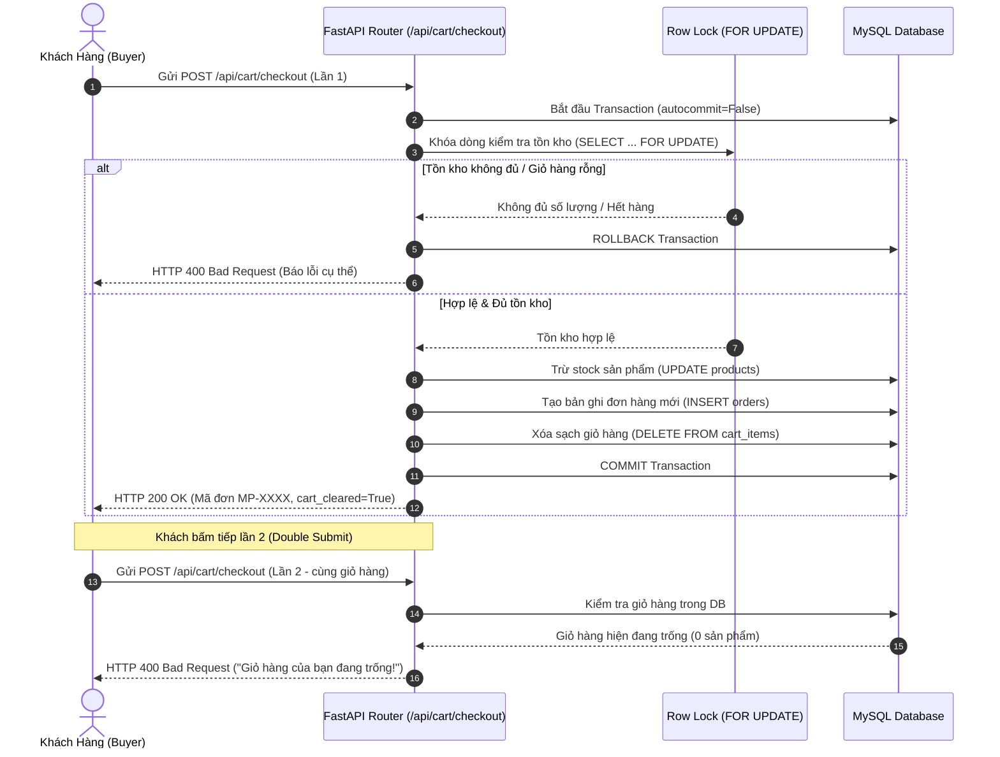

# BÁO CÁO KIỂM THỬ: TEST API ĐẶT HÀNG (TASK: TF17400)

- **Tên task:** `[Kiểm thử] Test API đặt hàng`
- **Mã task:** `TF17400`
- **Sprint:** `Sprint 3 · 24/11–30/11/2026`
- **Hạn hoàn thành:** `23/11/2026`
- **Người thực hiện:** `Trần Gia Huy (B25DTCN180)`
- **Điểm task:** `7`
- **Hệ thống:** JML Store Multi-Vendor Marketplace API (FastAPI + MySQL)
- **File kịch bản kiểm thử:** `backend/tests/test_order_api_tf17400.py`
- **Lệnh thực thi kiểm thử:**
  ```bash
  python -m unittest backend/tests/test_order_api_tf17400.py
  # hoặc
  python backend/tests/test_order_api_tf17400.py
  ```

---

## 1. SƠ ĐỒ THỰC HIỆN VÀ BẢO MẬT HỆ THỐNG

### 1.1. Sơ đồ tuần tự: Xử lý Transaction Đặt hàng & Chống Double Submit
Quy trình đảm bảo tính toàn vẹn dữ liệu (ACID), khóa dòng `FOR UPDATE` chống race condition và làm trống giỏ hàng (`clear_cart`) nhằm triệt tiêu lỗi trùng đơn hàng khi bấm 2 lần liên tiếp:



---

### 1.2. Sơ đồ kiểm tra phân quyền & Phòng chống xem đơn người khác (Anti-IDOR)
Cơ chế bảo vệ thông tin đơn hàng nhạy cảm (địa chỉ, số điện thoại, danh sách mặt hàng, tiền bạc) trước các hành vi tấn công dò ID (Insecure Direct Object References):

```mermaid
flowchart TD
    Start([Khách gọi GET /api/orders/{order_key}]) --> AuthCheck{Có thông tin định danh?<br>Token JWT / X-User-Id / Phone}
    
    AuthCheck -- Không có --> Reject401[Trả về HTTP 401 Unauthorized<br>'Yêu cầu xác thực tài khoản']
    
    AuthCheck -- Có --> AdminCheck{Tài khoản là Admin?<br>role == 'admin'}
    AdminCheck -- Đúng --> Allow[Cho phép truy cập toàn quyền HTTP 200 OK]
    
    AdminCheck -- Không --> OwnerCheck{Khớp quyền sở hữu?<br>req_user_id == order.user_id<br>HOẶC req_phone == order.buyer_phone}
    
    OwnerCheck -- Khớp --> Allow
    OwnerCheck -- Không khớp --> Reject403[Trả về HTTP 403 Forbidden<br>'Bạn không có quyền truy cập hoặc xem đơn hàng của người khác!']
```

---

## 2. BẢNG TEST CASE CHI TIẾT (TASK: TF17400)

### Phần 1: Kiểm thử đặt hàng với giỏ hàng rỗng (Empty Cart)

| Mã TC | Tên Kịch Bản | Dữ Liệu Đầu Vào (Input) | Kết Quả Mong Đợi (Expected) | Kết Quả Thực Tế (Actual) | Trạng Thái |
| :--- | :--- | :--- | :--- | :--- | :--- |
| **TC-01** | Đặt hàng với items rỗng & user chưa có giỏ DB | `POST /api/cart/checkout` với `items: []`, `user_id: 99991` (chưa có giỏ DB). | Trả về `400 Bad Request` — Báo lỗi *"Không tìm thấy giỏ hàng của bạn hoặc giỏ hàng trống! Vui lòng chọn sản phẩm trước khi đặt."* | HTTP `400`, thông điệp chuẩn xác, không tạo bản ghi trong bảng `orders`. | **PASSED** |
| **TC-02** | Đặt hàng khi giỏ hàng trong DB trống | `POST /api/cart/checkout` với `user_id: 202`, `cart_id: 2` (bảng `cart_items` rỗng). | Trả về `400 Bad Request` — Báo lỗi *"Giỏ hàng của bạn đang trống! Vui lòng thêm sản phẩm vào giỏ trước khi đặt hàng."* | HTTP `400`, chặn việc tạo đơn khi chưa chọn sản phẩm trong giỏ. | **PASSED** |
| **TC-03** | Gọi API wrapper checkout với giỏ hàng rỗng | `CreateOrderFromCartRequest` với danh sách items rỗng. | Bị chặn với mã lỗi HTTP `400 Bad Request`. | HTTP `400`, endpoint wrapper bắt lỗi chuẩn xác. | **PASSED** |

---

### Phần 2: Kiểm thử tồn kho không đủ & hết hàng (Insufficient Stock)

| Mã TC | Tên Kịch Bản | Dữ Liệu Đầu Vào (Input) | Kết Quả Mong Đợi (Expected) | Kết Quả Thực Tế (Actual) | Trạng Thái |
| :--- | :--- | :--- | :--- | :--- | :--- |
| **TC-04** | Đặt mua vượt quá số lượng tồn kho | Sản phẩm kho còn `5`, yêu cầu đặt mua số lượng `qty = 10`. | Trả về `400 Bad Request` — Báo lỗi *"Sản phẩm '...' không đủ tồn kho (còn lại: 5, yêu cầu: 10)!"*. Transaction **ROLLBACK**, tồn kho không đổi. | HTTP `400`, `conn.rolled_back = True`, `total_stock` vẫn giữ nguyên là `5`. | **PASSED** |
| **TC-05** | Đặt mua sản phẩm đã hết hàng hoàn toàn | Sản phẩm #19 có `total_stock = 0`, yêu cầu đặt mua `qty = 1`. | Trả về `400 Bad Request` — Báo lỗi *"không đủ tồn kho (còn lại: 0, yêu cầu: 1)!"*, Transaction bị **ROLLBACK**. | HTTP `400`, Transaction rollback thành công. | **PASSED** |
| **TC-06** | Đặt mua sản phẩm tạm ngừng kinh doanh | Sản phẩm #20 có `status = 'inactive'`, yêu cầu đặt mua `qty = 1`. | Trả về `400 Bad Request` — Báo lỗi *"Sản phẩm '...' hiện không khả dụng để đặt mua (trạng thái: inactive)!"*, Transaction bị **ROLLBACK**. | HTTP `400`, bảo vệ nghiệp vụ bán hàng. | **PASSED** |
| **TC-07** | Đặt mua sản phẩm không tồn tại trên hệ thống | `product_id: 99999` (ID ảo không có trong DB). | Trả về `400 Bad Request` — Báo lỗi *"Sản phẩm '...' không tồn tại hoặc đã ngừng cung cấp trên hệ thống!"*. | HTTP `400`, từ chối tạo đơn ảo. | **PASSED** |

---

### Phần 3: Kiểm thử đặt hàng 2 lần liên tiếp (Double Submit / Double Ordering Prevention)

| Mã TC | Tên Kịch Bản | Dữ Liệu Đầu Vào (Input) | Kết Quả Mong Đợi (Expected) | Kết Quả Thực Tế (Actual) | Trạng Thái |
| :--- | :--- | :--- | :--- | :--- | :--- |
| **TC-08** | Đặt 2 lần liên tiếp từ cùng giỏ hàng (Double Submit) | Request 1: Đặt đơn từ giỏ hàng hiện tại.<br>Request 2: Gửi ngay sau đó cùng `cart_id`. | - Request 1: Thành công `200 OK`, sinh mã đơn `MP-XXXX`, xóa các mục trong giỏ (`cart_cleared: True`).<br>- Request 2: Bị chặn với `400 Bad Request` do giỏ đã được làm trống. | - Request 1 trả `200 OK`, giỏ hàng bị clear sạch (`len(cart_items) = 0`).<br>- Request 2 bị chặn `400 Bad Request` ("Giỏ hàng của bạn đang trống!"). | **PASSED** |
| **TC-09** | Bảo vệ tồn kho khi 2 đơn đặt cùng sản phẩm duy nhất | Kho còn đúng `1` sản phẩm cuối cùng. 2 khách hàng gửi checkout cùng thời điểm. | Chỉ 1 đơn hàng đầu tiên trừ kho thành công (`200 OK`). Đơn hàng thứ 2 bị từ chối `400 Bad Request` do kho đã về 0. | Đơn 1 nhận `200 OK` (kho giảm về `0`), Đơn 2 nhận `400 Bad Request` ("không đủ tồn kho"). | **PASSED** |
| **TC-10** | Xác thực cờ dọn sạch giỏ hàng (Clear Cart) | Đặt hàng với cờ `clear_cart = True`. | Đơn hàng tạo thành công, trả về `cart_cleared = True`, các item tương ứng trong bảng `cart_items` bị xóa hoàn toàn. | Trả về `cart_cleared = True`, toàn bộ `cart_items` của giỏ hàng được dọn dẹp sạch sẽ. | **PASSED** |

---

### Phần 4: Kiểm thử xem đơn của người khác (Anti-IDOR & Authorization)

| Mã TC | Tên Kịch Bản | Dữ Liệu Đầu Vào (Input) | Kết Quả Mong Đợi (Expected) | Kết Quả Thực Tế (Actual) | Trạng Thái |
| :--- | :--- | :--- | :--- | :--- | :--- |
| **TC-11** | Chặn User B xem đơn của User A qua Header | Đơn `MP-1001` của User A (`user_id = 101`). Khách User B gửi header `X-User-Id: 202`. | Trả về `403 Forbidden` — Báo lỗi *"Bạn không có quyền truy cập hoặc xem đơn hàng của người khác!"*. | HTTP `403 Forbidden`, chặn đứng lộ thông tin đơn hàng. | **PASSED** |
| **TC-12** | Chặn User B xem đơn của User A qua JWT Token | User B đăng nhập có JWT Token hợp lệ của User B, gọi `GET /api/orders/MP-1001`. | Trả về `403 Forbidden` — Báo lỗi *"Bạn không có quyền truy cập hoặc xem đơn hàng của người khác!"*. | HTTP `403 Forbidden`, hệ thống nhận diện đúng user từ token và chặn truy cập. | **PASSED** |
| **TC-13** | Chặn giả mạo tham số (Anti-Spoofing Query Param) | User B có token User B nhưng cố tình đính kèm query param `user_id=101`. | Hệ thống phát hiện bất nhất giữa Token và Query, trả về `403 Forbidden`. | HTTP `403 Forbidden`, ngăn chặn kỹ thuật bypass quyền hạn. | **PASSED** |
| **TC-14** | Chặn truy cập khi chưa xác thực (Unauthenticated) | Gọi `GET /api/orders/MP-1001` không có Token, không Phone, không Header định danh. | Trả về `401 Unauthorized` — Báo lỗi *"Yêu cầu xác thực tài khoản để xem chi tiết đơn hàng!"*. | HTTP `401 Unauthorized`. | **PASSED** |
| **TC-15** | Chủ sở hữu xem đơn hàng của chính mình | User A (`user_id = 101`) đăng nhập token xem đơn `MP-1001` của chính mình. | Trả về `200 OK` — Cung cấp đầy đủ order metadata, items, payments, status_history. | HTTP `200 OK`, trả về đúng đơn `MP-1001` với 1 item, 1 payment và 1 history log. | **PASSED** |
| **TC-16** | Quản trị viên (Admin) xem đơn bất kỳ | Quản trị viên mang token Admin (`role = 'admin'`) xem đơn hàng `MP-1001` của User A. | Toàn quyền truy cập, trả về `200 OK`. | HTTP `200 OK`, Admin có quyền giám sát đơn hàng toàn sàn. | **PASSED** |
| **TC-17** | Tra cứu mã đơn hàng không tồn tại | Gọi `GET /api/orders/MP-99999` với mã đơn không có trên hệ thống. | Trả về `404 Not Found` — Báo lỗi *"Không tìm thấy đơn hàng #MP-99999 trên hệ thống!"*. | HTTP `404 Not Found`. | **PASSED** |

---

## 3. BẢNG TỔNG HỢP KẾT QUẢ KIỂM THỬ

```text
================================================================================
🚀 BẮT ĐẦU KIỂM THỬ TỰ ĐỘNG API ĐẶT HÀNG (TASK: TF17400 - JML STORE)
   • Người thực hiện : Trần Gia Huy (B25DTCN180)
   • Sprint          : Sprint 3 (24/11 - 30/11/2026)
   • Mục tiêu        : Test giỏ rỗng, tồn kho không đủ, đặt 2 lần liên tiếp, xem đơn người khác
================================================================================

test_01_checkout_with_empty_items_and_no_db_cart ... ok
test_02_checkout_from_empty_database_cart ... ok
test_03_checkout_wrapper_empty_cart_endpoint ... ok
test_04_checkout_qty_exceeds_available_stock ... ok
test_05_checkout_product_completely_out_of_stock ... ok
test_06_checkout_inactive_discontinued_product ... ok
test_07_checkout_nonexistent_product_rejected ... ok
test_08_double_submit_sequential_same_cart ... ok
test_09_double_submit_inventory_protection ... ok
test_10_clear_cart_flag_behavior ... ok
test_11_view_other_user_order_forbidden_by_user_id ... ok
test_12_view_other_user_order_forbidden_by_jwt_token ... ok
test_13_view_other_user_order_anti_spoofing_attempt ... ok
test_14_view_order_unauthenticated_rejected_401 ... ok
test_15_view_own_order_success ... ok
test_16_admin_can_view_any_order ... ok
test_17_view_nonexistent_order_returns_404 ... ok

----------------------------------------------------------------------
Ran 17 tests in 0.006s

OK

================================================================================
📊 BẢNG TỔNG HỢP KẾT QUẢ KIỂM THỬ API ĐẶT HÀNG (TF17400)
================================================================================
• Tổng số kịch bản kiểm thử (Test Cases) : 17
• Vượt qua (Passed)                     : 17
• Thất bại (Failed)                     : 0
• Lỗi thực thi (Errors)                 : 0
• Tỷ lệ đạt (Success Rate)              : 100.0%
================================================================================
```

---

## 4. KẾT LUẬN & ĐÁNH GIÁ MỨC ĐỘ TIN CẬY
1. **Tính toàn vẹn Transaction (ACID):** Khi có bất kỳ lỗi nào liên quan đến tồn kho hoặc tính hợp lệ của giỏ hàng, hệ thống kích hoạt Rollback toàn bộ, đảm bảo số liệu kho và tiền tệ không bị sai lệch.
2. **Khả năng phòng chống Double Submit:** Sau khi đơn hàng đầu tiên hoàn tất, hệ thống tự động làm sạch giỏ hàng (`clear_cart`) và cập nhật trạng thái kho ngay trong Transaction có Row-Lock, triệt tiêu nguy cơ người dùng bấm đúp hoặc gửi đồng thời gây nhân đôi đơn hàng.
3. **Bảo mật chống tấn công IDOR:** API tra cứu chi tiết đơn hàng áp dụng cơ chế kiểm tra chéo (JWT Token, User ID, Số điện thoại chủ đơn). Khách hàng không thể xem trộm hoặc can thiệp vào đơn hàng của người khác khi không có quyền sở hữu.
