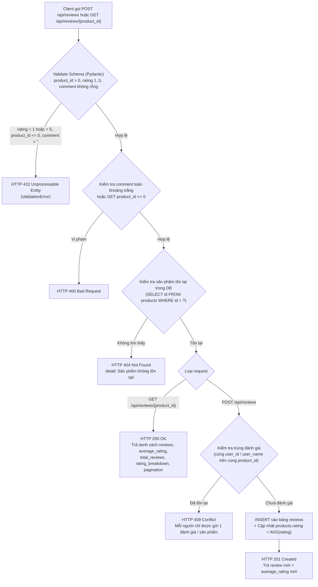

# Bảng Test Case: Kiểm Thử API Đánh Giá Sản Phẩm

**Sprint:** Sprint 3 · 24/11–30/11/2026  
**Hạn:** 20/11/2026  
**Người thực hiện:** Vũ Dũng (B25DTCN161)  
**File test tự động:** `backend/tests/test_reviews_api_cases.py` (kết hợp `backend/tests/test_reviews.py`)  
**Lệnh chạy test:** `python -m unittest backend.tests.test_reviews_api_cases backend.tests.test_reviews -v`

---

## Sơ đồ luồng xử lý & kiểm thử API Đánh giá



---

## 1. Test Dữ Liệu Đúng (`Valid Data`)

| Mã TC | Tên Test Case | Endpoint & Input | Expected | Actual Output ghi nhận | Status Code | Kết quả |
|-------|---------------|------------------|----------|------------------------|-------------|---------|
| **TC-01** | Gửi đánh giá 5 sao hợp lệ | `POST /api/reviews` (`product_id=1`, `user_id=10`, `rating=5`, `comment="Chất âm tuyệt vời, đóng gói kỹ!"`) | Tạo review thành công, `average_rating=5.0`, `total_reviews=1` | `review.rating=5`, `review.user_name="Nguyễn Đức Anh"`, `average_rating=5.0`, `total_reviews=1` | **201** | **PASS** |
| **TC-02** | Giá trị biên hợp lệ 1 sao và 5 sao | 2 request `POST /api/reviews` cho `product_id=1` (`rating=5` từ `user_id=10`, `rating=1` từ `user_id=11`) | Chấp nhận cả 2 biên `1` và `5`, trung bình `(5+1)/2 = 3.0` | `average_rating=3.0`, `total_reviews=2` | **201** | **PASS** |
| **TC-03** | Nhiều đánh giá cập nhật điểm trung bình & phân bố sao | 3 request `POST /api/reviews` cho `product_id=1` với `rating=5, 4, 4` | `average_rating=4.3`, `total_reviews=3`, đồng bộ `products.rating=4.3` | `average_rating=4.3`, `total_reviews=3`, `rating_breakdown["5"]=1`, `rating_breakdown["4"]=2`, `products[1].rating=4.3` | **201** | **PASS** |
| **TC-04** | Xem danh sách đánh giá & sản phẩm chưa có đánh giá | `GET /api/reviews/1` (có 1 review) và `GET /api/reviews/3` (chưa có review) | SP 1 trả 1 review & `avg=5.0`; SP 3 trả `reviews=[]`, `avg=0.0`, `total=0` | SP 1: `total_reviews=1`, `average_rating=5.0`, `len(reviews)=1`; SP 3: `total_reviews=0`, `average_rating=0.0`, `reviews=[]` | **200** | **PASS** |
| **TC-05** | Lọc đánh giá theo số sao & phân trang | `GET /api/reviews/1?rating=4&page=1&page_size=1` (trong 3 review: 5, 4, 4) | `total_reviews=3`, `pagination.total=2`, `total_pages=2`, trả 1 item `rating=4` | `total_reviews=3`, `pagination.total=2`, `pagination.total_pages=2`, `len(reviews)=1`, `reviews[0].rating=4` | **200** | **PASS** |

## 2. Test ID Không Tồn Tại & ID Không Hợp Lệ (`Non-existent / Invalid ID`)

| Mã TC | Tên Test Case | Endpoint & Input | Expected | Actual Output ghi nhận | Status Code | Kết quả |
|-------|---------------|------------------|----------|------------------------|-------------|---------|
| **TC-06** | `POST /api/reviews` với `product_id` không tồn tại | `POST /api/reviews` (`product_id=99999`, `user_id=10`, `rating=5`) | Báo lỗi không tìm thấy sản phẩm | `HTTPException(status_code=404, detail="Sản phẩm không tồn tại!")` | **404** | **PASS** |
| **TC-07** | `GET /api/reviews/{product_id}` không tồn tại | `GET /api/reviews/99999` | Báo lỗi không tìm thấy sản phẩm | `HTTPException(status_code=404, detail="Sản phẩm không tồn tại!")` | **404** | **PASS** |
| **TC-08** | `GET /api/reviews/{product_id}` với ID `<= 0` | `GET /api/reviews/0` và `GET /api/reviews/-5` | Từ chối mã sản phẩm không hợp lệ | `HTTPException(status_code=400, detail="Mã sản phẩm không hợp lệ.")` | **400** | **PASS** |
| **TC-09** | `POST /api/reviews` với `product_id <= 0` | `ReviewCreate(product_id=0)` và `ReviewCreate(product_id=-1)` | Từ chối ở tầng validate Pydantic (`gt=0`) | Raise `ValidationError` cho cả `0` và `-1` | **422** | **PASS** |

## 3. Test Đánh Giá Trùng (`Duplicate Review`)

| Mã TC | Tên Test Case | Endpoint & Input | Expected | Actual Output ghi nhận | Status Code | Kết quả |
|-------|---------------|------------------|----------|------------------------|-------------|---------|
| **TC-10** | Cùng `user_id` đánh giá 2 lần cho cùng 1 sản phẩm | `user_id=10` gửi lần 1 (`rating=5`) rồi gửi lần 2 (`rating=2`) cho `product_id=1` | Chặn lần 2, giữ nguyên `total_reviews=1`, `average_rating=5.0` | `HTTPException(status_code=409)`, `total_reviews=1`, `average_rating=5.0` | **409** | **PASS** |
| **TC-11** | Khách không có `user_id` gửi trùng `user_name` | `user_name="Nguyễn Văn A"` gửi lần 1; lần 2 gửi `"  nguyễn văn a  "` trên `product_id=1` | Chuẩn hóa tên & chặn đánh giá trùng | `HTTPException(status_code=409)` | **409** | **PASS** |
| **TC-12** | Cùng `user_id` đánh giá sản phẩm khác | `user_id=10` gửi cho `product_id=1` và tiếp tục gửi cho `product_id=2` | Cho phép đánh giá bình thường trên sản phẩm khác | Tạo thành công review ở cả `product_id=1` và `product_id=2` | **201** | **PASS** |

## 4. Test Điểm Sao Ngoài Khoảng & Nhận Xét Rỗng (`Out-of-Range Rating`)

| Mã TC | Tên Test Case | Endpoint & Input | Expected | Actual Output ghi nhận | Status Code | Kết quả |
|-------|---------------|------------------|----------|------------------------|-------------|---------|
| **TC-13** | Điểm sao nhỏ hơn 1 (`rating = 0`) | `ReviewCreate(product_id=1, user_id=10, rating=0, comment="0 sao")` | Từ chối vì ngoài khoảng `1..5` (`ge=1`) | Raise `ValidationError` | **422** | **PASS** |
| **TC-14** | Điểm sao âm (`rating = -3`) | `ReviewCreate(product_id=1, user_id=10, rating=-3, comment="Sao âm")` | Từ chối vì ngoài khoảng `1..5` (`ge=1`) | Raise `ValidationError` | **422** | **PASS** |
| **TC-15** | Điểm sao lớn hơn 5 (`rating = 6`, `rating = 99`) | `ReviewCreate(..., rating=6)` và `ReviewCreate(..., rating=99)` | Từ chối vì ngoài khoảng `1..5` (`le=5`) | Raise `ValidationError` cho cả `6` và `99` | **422** | **PASS** |
| **TC-16** | Nhận xét rỗng hoặc toàn khoảng trắng | `comment=""` và `comment="     "` | `""` bị từ chối ở Pydantic (`422`); `"     "` bị từ chối ở handler (`400`) | `""` raise `ValidationError`; `"     "` raise `HTTPException(status_code=400)` | **422 / 400** | **PASS** |

---

## Tổng Kết Kết Quả Chạy Test

| Nhóm kiểm thử | Số lượng TC | Passed | Failed |
|---------------|-------------|--------|--------|
| Dữ liệu đúng (`TC-01` → `TC-05`) | 5 | 5 | 0 |
| ID không tồn tại / không hợp lệ (`TC-06` → `TC-09`) | 4 | 4 | 0 |
| Đánh giá trùng (`TC-10` → `TC-12`) | 3 | 3 | 0 |
| Điểm sao ngoài khoảng & nhận xét rỗng (`TC-13` → `TC-16`) | 4 | 4 | 0 |
| Unit test module nền (`test_reviews.py`) | 3 | 3 | 0 |
| **Tổng cộng** | **19** | **19** | **0** |

```text
python -m unittest backend.tests.test_reviews_api_cases backend.tests.test_reviews -v
...
Ran 19 tests in 0.004s

OK
```
