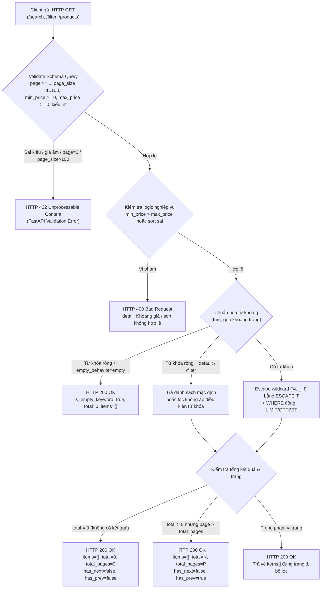

# Bảng Test Case: Kiểm Thử API Tìm Kiếm & Lọc Sản Phẩm

**Mã task:** `TF16E89`  
**Tên task:** `[Kiểm thử] Test API tìm kiếm và lọc`  
**Sprint:** Sprint 3 · 24/11–30/11/2026  
**Người thực hiện:** Trịnh Quốc Trung (B25DTCN263)  
**File test tự động:** `backend/tests/test_search_and_filter_api_tf16e89.py`  
**Ảnh minh chứng kết quả:** `backend/tests/MINH_CHUNG_TF16E89_BANG_TEST_CASE.png`  
**Lệnh chạy test:** `python -m unittest backend.tests.test_search_and_filter_api_tf16e89 backend.tests.test_product_search backend.tests.test_product_filter_sort_pagination -v`

---

## Sơ đồ luồng xử lý & kiểm thử Edge Cases



---

## 1. Test Từ Khóa Rỗng (`Empty / Whitespace Keyword`)

| Mã TC | Tên Test Case | Endpoint & Input | Expected | Actual Output ghi nhận | Status Code | Kết quả |
|-------|---------------|------------------|----------|------------------------|-------------|---------|
| **TC-01** | Từ khóa rỗng chế độ mặc định | `GET /api/products/search?q=&page_size=10` | `is_empty_keyword=true`, `keyword=""`, trả tối đa 10 SP mặc định | `total=95`, `items_count=10`, `total_pages=10`, `message="Từ khóa rỗng: hiển thị danh sách sản phẩm mặc định."` | **200** | **PASS** |
| **TC-02** | Từ khóa toàn khoảng trắng | `GET /api/products/search?q=%20%20%20&page_size=8` | `is_empty_keyword=true`, `keyword=""`, không lỗi SQL | `raw_keyword="   "`, `keyword=""`, `items_count=8`, `total=95` | **200** | **PASS** |
| **TC-03** | Từ khóa rỗng chế độ `empty_behavior=empty` | `GET /api/products/search?q=&empty_behavior=empty` | `is_empty_keyword=true`, `total=0`, `items=[]`, `total_pages=0` | `total=0`, `items=[]`, `pagination={page:1, total:0, total_pages:0, has_next:false, has_prev:false}` | **200** | **PASS** |
| **TC-04** | Từ khóa rỗng trên `/filter` & `/api/products` | `GET /api/products/filter?q=%20%20%20&category=tech` & `GET /api/products?q=%20%20%20` | Bỏ qua từ khóa rỗng, lọc đúng `category=tech` và giữ cấu trúc `flash_products` | `/filter` trả toàn bộ SP `tech`, `filters.q=""`; `/api/products` trả `is_empty_keyword=true` kèm danh sách SP | **200** | **PASS** |

## 2. Test Khoảng Giá Sai (`Invalid Price Range & Bounds`)

| Mã TC | Tên Test Case | Endpoint & Input | Expected | Actual Output ghi nhận | Status Code | Kết quả |
|-------|---------------|------------------|----------|------------------------|-------------|---------|
| **TC-05** | `min_price > max_price` tại `/filter` | `GET /api/products/filter?min_price=10000000&max_price=5000000` | Từ chối khoảng giá ngược | `detail="Khoảng giá không hợp lệ: min_price (10000000) không được lớn hơn max_price (5000000)."` | **400** | **PASS** |
| **TC-06** | `min_price > max_price` tại `/search` | `GET /api/products/search?q=Apple&min_price=20000000&max_price=10000000` | Từ chối khoảng giá ngược | Trả lỗi `"Khoảng giá không hợp lệ..."` | **400** | **PASS** |
| **TC-07** | `min_price > max_price` tại `/api/products` | `GET /api/products?min_price=5000000&max_price=1000000` | Từ chối khoảng giá ngược | Trả lỗi `"Khoảng giá không hợp lệ..."` | **400** | **PASS** |
| **TC-08** | Giá trị âm (`min_price < 0`, `max_price < 0`) | `GET /api/products/filter?min_price=-1000` & `/search?max_price=-500` | Validation Error (`ge=0`) | `detail[0].type="greater_than_equal"`, `loc=["query","min_price"]` | **422** | **PASS** |
| **TC-09** | Khoảng giá sai kiểu dữ liệu (`min_price=abc`) | `GET /api/products/filter?min_price=abc` & `/search?max_price=khongphaiso` | Validation Error (`int_parsing`) | FastAPI trả lỗi kiểu số nguyên không hợp lệ | **422** | **PASS** |
| **TC-10** | Biên giá bằng nhau (`min_price == max_price`) | `GET /api/products/filter?min_price=<giá_mẫu>&max_price=<giá_mẫu>` | Trả đúng các sản phẩm có giá bằng giá mẫu | `total >= 1`, 100% `item.price == target_price` | **200** | **PASS** |

## 3. Test Không Có Kết Quả (`No Matching Results`)

| Mã TC | Tên Test Case | Endpoint & Input | Expected | Actual Output ghi nhận | Status Code | Kết quả |
|-------|---------------|------------------|----------|------------------------|-------------|---------|
| **TC-11** | Từ khóa không tồn tại trong DB | `GET /api/products/search?q=SanPhamKhongTonTaiXYZ_99999` | `total=0`, `items=[]`, `total_pages=0`, `has_next=false`, `has_prev=false` | `total=0`, `items=[]`, `message="Tìm thấy 0 sản phẩm phù hợp với từ khóa 'SanPhamKhongTonTaiXYZ_99999'."` | **200** | **PASS** |
| **TC-12** | Ký tự wildcard SQL (`%%%`, `___`) | `GET /api/products/search?q=%25%25%25` & `q=___` | Escape `ESCAPE '!'`, không match nhầm toàn bảng (`total=0`) | `total=0`, `items=[]`, `escaped_like_pattern="%!%!%!%%"` | **200** | **PASS** |
| **TC-13** | Tổ hợp bộ lọc giao rỗng | `GET /api/products/filter?category=shoes&brand=Apple` | `total=0`, `items=[]`, `total_pages=0` | `total=0`, `items=[]`, `total_pages=0` | **200** | **PASS** |
| **TC-14** | Khoảng giá vượt mức giá cao nhất | `GET /api/products/filter?min_price=999000000&max_price=1500000000` | `total=0`, `items=[]` | `total=0`, `items=[]` | **200** | **PASS** |

## 4. Test Phân Trang Vượt Trang Cuối & Tham Số Biên (`Out-of-Range Pagination`)

| Mã TC | Tên Test Case | Endpoint & Input | Expected | Actual Output ghi nhận | Status Code | Kết quả |
|-------|---------------|------------------|----------|------------------------|-------------|---------|
| **TC-15** | Vượt trang cuối tại `/filter` | `GET /api/products/filter?page=9999&page_size=12` | `items=[]`, giữ nguyên `total > 0`, `has_next=false`, `has_prev=true` | `total=95`, `items=[]`, `total_pages=8`, `page=9999`, `has_next=false`, `has_prev=true` | **200** | **PASS** |
| **TC-16** | Vượt trang cuối tại `/search` (`page` & `offset`) | `GET /api/products/search?q=Apple&page=999&page_size=10` & `offset=9990` | `items=[]`, giữ đúng `total`, `has_next=false`, `has_prev=true` | `total=22`, `total_pages=3`, `items=[]`, `has_next=false`, `has_prev=true` | **200** | **PASS** |
| **TC-17** | Vượt trang cuối tại `/api/products` | `GET /api/products?page=9999&page_size=12` | `items=[]`, `flash_products=[]`, `recommend_products=[]`, `has_next=false` | `items=[]`, `flash_products=[]`, `recommend_products=[]`, `total=95`, `has_next=false` | **200** | **PASS** |
| **TC-18** | Vượt trang khi `total = 0` | `GET /api/products/filter?category=shoes&brand=Apple&page=5&page_size=12` | `items=[]`, `total=0`, `total_pages=0`, `has_next=false`, `has_prev=false` | `items=[]`, `total=0`, `total_pages=0`, `has_next=false`, `has_prev=false` | **200** | **PASS** |
| **TC-19** | Trang cuối hợp lệ (`page == total_pages`) | `GET /api/products/filter?page=10&page_size=10` | Trả phần dư cuối (`1..10` item), `has_next=false`, `has_prev=true` | `total=95`, `total_pages=10`, `items_count=5`, `has_next=false`, `has_prev=true` | **200** | **PASS** |
| **TC-20** | Tham số phân trang & `sort` sai | `page=0/-1`, `page_size=0/101`, `sort=invalid_sort` | `page`/`page_size` sai -> `422`; `sort` sai -> `400` | `page=0/-1`, `page_size=0/101` trả **422**; `sort=invalid_sort` trả **400** | **422 / 400** | **PASS** |

---

## Tổng kết kết quả chạy kiểm thử

| Nhóm kiểm thử | Số TC | Đạt (PASS) | Thất bại |
|---------------|-------|------------|----------|
| Từ khóa rỗng (`/search`, `/filter`, `/products`) | 4 | 4 | 0 |
| Khoảng giá sai (`min > max`, âm, sai kiểu, biên) | 6 | 6 | 0 |
| Không có kết quả & escape SQL wildcard | 4 | 4 | 0 |
| Phân trang vượt trang cuối & tham số biên | 6 | 6 | 0 |
| Hồi quy `test_product_search.py` (TF16DB5) | 8 | 8 | 0 |
| Hồi quy `test_product_filter_sort_pagination.py` (TF16DE9) | 7 | 7 | 0 |
| **Tổng cộng** | **35** | **35** | **0** |

```text
python -m unittest backend.tests.test_search_and_filter_api_tf16e89 backend.tests.test_product_search backend.tests.test_product_filter_sort_pagination -v
...
Ran 35 tests in 9.113s

OK
```
