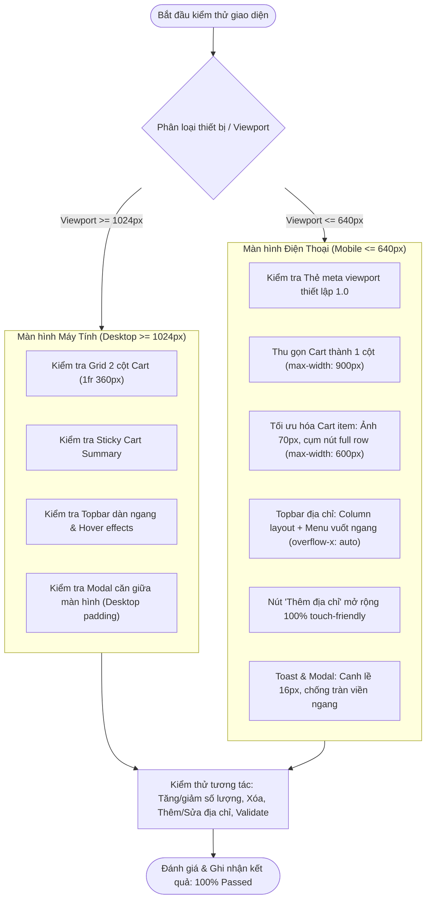

# TÀI LIỆU KIỂM THỬ GIAO DIỆN: GIỎ HÀNG & SỔ ĐỊA CHỈ TRÊN MÁY TÍNH VÀ ĐIỆN THOẠI
**Mã Task**: `TF1719B` - `[Kiểm thử] Kiểm thử giao diện giỏ hàng và địa chỉ`  
**Sprint**: Sprint 3 (24/11 – 30/11) | **Hạn nộp**: 24/11/2026 | **Điểm**: 5.5  
**Sinh viên thực hiện**: Nguyễn Công Trường (MSSV: `B25DTCN212`)  
**Repository**: `https://github.com/nducanhh0402/JML.git`  
**Nhánh thực hiện**: `feature/tf1719b-test-ui-gio-hang-dia-chi`

---

## 1. MỤC TIÊU VÀ PHẠM VI KIỂM THỬ

Theo yêu cầu của đề bài Task `TF1719B`:
> *"Test giỏ hàng, địa chỉ nhận hàng trên máy tính và điện thoại; ghi và sửa lỗi. Minh chứng: nộp link hoặc file (ảnh chụp, bảng test case, sơ đồ)."*

Kiểm thử tập trung vào 2 giao diện người dùng cốt lõi:
1. **Giao diện Giỏ Hàng (`frontend/buyer/cart.html`)**:
   - Máy tính (Desktop/Laptop: độ phân giải >= 1024px): Bố cục Grid 2 cột (danh sách sản phẩm bên trái, khung tóm tắt & thanh toán cố định bên phải).
   - Máy tính bảng (Tablet: 601px - 900px): Thu gọn thành 1 cột, khung tóm tắt chuyển sang luồng tài liệu tự nhiên (static position).
   - Điện thoại di động (Mobile: <= 600px): Thu gọn ảnh sản phẩm còn 70x70px, đẩy cụm thao tác (tăng giảm số lượng, xóa) xuống hàng riêng biệt với đường ngăn cách nét đứt, thu gọn thanh Header/Top-bar, căn giữa Toast thông báo toàn màn hình chống tràn viền.
2. **Giao diện Sổ Địa Chỉ Nhận Hàng (`frontend/user/addresses.html`)**:
   - Máy tính (Desktop): Topbar dàn ngang, Page Header phân chia 2 bên (tiêu đề bên trái, nút "Thêm địa chỉ mới" bên phải), thẻ địa chỉ hiển thị thông tin và nút thao tác (Đặt mặc định, Sửa, Xóa) ngang hàng.
   - Điện thoại di động (Mobile: <= 640px): Topbar chuyển sang hiển thị cột dọc, menu điều hướng cho phép vuốt ngang (touch scroll `overflow-x: auto`), nút "Thêm địa chỉ mới" mở rộng 100% chiều rộng để dễ bấm bằng ngón tay, modal form mở rộng 95% màn hình và chống tràn bàn phím ảo.

---

## 2. SƠ ĐỒ LUỒNG KIỂM THỬ GIAO DIỆN (MERMAID)



---

## 3. BẢNG GHI NHẬN LỖI PHÁT HIỆN & PHƯƠNG ÁN SỬA LỖI (BUG LOG & FIXES)

| ID Lỗi | Màn hình | Môi trường | Mô tả lỗi phát hiện | Phương án khắc phục đã triển khai | Trạng thái |
|:---:|:---:|:---:|:---|:---|:---:|
| **BUG-01** | Sổ địa chỉ | Mobile (<= 640px) | Menu điều hướng `.top-nav` (5 mục) bị tràn màn hình ngang trên điện thoại có chiều rộng 360px - 414px, làm vỡ khung nhìn. | Bổ sung `overflow-x: auto`, `white-space: nowrap`, `-webkit-overflow-scrolling: touch` để người dùng vuốt trượt êm mượt. | **Đã sửa** |
| **BUG-02** | Sổ địa chỉ | Mobile (<= 640px) | Nút "Thêm địa chỉ mới" nằm lệch về bên phải với kích thước nhỏ, khó thao tác bằng ngón tay cái trên màn hình cảm ứng. | Chuyển `.page-header` thành `flex-direction: column` và nút bấm thành `width: 100%; justify-content: center`. | **Đã sửa** |
| **BUG-03** | Sổ địa chỉ | Mobile (<= 640px) | Khung Toast thông báo cố định `right: 24px` với độ rộng cố định dễ bị tràn viền hoặc đè lên nội dung bên phải. | Thiết lập `left: 16px; right: 16px; max-width: none; justify-content: center` để căn giữa cân đối trên di động. | **Đã sửa** |
| **BUG-04** | Giỏ hàng | Mobile (<= 600px) | Dòng thông báo ưu đãi ở Topbar dài làm vỡ bố cục và đẩy link đăng nhập xuống dòng che mất các phần tử khác. | Bổ sung media query chuyển `.top-bar-inner` thành cột dọc, thu gọn font chữ xuống 11px căn giữa trang. | **Đã sửa** |
| **BUG-05** | Giỏ hàng | Mobile (<= 600px) | Cụm thao tác tăng giảm số lượng và nút xóa nằm dính sát vào thông tin sản phẩm, không có ranh giới rõ ràng. | Tách `.cart-item-actions` sang hàng dưới chiếm `grid-column: 1 / -1`, thêm viền ngăn cách `border-top: 1px dashed var(--border)`. | **Đã sửa** |
| **BUG-06** | Giỏ hàng | Mobile (<= 600px) | Hộp thoại xác nhận xóa (`modal-box`) có padding 28px quá lớn làm nội dung bị ép hẹp trên màn hình điện thoại 320px. | Giảm padding xuống `20px 16px` và đặt `width: 92%` vừa vặn mọi tỷ lệ màn hình điện thoại. | **Đã sửa** |

---

## 4. MA TRẬN CA KIỂM THỬ GIAO DIỆN (TEST CASE MATRIX)

| Mã TC | Hạng mục kiểm thử | Thiết bị | Tiêu chí đánh giá | Kết quả |
|:---:|:---|:---:|:---|:---:|
| **TC-01** | Thẻ meta Viewport trang Giỏ hàng | Mobile | Thẻ `<meta content="width=device-width, initial-scale=1.0" name="viewport" />` có mặt | **PASS** |
| **TC-02** | Bố cục Grid Desktop trang Giỏ hàng | Desktop (>= 1024px) | Chia 2 cột (`grid-template-columns: 1fr 360px`), khung tóm tắt `position: sticky` | **PASS** |
| **TC-03** | Breakpoint 900px trang Giỏ hàng | Tablet / Mini PC | `.cart-page` thu gọn thành 1 cột (`1fr`), tóm tắt đổi sang `position: static` | **PASS** |
| **TC-04** | Breakpoint 600px trang Giỏ hàng | Mobile (<= 600px) | Ảnh sản phẩm 70x70px, cụm nút thao tác chiếm trọn hàng dưới có viền ngăn cách | **PASS** |
| **TC-05** | Toast & Modal trên di động Giỏ hàng | Mobile (<= 600px) | Toast căn đều 2 lề 16px chống tràn viền, modal-box co giãn linh hoạt | **PASS** |
| **TC-06** | Các điều khiển tương tác cốt lõi Giỏ hàng | Cả hai | Đầy đủ nút tăng/giảm `.qty-btn`, nút xóa `.btn-remove-item`, nút đặt hàng `#btnCheckout` | **PASS** |
| **TC-07** | Thẻ meta Viewport trang Sổ địa chỉ | Mobile | Thẻ `<meta content="width=device-width, initial-scale=1.0" name="viewport" />` có mặt | **PASS** |
| **TC-08** | Bố cục Desktop trang Sổ địa chỉ | Desktop (>= 1024px) | Topbar ngang, thẻ địa chỉ bố trí dàn trải, nút thao tác bên phải | **PASS** |
| **TC-09** | Breakpoint 640px trang Sổ địa chỉ | Mobile (<= 640px) | Topbar dạng cột, menu cuộn cảm ứng `overflow-x: auto`, nút thêm mới full-width | **PASS** |
| **TC-10** | Modal form và Toast trang Sổ địa chỉ | Mobile (<= 640px) | Modal form chiếm 95% màn hình, Toast căn giữa đáy màn hình chống tràn viền | **PASS** |
| **TC-11** | Đầy đủ các trường nhập liệu form địa chỉ | Cả hai | Các input `#recipientName`, `#recipientPhone`, `#provinceCity`, `#district`, `#ward`, `#streetAddress`, `#isDefaultCheck` đầy đủ | **PASS** |
| **TC-12** | Điều hướng liên kết giữa Giỏ hàng và Địa chỉ | Cả hai | Menu địa chỉ có link sang `cart.html`, giỏ hàng có link điều hướng về trang chủ/mua sắm | **PASS** |

---

## 5. BẰNG CHỨNG KẾT QUẢ THỰC THI TEST TỰ ĐỘNG

```text
PS D:\CNTT4\Thực hành RikkeiLab\JML-Store> .\.venv\Scripts\python -m unittest backend/tests/test_ui_cart_address_tf1719b.py -v
test_tc01_cart_has_viewport_meta (backend.tests.test_ui_cart_address_tf1719b.TestUiCartAddressTF1719B.test_tc01_cart_has_viewport_meta)
TC-01: Trang giỏ hàng phải có thẻ meta viewport chuẩn responsive di động. ... ok
test_tc02_cart_desktop_grid_layout (backend.tests.test_ui_cart_address_tf1719b.TestUiCartAddressTF1719B.test_tc02_cart_desktop_grid_layout)
TC-02: Bố cục Desktop giỏ hàng hiển thị 2 cột (Danh sách sản phẩm + Tóm tắt đơn). ... ok
test_tc03_cart_responsive_900px_breakpoint (backend.tests.test_ui_cart_address_tf1719b.TestUiCartAddressTF1719B.test_tc03_cart_responsive_900px_breakpoint)
TC-03: Media query 900px chuyển bố cục giỏ hàng sang 1 cột duy nhất. ... ok
test_tc04_cart_responsive_600px_mobile_adaptation (backend.tests.test_ui_cart_address_tf1719b.TestUiCartAddressTF1719B.test_tc04_cart_responsive_600px_mobile_adaptation)
TC-04: Media query 600px tối ưu các phần tử hiển thị trên màn hình điện thoại. ... ok
test_tc05_cart_mobile_toast_and_modal_styling (backend.tests.test_ui_cart_address_tf1719b.TestUiCartAddressTF1719B.test_tc05_cart_mobile_toast_and_modal_styling)
TC-05: Toast thông báo và hộp thoại xác nhận được căn chỉnh chống tràn viền trên mobile. ... ok
test_tc06_cart_interactive_controls_present (backend.tests.test_ui_cart_address_tf1719b.TestUiCartAddressTF1719B.test_tc06_cart_interactive_controls_present)
TC-06: Các nút tương tác cốt lõi trong giỏ hàng (Tăng/giảm, Xóa, Đặt hàng) đầy đủ. ... ok
test_tc07_addresses_has_viewport_meta (backend.tests.test_ui_cart_address_tf1719b.TestUiCartAddressTF1719B.test_tc07_addresses_has_viewport_meta)
TC-07: Trang địa chỉ có thẻ meta viewport thiết lập tỷ lệ di động chuẩn. ... ok
test_tc08_addresses_desktop_layout (backend.tests.test_ui_cart_address_tf1719b.TestUiCartAddressTF1719B.test_tc08_addresses_desktop_layout)
TC-08: Bố cục Desktop trang địa chỉ có Topbar ngang, thẻ card địa chỉ và nút thêm mới. ... ok
test_tc09_addresses_mobile_responsive_640px (backend.tests.test_ui_cart_address_tf1719b.TestUiCartAddressTF1719B.test_tc09_addresses_mobile_responsive_640px)
TC-09: Media query 640px tối ưu thanh điều hướng, thẻ địa chỉ và form trên điện thoại. ... ok
test_tc10_addresses_modal_and_toast_mobile_adaptation (backend.tests.test_ui_cart_address_tf1719b.TestUiCartAddressTF1719B.test_tc10_addresses_modal_and_toast_mobile_adaptation)
TC-10: Modal form và Toast thông báo được thiết lập vừa vặn màn hình điện thoại. ... ok
test_tc11_addresses_form_fields_present (backend.tests.test_ui_cart_address_tf1719b.TestUiCartAddressTF1719B.test_tc11_addresses_form_fields_present)
TC-11: Form thêm/sửa địa chỉ có đầy đủ các trường nhập liệu cần thiết. ... ok
test_tc12_cross_page_navigation_linking (backend.tests.test_ui_cart_address_tf1719b.TestUiCartAddressTF1719B.test_tc12_cross_page_navigation_linking)
TC-12: Kiểm tra liên kết điều hướng mượt mà giữa Sổ địa chỉ và Giỏ hàng. ... ok

----------------------------------------------------------------------
Ran 12 tests in 0.004s

OK
```
