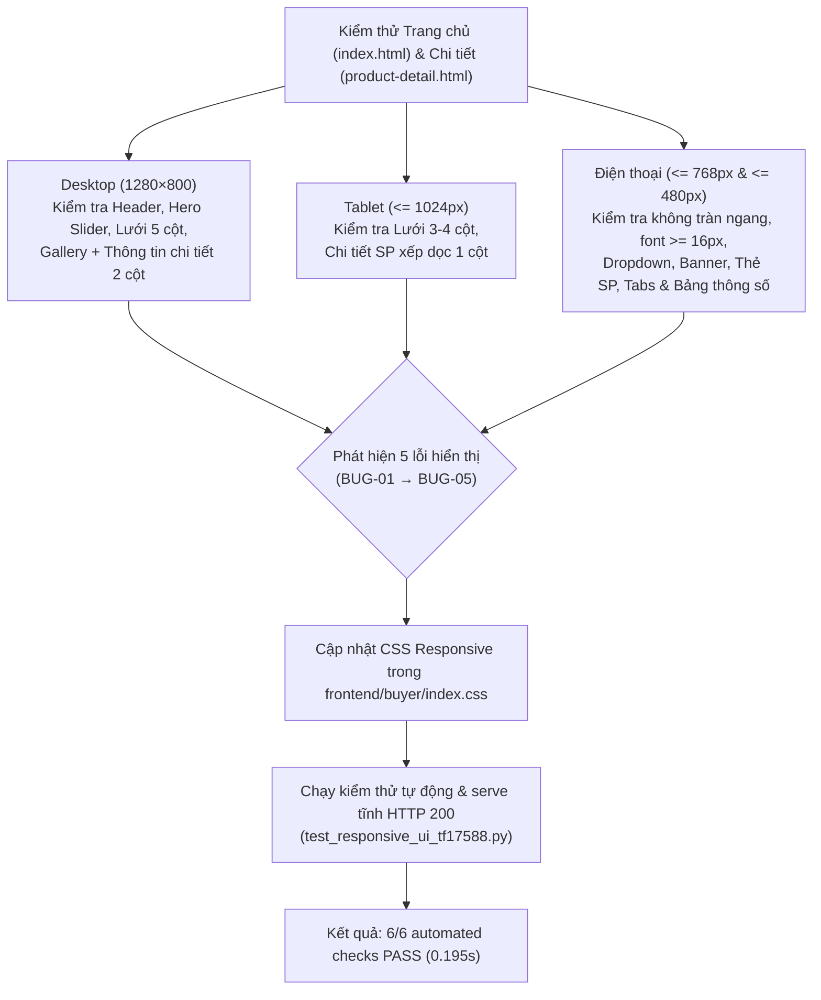

# Bảng Test Case & Ghi Nhận Sửa Lỗi Hiển Thị (Máy Tính & Điện Thoại)

**Mã task:** `TF17588`  
**Tên task:** `Test trang chủ và chi tiết trên máy tính và điện thoại; ghi và sửa lỗi hiển thị`  
**Sprint:** Sprint 3 · 24/11–30/11/2026  
**Hạn:** 24/11/2026  
**Người thực hiện:** Vũ Dũng (B25DTCN161)  
**Phạm vi kiểm thử:** `frontend/buyer/index.html`, `frontend/buyer/buyer-index.js`, `frontend/buyer/product-detail.html`, `frontend/buyer/product-detail.js`, `frontend/buyer/index.css`  
**File test tự động:** `backend/tests/test_responsive_ui_tf17588.py`  
**Lệnh chạy test:** `python -m unittest backend.tests.test_responsive_ui_tf17588 -v`

---

## 1. Sơ đồ luồng kiểm thử & sửa lỗi hiển thị Desktop / Mobile



---

## 2. Danh Sách Lỗi Hiển Thị Đã Phát Hiện & Sửa (`Bug Log`)

| Mã lỗi | Trang / Thành phần | Hiện tượng lỗi trước khi sửa | Nguyên nhân gốc trong CSS | Cách đã sửa trong `frontend/buyer/index.css` |
| :--- | :--- | :--- | :--- | :--- |
| **BUG-01** | Trang chủ (Mobile `<= 768px`) — `.main-slider`, `.slide`, `.side-banners` | Hero slider cao `380px`, `.slide` giữ `padding: 0 54px` và tiêu đề `34px` gây chật/cắt chữ trên `375px`; `.side-banners` giữ `flex-direction: row` từ `<= 1024px` khiến 2 banner phụ bị ép ngang trên điện thoại. | Thiếu media query thu gọn `.main-slider`, `.slide-title` và chưa chuyển `.side-banners` về `column` ở `<= 768px`. | Trong `@media (max-width: 768px)`: set `.main-slider { height: 300px; }`, `.slide { padding: 0 22px; }`, `.slide-title { font-size: 22px; }`, `.side-banners { flex-direction: column; gap: 12px; }`. |
| **BUG-02** | Header & Dropdown (Mobile `<= 768px`) — `.cart-dropdown`, `.search-keywords`, `.search-input` | `.cart-dropdown` đặt `right: -50px` làm dropdown tài khoản/giỏ hàng bị đẩy ra ngoài mép phải màn hình 50px; `.search-keywords` không xuống dòng; `.search-input` dùng `14px` dễ gây auto-zoom iOS. | Thiếu `right: 0`, thiếu `flex-wrap: wrap` cho `.search-keywords`, và `font-size < 16px` cho ô input tìm kiếm. | Đặt `.cart-dropdown { width: min(340px, calc(100vw - 24px)); right: 0; }`, `.search-keywords { flex-wrap: wrap; }`, `.search-input { font-size: 16px; }`. |
| **BUG-03** | Trang chủ (Desktop/Mobile) — `.section-title-wrap`, `.flash-sale-wrapper`, `.price-row` | Tiêu đề mục dài và link `Xem Tất Cả →` dễ ép sát trên màn hình hẹp; thẻ sản phẩm 2 cột trên `360–375px` dễ tràn ngang khi giá lớn (`26.990.000 ₫` + giá gốc). | `.section-title-wrap` và `.price-row` thiếu `flex-wrap: wrap`; padding flash sale và gap lưới chưa thu gọn cho mobile. | Thêm `flex-wrap: wrap` cho `.section-title-wrap` và `.price-row`; thu gọn `.flash-sale-wrapper` (`padding: 16px 14px`), `gap: 10px` và `.current-price { font-size: 15px; }` ở `<= 768px`. |
| **BUG-04** | Trang chi tiết (Mobile `<= 768px`) — Breadcrumb, Giá, Tabs, Bảng thông số | `.breadcrumb-current` `max-width: 380px` vượt chiều rộng `375px`; `.detail-meta-row` thiếu `flex-wrap` khi kèm badge tồn kho; `.detail-product-title` (`26px`) & `.detail-current-price` (`32px`) quá to; `.spec-table td.spec-key` `28%` quá hẹp. | Thiếu `flex-wrap` và các rule thu gọn kích thước cho màn hình `<= 768px`. | Thêm `flex-wrap: wrap` cho `.breadcrumb-trail`, `.detail-meta-row`, `.detail-mall-badge`, `.price-header`; set `.detail-product-title { font-size: 20px }`, `.detail-current-price { font-size: 24px }`, `.detail-tabs-section { padding: 18px 16px }`, `.spec-table td.spec-key { width: 40% }`. |
| **BUG-05** | Màn hình nhỏ (`<= 480px`) & chung — `.trust-features-grid`, `.gallery-zoom-hint`, tràn ngang | Lưới cam kết 2 cột (`1fr 1fr`) bị chật trên `360–480px`; nhãn `"🔍 Bấm ảnh để phóng to"` có thể chạm nhãn góc chụp ở góc dưới ảnh chính. | Thiếu breakpoint `@media (max-width: 480px)` và quy tắc `max-width: 100%` cho `html, body, img`. | Bổ sung `html, body { max-width: 100%; overflow-x: hidden; }`, `img { max-width: 100%; }`, và ở `<= 480px` chuyển `.trust-features-grid` thành `1fr` và ẩn `.gallery-zoom-hint`. |

---

## 3. Bảng Test Case Hiển Thị Máy Tính & Điện Thoại

| Mã TC | Thiết bị / Viewport | Trang | Nội dung kiểm tra | Kết quả kỳ vọng | Kết quả thực tế | Trạng thái |
| :--- | :--- | :--- | :--- | :--- | :--- | :--- |
| **TC-01** | Desktop (`1280×800`) | Trang chủ | Header, thanh tìm kiếm, hero slider + 2 banner phụ (`2.2fr 1fr`) | Căn giữa `.container` (`1240px`), slider + 2 side banner cân đối | Đạt chuẩn cấu trúc lưới `2.2fr 1fr` và hiển thị HTTP 200 | **PASS** |
| **TC-02** | Desktop (`1280×800`) | Trang chủ | Lưới danh mục (`8` cột), Flash Sale & Sản phẩm nổi bật/mới nhất (`5` cột) | Thẻ sản phẩm đều chiều cao, giá & nút giỏ hàng thẳng hàng | Đạt chuẩn lưới `repeat(8, 1fr)` / `repeat(5, 1fr)` | **PASS** |
| **TC-03** | Desktop (`1280×800`) | Chi tiết SP | Bố cục 2 cột (`1.15fr 1.35fr`): thư viện ảnh sticky + khối giá, tồn kho, số lượng, nút giỏ | Ảnh vuông sắc nét, thumbnail 4 cột, giá/tồn kho/nút rõ ràng | Đạt chuẩn `1.15fr 1.35fr`, `sticky` gallery, đủ chức năng | **PASS** |
| **TC-04** | Desktop (`1280×800`) | Chi tiết SP | Khối tổng quan đánh giá 2 cột (`220px 1fr`), form gửi đánh giá & 4 thẻ SP cùng danh mục | Thanh tiến độ 5★→1★ cân đối, SP liên quan hiển thị 4–5 cột | Đạt chuẩn `.reviews-summary-box` `220px 1fr` | **PASS** |
| **TC-05** | Tablet (`1024px`) | Trang chủ & Chi tiết | Chuyển lưới 3 cột sản phẩm, 4 cột danh mục, chi tiết SP xếp dọc `1fr` | Không chồng chéo khi thu hẹp cửa sổ | Đạt chuẩn tại `@media (max-width: 1024px)` | **PASS** |
| **TC-06** | Mobile (`375×812`) | Trang chủ | Header & ô tìm kiếm xuống dòng, font input `16px`, dropdown không lệch mép | Không auto-zoom iOS, `.cart-dropdown` `right: 0` gọn trong màn hình | Đã sửa **BUG-02** và xác nhận trong test CSS | **PASS** |
| **TC-07** | Mobile (`375×812`) | Trang chủ | Hero slider (`300px`, `padding: 0 22px`) & 2 side banners xếp dọc `column` | Tiêu đề đọc rõ, không đè mũi tên, 2 side banners không bị ép ngang | Đã sửa **BUG-01** và xác nhận trong test CSS | **PASS** |
| **TC-08** | Mobile (`375×812`) | Trang chủ | Lưới danh mục 2 cột, Flash Sale & Gợi ý hôm nay 2 cột, `.price-row` wrap | Không tràn giá tiền, tổng chiều rộng không vượt `100%` | Đã sửa **BUG-03** & **BUG-05** | **PASS** |
| **TC-09** | Mobile (`375×812`) | Chi tiết SP | Breadcrumb, tiêu đề (`20px`), giá (`24px`), meta rating + badge tồn kho `flex-wrap` | Không tràn ngang, nút Thêm vào giỏ & Mua ngay xếp dọc full-width | Đã sửa **BUG-04** và xác nhận trong test CSS | **PASS** |
| **TC-10** | Mobile (`375×812`) | Chi tiết SP | Khu vực đánh giá (`.reviews-summary-box` xếp 1 cột) & bảng thông số (`40%`) | Điểm trung bình nằm trên thanh sao, thông số không bị ép cột | Đạt chuẩn tại `@media (max-width: 768px)` | **PASS** |
| **TC-11** | Mobile nhỏ (`360×740` / `<= 480px`) | Chi tiết SP | Khối cam kết `.trust-features-grid` chuyển 1 cột & ẩn `.gallery-zoom-hint` | Các mục cam kết dễ đọc, không đụng nhãn góc ảnh | Đã sửa **BUG-05** tại `@media (max-width: 480px)` | **PASS** |
| **TC-12** | Local Server | Cả 2 trang | Chạy kiểm thử tự động `test_responsive_ui_tf17588.py` & HTTP serve tĩnh `200` | Toàn bộ 6 test case tự động đạt `OK` | `Ran 6 tests in 0.195s` → **OK (6/6 PASS)** | **PASS** |

---

## 4. Kết Quả Chạy Kiểm Thử Tự Động

```text
python -m unittest backend.tests.test_responsive_ui_tf17588 -v
test_01_viewport_meta_and_stylesheets_present ... ok
test_02_no_horizontal_overflow_and_desktop_grids ... ok
test_03_mobile_banner_and_header_dropdown_fixes ... ok
test_04_mobile_detail_page_and_480px_fixes ... ok
test_05_required_homepage_and_detail_sections_exist ... ok
test_06_static_http_serving_200 ... ok

----------------------------------------------------------------------
Ran 6 tests in 0.195s

OK
```
