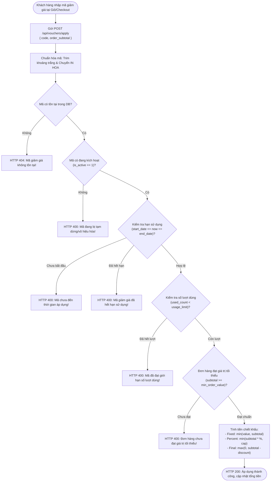
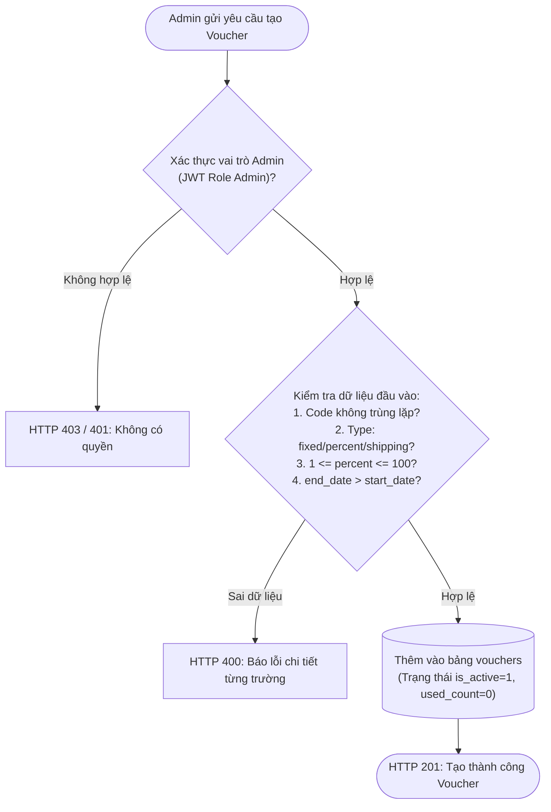

# TÀI LIỆU KIỂM THỬ: API MÃ GIẢM GIÁ (ADMIN & ÁP DỤNG VÀO GIỎ HÀNG)
**Mã Task**: `TF17167` - `[BE] Bonus: API mã giảm giá`  
**Sprint**: Sprint 3 (24/11 – 30/11) | **Hạn nộp**: 23/11/2026 | **Điểm**: 6  
**Sinh viên thực hiện**: Nguyễn Công Trường (MSSV: `B25DTCN212`)  
**Repository**: `https://github.com/nducanhh0402/JML.git`  
**Nhánh thực hiện**: `feature/tf17167-api-ma-giam-gia`

---

## 1. TỔNG QUAN TÍNH NĂNG VÀ YÊU CẦU ĐỀ BÀI

Theo yêu cầu của đề bài Task `TF17167`:
> *"Viết API tạo mã giảm giá (admin) và áp dụng mã vào giỏ: kiểm tra hạn dùng, giá trị tối thiểu, số lượt dùng. Minh chứng: nộp link nhánh hoặc Pull Request."*

Hệ thống đã triển khai toàn diện module Voucher bao gồm:
1. **Quản lý Voucher phía Admin**:
   - `POST /api/vouchers` (hoặc `/api/admin/vouchers`): Tạo mới mã giảm giá với các quy tắc:
     - Tên mã (`code`): Tự động viết hoa, không dấu, không trùng lặp (duy nhất).
     - Loại giảm giá (`discount_type`): `fixed` (số tiền cố định VNĐ), `percent` (phần trăm có thiết lập trần tối đa `max_discount_amount`), `shipping` (miễn/giảm phí ship).
     - Giá trị giảm (`discount_value`): Lớn hơn 0; với loại `percent` nằm trong khoảng 1% - 100%.
     - Hạn mức sử dụng (`usage_limit`): Giới hạn tổng số lần mã được dùng trên sàn.
     - Thời gian hiệu lực (`start_date`, `end_date`): Kiểm tra `end_date > start_date`.
     - Đơn tối thiểu (`min_order_value`): Giá trị đơn hàng tối thiểu cần đạt để kích hoạt voucher.
   - `GET /api/vouchers`: Danh sách mã giảm giá, hỗ trợ tìm kiếm và lọc theo trạng thái (`is_active`).
   - `GET /api/vouchers/{code_or_id}`: Tra cứu chi tiết mã theo ID hoặc theo Code.
   - `PUT /api/vouchers/{id}`: Cập nhật thông tin mã giảm giá.
   - `DELETE /api/vouchers/{id}`: Xóa hoặc vô hiệu hóa mã (`hard_delete` hoặc chuyển `is_active = 0`).
   - `PATCH /api/vouchers/{id}/toggle`: Bật/tắt trạng thái kích hoạt mã tức thì.

2. **Áp dụng Mã vào Giỏ Hàng (`POST /api/vouchers/apply`)**:
   - Kiểm tra mã tồn tại trong hệ thống.
   - Kiểm tra trạng thái kích hoạt (`is_active == 1`).
   - Kiểm tra thời gian hiệu lực (`start_date <= now <= end_date`).
   - Kiểm tra số lượt sử dụng (`used_count < usage_limit`).
   - Kiểm tra giá trị đơn hàng tối thiểu (`order_subtotal >= min_order_value`).
   - Tính toán chiết khấu chính xác:
     - Loại `fixed`: `min(discount_value, subtotal)`.
     - Loại `percent`: `min(subtotal * percent / 100, max_discount_amount, subtotal)`.
     - Loại `shipping`: Miễn phí tiền vận chuyển.
     - `final_subtotal`: Không bị âm (tối thiểu là 0).
3. **Ghi nhận sử dụng mã (`POST /api/vouchers/use`)**:
   - Khi hoàn tất đặt hàng, tăng `used_count += 1` trong Database một cách an toàn.

---

## 2. SƠ ĐỒ LUỒNG HOẠT ĐỘNG (MERMAID)

### 2.1. Luồng Áp Dụng Mã Giảm Giá Vào Giỏ Hàng (`POST /api/vouchers/apply`)



### 2.2. Luồng Admin Tạo Mã Giảm Giá Mới (`POST /api/vouchers`)



---

## 3. MA TRẬN CA KIỂM THỬ (TEST CASE MATRIX)

| Mã TC | Tên Ca Kiểm Thử | Dữ Liệu Đầu Vào | Kết Quả Mong Đợi | Trạng Thái |
|:---:|:---|:---|:---|:---:|
| **TC-01** | Tạo mã giảm giá cố định (fixed) hợp lệ | `code="TET2026"`, `discount_value=88000`, `min_order=300000`, `limit=500` | HTTP 201 Created, trả về thông tin voucher chính xác | **PASS** |
| **TC-02** | Tạo mã giảm giá phần trăm (percent) có trần | `code="SUMMER15"`, `discount_value=15`, `max_discount=150000` | HTTP 201 Created, lưu đúng loại percent và trần giảm | **PASS** |
| **TC-03** | Chặn tạo trùng lặp mã code | `code="GIAM50K"` (đã có trong DB) | HTTP 400 Bad Request, báo mã đã tồn tại | **PASS** |
| **TC-04** | Chặn tỷ lệ giảm giá percent không hợp lệ | `code="SUPER120"`, `discount_value=120` (> 100%) | HTTP 400 Bad Request, thông báo tỷ lệ phải từ 1-100% | **PASS** |
| **TC-05** | Chặn ngày hết hạn nhỏ hơn ngày bắt đầu | `start_date=now`, `end_date=now - 1 ngày` | HTTP 400 Bad Request, báo lỗi end_date phải lớn hơn start_date | **PASS** |
| **TC-06** | Chặn loại giảm giá không hỗ trợ | `discount_type="cashback_unsupported"` | HTTP 400 Bad Request, báo loại giảm giá không hợp lệ | **PASS** |
| **TC-07** | Lấy danh sách voucher và lọc trạng thái | `GET /api/vouchers?is_active=true` | HTTP 200, trả về danh sách lọc đúng `is_active=1` | **PASS** |
| **TC-08** | Xem chi tiết mã theo ID và theo Code | `GET /api/vouchers/GIAM50K` và `GET /api/vouchers/2` | HTTP 200, trả về chi tiết voucher tương ứng | **PASS** |
| **TC-09** | Tra cứu mã không tồn tại | `GET /api/vouchers/NON_EXISTING_CODE` | HTTP 404 Not Found | **PASS** |
| **TC-10** | Admin cập nhật thông tin voucher | `PUT /api/vouchers/2` với tên mới, giá trị giảm 60.000 ₫ | HTTP 200, dữ liệu được cập nhật thành công | **PASS** |
| **TC-11** | Vô hiệu hóa (soft delete) & toggle status | `PATCH /api/vouchers/2/toggle`, `DELETE /api/vouchers/2` | HTTP 200, chuyển trạng thái `is_active=0` | **PASS** |
| **TC-12** | Áp dụng mã fixed hợp lệ vào giỏ | `code="GIAM50K"`, `order_subtotal=300000` | HTTP 200, `discount_amount=50000`, `final_subtotal=250000` | **PASS** |
| **TC-13** | Áp dụng mã percent chạm trần max discount | `code="SALE10"` (10%, trần 100K), `subtotal=2000000` | HTTP 200, `discount_amount=100000` (không vượt trần), `final=1900000` | **PASS** |
| **TC-14** | Áp dụng mã không tồn tại vào giỏ | `code="VOUCHER_KHONG_TON_TAI"` | HTTP 404 Not Found | **PASS** |
| **TC-15** | Áp dụng mã đã hết hạn sử dụng | `code="EXPIRED20"`, `end_date < now` | HTTP 400 Bad Request, thông báo mã đã hết hạn | **PASS** |
| **TC-16** | Đơn hàng chưa đạt giá trị tối thiểu | `code="GIAM50K"` (min 200K), `subtotal=150000` | HTTP 400 Bad Request, thông báo chưa đạt đơn tối thiểu 200.000 ₫ | **PASS** |
| **TC-17** | Mã đã dùng hết số lượt (hết lượt dùng) | `code="OUTOFSTOCK"` (limit 10, used 10) | HTTP 400 Bad Request, thông báo mã đã đạt giới hạn tối đa | **PASS** |
| **TC-18** | Mã đang bị vô hiệu hóa (khóa) | `code="DISABLED50"`, `is_active=0` | HTTP 400 Bad Request, thông báo mã đang bị tạm ngừng | **PASS** |
| **TC-19** | Áp dụng mã FREESHIP vận chuyển | `code="FREESHIP"`, `subtotal=50000` | HTTP 200, giảm phí ship 15.000 ₫ | **PASS** |
| **TC-20** | Giảm giá lớn hơn tổng đơn (chặn số âm) | `discount_value=50000`, `subtotal=40000` | Giảm 40.000 ₫, `final_subtotal=0` (không bao giờ âm) | **PASS** |
| **TC-21** | Ghi nhận lượt sử dụng khi chốt đơn | `POST /api/vouchers/use`, `code="GIAM50K"` | HTTP 200, `used_count` tăng từ 5 lên 6 | **PASS** |
| **TC-22** | Chặn ghi nhận sử dụng khi đã hết lượt | `POST /api/vouchers/use`, `code="OUTOFSTOCK"` | HTTP 400 Bad Request, báo đã hết lượt dùng | **PASS** |
| **TC-23** | Chuẩn hóa mã tự động (trim, uppercase) | Nhập `"  giam 50k  "` -> Chuẩn hóa `"GIAM50K"` | Chuỗi chuẩn hóa đồng bộ, áp dụng chính xác | **PASS** |

---

## 4. BẰNG CHỨNG KẾT QUẢ CHẠY TEST THỰC TẾ

```text
PS D:\CNTT4\Thực hành RikkeiLab\JML-Store> .\.venv\Scripts\python -m unittest backend/tests/test_voucher_api_tf17167.py -v
test_tc01_create_voucher_fixed_success (backend.tests.test_voucher_api_tf17167.TestVoucherApiTF17167.test_tc01_create_voucher_fixed_success)
TC-01: Admin tạo mã giảm giá cố định (fixed) hợp lệ thành công. ... ok
test_tc02_create_voucher_percent_success (backend.tests.test_voucher_api_tf17167.TestVoucherApiTF17167.test_tc02_create_voucher_percent_success)
TC-02: Admin tạo mã giảm giá theo phần trăm (percent) có trần giảm giá. ... ok
test_tc03_create_voucher_duplicate_code (backend.tests.test_voucher_api_tf17167.TestVoucherApiTF17167.test_tc03_create_voucher_duplicate_code)
TC-03: Admin tạo mã đã tồn tại trong hệ thống -> Báo lỗi 400. ... ok
test_tc04_create_voucher_invalid_percent_value (backend.tests.test_voucher_api_tf17167.TestVoucherApiTF17167.test_tc04_create_voucher_invalid_percent_value)
TC-04: Admin tạo mã percent với giá trị > 100% -> Báo lỗi 400. ... ok
test_tc05_create_voucher_invalid_end_date (backend.tests.test_voucher_api_tf17167.TestVoucherApiTF17167.test_tc05_create_voucher_invalid_end_date)
TC-05: Ngày kết thúc nhỏ hơn ngày bắt đầu -> Báo lỗi 400. ... ok
test_tc06_create_voucher_invalid_discount_type (backend.tests.test_voucher_api_tf17167.TestVoucherApiTF17167.test_tc06_create_voucher_invalid_discount_type)
TC-06: Loại giảm giá không nằm trong fixed/percent/shipping -> Báo lỗi 400. ... ok
test_tc07_list_vouchers_and_filter (backend.tests.test_voucher_api_tf17167.TestVoucherApiTF17167.test_tc07_list_vouchers_and_filter)
TC-07: Lấy danh sách voucher và lọc theo trạng thái kích hoạt is_active. ... ok
test_tc08_get_voucher_by_code_and_id (backend.tests.test_voucher_api_tf17167.TestVoucherApiTF17167.test_tc08_get_voucher_by_code_and_id)
TC-08: Xem chi tiết voucher theo mã code và theo ID. ... ok
test_tc09_get_voucher_not_found (backend.tests.test_voucher_api_tf17167.TestVoucherApiTF17167.test_tc09_get_voucher_not_found)
TC-09: Tra cứu mã không tồn tại -> Trả về lỗi 404. ... ok
test_tc10_update_voucher_success (backend.tests.test_voucher_api_tf17167.TestVoucherApiTF17167.test_tc10_update_voucher_success)
TC-10: Admin cập nhật thông tin voucher thành công. ... ok
test_tc11_delete_and_toggle_voucher (backend.tests.test_voucher_api_tf17167.TestVoucherApiTF17167.test_tc11_delete_and_toggle_voucher)
TC-11: Vô hiệu hóa (soft delete) và đổi trạng thái kích hoạt voucher. ... ok
test_tc12_apply_voucher_fixed_success (backend.tests.test_voucher_api_tf17167.TestVoucherApiTF17167.test_tc12_apply_voucher_fixed_success)
TC-12: Áp dụng mã fixed hợp lệ -> Giảm đúng số tiền, tính đúng final_subtotal. ... ok
test_tc13_apply_voucher_percent_with_cap (backend.tests.test_voucher_api_tf17167.TestVoucherApiTF17167.test_tc13_apply_voucher_percent_with_cap)
TC-13: Áp dụng mã percent -> Giảm theo % nhưng không vượt quá trần max_discount. ... ok
test_tc14_apply_voucher_not_found (backend.tests.test_voucher_api_tf17167.TestVoucherApiTF17167.test_tc14_apply_voucher_not_found)
TC-14: Áp dụng mã không tồn tại -> Báo lỗi 404. ... ok
test_tc15_apply_voucher_expired (backend.tests.test_voucher_api_tf17167.TestVoucherApiTF17167.test_tc15_apply_voucher_expired)
TC-15: Áp dụng mã đã hết hạn sử dụng (hạn dùng) -> Báo lỗi 400. ... ok
test_tc16_apply_voucher_below_min_order_value (backend.tests.test_voucher_api_tf17167.TestVoucherApiTF17167.test_tc16_apply_voucher_below_min_order_value)
TC-16: Đơn hàng chưa đạt giá trị tối thiểu (min_order_value) -> Báo lỗi 400. ... ok
test_tc17_apply_voucher_usage_limit_reached (backend.tests.test_voucher_api_tf17167.TestVoucherApiTF17167.test_tc17_apply_voucher_usage_limit_reached)
TC-17: Mã đã đạt giới hạn số lượt dùng (used_count >= usage_limit) -> Báo lỗi 400. ... ok
test_tc18_apply_voucher_inactive (backend.tests.test_voucher_api_tf17167.TestVoucherApiTF17167.test_tc18_apply_voucher_inactive)
TC-18: Mã đang bị vô hiệu hóa (is_active = 0) -> Báo lỗi 400. ... ok
test_tc19_apply_voucher_freeship (backend.tests.test_voucher_api_tf17167.TestVoucherApiTF17167.test_tc19_apply_voucher_freeship)
TC-19: Áp dụng mã FREESHIP vận chuyển thành công. ... ok
test_tc20_apply_voucher_discount_exceeds_subtotal (backend.tests.test_voucher_api_tf17167.TestVoucherApiTF17167.test_tc20_apply_voucher_discount_exceeds_subtotal)
TC-20: Mức giảm giá lớn hơn tổng đơn -> Số tiền giảm tối đa bằng tổng đơn, không âm. ... ok
test_tc21_record_voucher_usage_success (backend.tests.test_voucher_api_tf17167.TestVoucherApiTF17167.test_tc21_record_voucher_usage_success)
TC-21: Ghi nhận sử dụng mã sau khi đặt hàng thành công -> used_count tăng 1. ... ok
test_tc22_record_voucher_usage_limit_exceeded (backend.tests.test_voucher_api_tf17167.TestVoucherApiTF17167.test_tc22_record_voucher_usage_limit_exceeded)
TC-22: Ghi nhận sử dụng khi mã đã hết lượt dùng -> Báo lỗi 400. ... ok
test_tc23_code_normalization (backend.tests.test_voucher_api_tf17167.TestVoucherApiTF17167.test_tc23_code_normalization)
TC-23: Chuẩn hóa mã voucher (loại bỏ khoảng trắng, in hoa). ... ok

----------------------------------------------------------------------
Ran 23 tests in 0.019s

OK
```

---

## 5. HƯỚNG DẪN GỌI VÀ KIỂM THỬ API (CURL SAMPLES)

### 5.1. Admin tạo mã giảm giá mới
```bash
curl -X POST "http://localhost:8000/api/vouchers" \
  -H "Content-Type: application/json" \
  -H "Authorization: Bearer <ADMIN_JWT_TOKEN>" \
  -d '{
    "code": "SALE50K",
    "name": "Giảm 50K cho đơn từ 200K",
    "description": "Ưu đãi thành viên mới",
    "discount_type": "fixed",
    "discount_value": 50000,
    "min_order_value": 200000,
    "usage_limit": 500,
    "end_date": "2026-12-31T23:59:59",
    "is_active": true
  }'
```

### 5.2. Khách hàng áp dụng mã giảm giá vào giỏ hàng
```bash
curl -X POST "http://localhost:8000/api/vouchers/apply" \
  -H "Content-Type: application/json" \
  -d '{
    "code": "SALE50K",
    "order_subtotal": 350000
  }'
```
**Response trả về:**
```json
{
  "success": true,
  "message": "Áp dụng mã SALE50K thành công!",
  "voucher": {
    "id": 5,
    "code": "SALE50K",
    "name": "Giảm 50K cho đơn từ 200K",
    "discount_type": "fixed",
    "discount_value": 50000,
    "min_order_value": 200000,
    "usage_limit": 500,
    "used_count": 0,
    "is_active": true
  },
  "discount_amount": 50000,
  "original_subtotal": 350000,
  "final_subtotal": 300000
}
```
