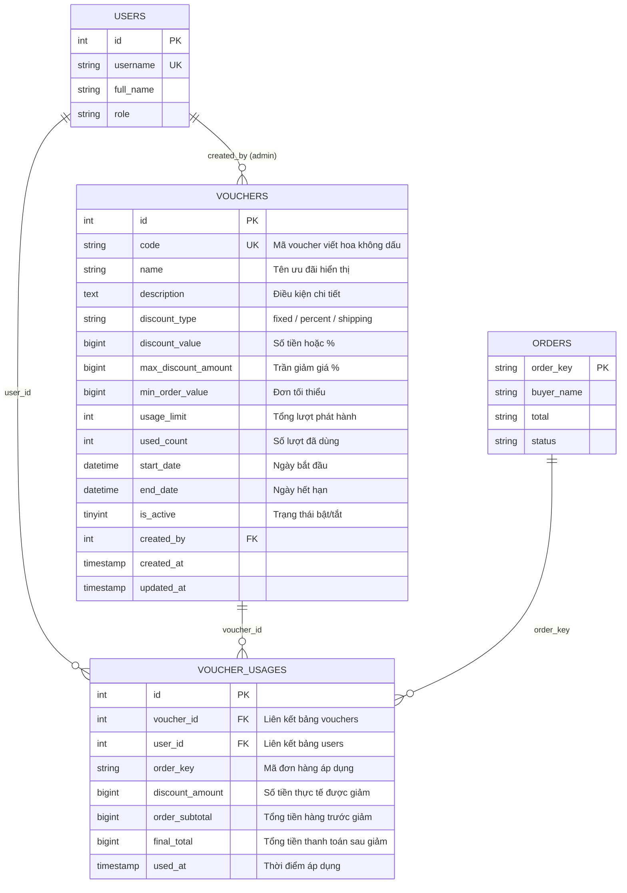

# TÀI LIỆU KIỂM THỬ: BẢNG VOUCHERS, VOUCHER_USAGES VÀ DỮ LIỆU MẪU (DATABASE)
**Mã Task**: `TF1728C` - `[DB] Bảng vouchers, voucher_usages và dữ liệu mẫu`  
**Sprint**: Sprint 4 (01/12 – 07/12) | **Hạn nộp**: 25/11/2026 | **Điểm**: 7  
**Sinh viên thực hiện**: Nguyễn Công Trường (MSSV: `B25DTCN212`)  
**Repository**: `https://github.com/nducanhh0402/JML.git`  
**Nhánh thực hiện**: `feature/tf1728c-bang-vouchers-voucher-usages`

---

## 1. YÊU CẦU ĐỀ BÀI VÀ THIẾT KẾ CƠ SỞ DỮ LIỆU

Theo mô tả đề bài Task `TF1728C`:
> *"Viết CREATE TABLE mã giảm giá và lịch sử sử dụng, thêm một số mã mẫu. Minh chứng: nộp link hoặc file (ảnh chụp, bảng test case, sơ đồ)."*

Hệ thống đã triển khai thiết kế chuẩn cơ sở dữ liệu quan hệ (RDBMS) gồm 2 bảng:
1. **`vouchers`**: Lưu danh mục mã giảm giá/ưu đãi được phát hành trên sàn JML Store.
2. **`voucher_usages`**: Lưu lịch sử từng lần khách hàng áp dụng voucher thành công vào đơn hàng, hỗ trợ đối soát kế toán và phân tích hiệu quả chiến dịch.

---

## 2. SƠ ĐỒ MỐI QUAN HỆ THỰC THỂ (ER DIAGRAM)



---

## 3. ĐẶC TẢ CHI TIẾT CẤU TRÚC BẢNG

### 3.1. Bảng `vouchers` (Mã giảm giá)

| Tên Cột | Kiểu Dữ Liệu | Ràng Buộc | Ý Nghĩa Nghiệp Vụ |
|:---|:---|:---|:---|
| `id` | INT | PRIMARY KEY, AUTO_INCREMENT | Mã định danh duy nhất của voucher |
| `code` | VARCHAR(50) | NOT NULL, UNIQUE | Mã voucher nhập liệu (VD: `FREESHIP`, `JML50K`) |
| `name` | VARCHAR(150) | NOT NULL DEFAULT '' | Tiêu đề hiển thị ngắn gọn |
| `description` | TEXT | NULL | Mô tả chi tiết thể lệ chương trình |
| `discount_type` | VARCHAR(20) | NOT NULL DEFAULT 'fixed' | Phân loại: `fixed` (tiền cố định), `percent` (phần trăm), `shipping` (vận chuyển) |
| `discount_value` | BIGINT | NOT NULL DEFAULT 0 | Giá trị giảm trừ (VNĐ hoặc %) |
| `max_discount_amount` | BIGINT | NULL | Số tiền giảm tối đa (với loại percent) |
| `min_order_value` | BIGINT | NOT NULL DEFAULT 0 | Giá trị đơn hàng tối thiểu cần đạt để kích hoạt |
| `usage_limit` | INT | NOT NULL DEFAULT 100 | Số lượt sử dụng tối đa trên toàn sàn |
| `used_count` | INT | NOT NULL DEFAULT 0 | Số lượt thực tế khách hàng đã sử dụng |
| `start_date` | DATETIME | NOT NULL DEFAULT CURRENT_TIMESTAMP | Ngày bắt đầu có hiệu lực |
| `end_date` | DATETIME | NOT NULL | Ngày hết hạn |
| `is_active` | TINYINT(1) | NOT NULL DEFAULT 1 | 1: Hoạt động, 0: Vô hiệu hóa |
| `created_by` | INT | NULL, FK users(id) | Admin tạo mã (xóa user -> SET NULL) |
| `created_at` | TIMESTAMP | DEFAULT CURRENT_TIMESTAMP | Thời điểm tạo bản ghi |
| `updated_at` | TIMESTAMP | ON UPDATE CURRENT_TIMESTAMP | Thời điểm cập nhật cuối cùng |

**Indexes**:
- `idx_vouchers_code` (`code`): Tăng tốc tra cứu mã tức thì khi khách hàng nhập mã.
- `idx_vouchers_active_dates` (`is_active`, `start_date`, `end_date`): Tối ưu truy vấn kiểm tra điều kiện hiệu lực.

---

### 3.2. Bảng `voucher_usages` (Lịch sử sử dụng)

| Tên Cột | Kiểu Dữ Liệu | Ràng Buộc | Ý Nghĩa Nghiệp Vụ |
|:---|:---|:---|:---|
| `id` | INT | PRIMARY KEY, AUTO_INCREMENT | Mã bản ghi lịch sử |
| `voucher_id` | INT | NOT NULL, FK vouchers(id) | Mã voucher được dùng (Xóa voucher -> xóa lịch sử) |
| `user_id` | INT | NOT NULL, FK users(id) | Khách hàng áp dụng mã |
| `order_key` | VARCHAR(50) | NULL | Mã đơn hàng phát sinh chiết khấu |
| `discount_amount` | BIGINT | NOT NULL DEFAULT 0 | Số tiền thực tế được trừ vào đơn hàng (VNĐ) |
| `order_subtotal` | BIGINT | NOT NULL DEFAULT 0 | Giá trị hàng tạm tính trước giảm |
| `final_total` | BIGINT | NOT NULL DEFAULT 0 | Giá trị khách phải thanh toán sau khi trừ voucher |
| `used_at` | TIMESTAMP | DEFAULT CURRENT_TIMESTAMP | Thời điểm khách hàng chốt đơn với voucher |

**Indexes**:
- `idx_usages_voucher` (`voucher_id`): Thống kê lượt sử dụng theo voucher.
- `idx_usages_user` (`user_id`): Tra cứu lịch sử dùng mã của từng khách hàng.
- `idx_usages_order` (`order_key`): Đối soát đơn hàng và chiết khấu.
- `idx_usages_user_voucher` (`user_id`, `voucher_id`): Kiểm tra giới hạn số lần 1 user được dùng 1 mã.

---

## 4. DỮ LIỆU MẪU ĐÃ KHỞI TẠO (SEED DATA)

### 4.1. Danh mục Voucher Mẫu

| ID | Mã Code | Tên Ưu Đãi | Loại Giảm | Giá Trị | Trần Giảm | Đơn Tối Thiểu | Giới Hạn | Đã Dùng | Trạng Thái |
|:---:|:---|:---|:---:|:---:|:---:|:---:|:---:|:---:|:---:|
| 1 | `FREESHIP` | Freeship Toàn Quốc | `shipping` | 15.000 ₫ | 30.000 ₫ | 0 ₫ | 1.000 | 15 | Hoạt động |
| 2 | `JML50K` | Giảm 50K cho đơn từ 200K | `fixed` | 50.000 ₫ | - | 200.000 ₫ | 500 | 8 | Hoạt động |
| 3 | `GIAM10` | Giảm 10% tối đa 100K | `percent` | 10% | 100.000 ₫ | 100.000 ₫ | 300 | 12 | Hoạt động |
| 4 | `VIP100K` | Vip 100K cho đơn từ 1M | `fixed` | 100.000 ₫ | - | 1.000.000 ₫ | 100 | 3 | Hoạt động |
| 5 | `CHAOXUAN2026` | Mừng Xuân 2026 Giảm 20% | `percent` | 20% | 200.000 ₫ | 300.000 ₫ | 200 | 0 | Hoạt động |
| 6 | `TRIAN50` | Tri Ân Khách Hàng | `fixed` | 50.000 ₫ | - | 150.000 ₫ | 250 | 5 | Hoạt động |
| 7 | `EXPIREDVOUCHER` | Voucher Hết Hạn Dùng | `fixed` | 20.000 ₫ | - | 50.000 ₫ | 100 | 20 | Hết hạn |
| 8 | `OUTOFSTOCKVOUCHER` | Voucher Hết Lượt Dùng | `fixed` | 30.000 ₫ | - | 100.000 ₫ | 10 | 10 | Hết lượt |

### 4.2. Lịch Sử Sử Dụng Mẫu (`voucher_usages`)

| ID | Voucher ID | Mã Code | User ID | Mã Đơn Hàng | Tiền Giảm | Tạm Tính | Thanh Toán |
|:---:|:---:|:---|:---:|:---|:---:|:---:|:---:|
| 1 | 1 | `FREESHIP` | 1 | `ORD-202611-001` | 15.000 ₫ | 185.000 ₫ | 170.000 ₫ |
| 2 | 2 | `JML50K` | 1 | `ORD-202611-002` | 50.000 ₫ | 350.000 ₫ | 300.000 ₫ |
| 3 | 3 | `GIAM10` | 1 | `ORD-202611-003` | 45.000 ₫ | 450.000 ₫ | 405.000 ₫ |

---

## 5. MA TRẬN CA KIỂM THỬ VÀ BẰNG CHỨNG (TEST EVIDENCE)

| Mã TC | Hạng mục kiểm thử | Tiêu chí đánh giá | Kết quả |
|:---:|:---|:---|:---:|
| **TC-01** | Kiểm tra file migration 008 | Tồn tại file SQL và chứa `CREATE TABLE` cho 2 bảng | **PASS** |
| **TC-02** | Ràng buộc cấu trúc bảng `vouchers` | Đầy đủ các trường, khóa chính, UNIQUE code | **PASS** |
| **TC-03** | Khóa ngoại bảng `voucher_usages` | Ràng buộc FOREIGN KEY với `vouchers(id)` và `users(id)` (CASCADE) | **PASS** |
| **TC-04** | Hệ thống chỉ mục (Index) | Có đủ 6 index tối ưu tra cứu cho cả 2 bảng | **PASS** |
| **TC-05** | Tính đa dạng dữ liệu mẫu voucher | Đủ các loại: fixed, percent, shipping, expired, out of stock | **PASS** |
| **TC-06** | Dữ liệu mẫu lịch sử `voucher_usages` | Nạp thành công các bản ghi liên kết mã đơn và tiền giảm | **PASS** |
| **TC-07** | Tích hợp vào `backend/database.py` | Hàm `init_db()` tự động tạo 2 bảng và index | **PASS** |
| **TC-08** | Seed dữ liệu tự động trong `database.py` | Hàm `seed_initial_data()` nạp mẫu khi CSDL trống | **PASS** |

### Kết quả chạy kiểm thử tự động:
```text
PS D:\CNTT4\Thực hành RikkeiLab\JML-Store> .\.venv\Scripts\python -m unittest backend/tests/test_vouchers_db_tf1728c.py -v
test_tc01_migration_file_exists_and_contains_tables (backend.tests.test_vouchers_db_tf1728c.TestVouchersDbTF1728C.test_tc01_migration_file_exists_and_contains_tables)
TC-01: File migration 008 tồn tại và chứa định nghĩa CREATE TABLE cho 2 bảng. ... ok
test_tc02_vouchers_table_columns_and_constraints (backend.tests.test_vouchers_db_tf1728c.TestVouchersDbTF1728C.test_tc02_vouchers_table_columns_and_constraints)
TC-02: Bảng vouchers có đầy đủ các trường cốt lõi và ràng buộc UNIQUE code. ... ok
test_tc03_voucher_usages_table_columns_and_foreign_keys (backend.tests.test_vouchers_db_tf1728c.TestVouchersDbTF1728C.test_tc03_voucher_usages_table_columns_and_foreign_keys)
TC-03: Bảng voucher_usages có đầy đủ các trường và khóa ngoại FOREIGN KEY. ... ok
test_tc04_database_indexes_present (backend.tests.test_vouchers_db_tf1728c.TestVouchersDbTF1728C.test_tc04_database_indexes_present)
TC-04: Kiểm tra đầy đủ các Index tối ưu hóa truy vấn trên cả 2 bảng. ... ok
test_tc05_seed_sample_vouchers_variety (backend.tests.test_vouchers_db_tf1728c.TestVouchersDbTF1728C.test_tc05_seed_sample_vouchers_variety)
TC-05: Dữ liệu mẫu chứa đa dạng các loại voucher: fixed, percent, shipping, expired. ... ok
test_tc06_seed_sample_usages_records (backend.tests.test_vouchers_db_tf1728c.TestVouchersDbTF1728C.test_tc06_seed_sample_usages_records)
TC-06: Dữ liệu mẫu chứa lịch sử sử dụng voucher_usages liên kết đơn hàng. ... ok
test_tc07_database_py_table_and_indexes_registered (backend.tests.test_vouchers_db_tf1728c.TestVouchersDbTF1728C.test_tc07_database_py_table_and_indexes_registered)
TC-07: File backend/database.py đã tích hợp tạo bảng vouchers và voucher_usages. ... ok
test_tc08_database_py_seed_data_registered (backend.tests.test_vouchers_db_tf1728c.TestVouchersDbTF1728C.test_tc08_database_py_seed_data_registered)
TC-08: File backend/database.py đã tích hợp seed dữ liệu mẫu trong seed_initial_data(). ... ok

----------------------------------------------------------------------
Ran 8 tests in 0.004s

OK
```
