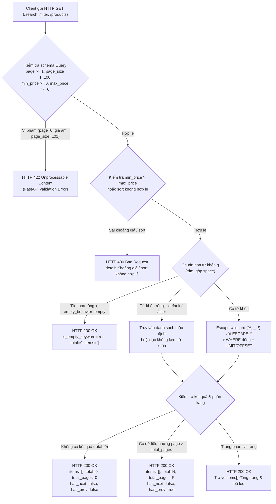

# MINH CHỨNG KIỂM THỬ — TF16E89: Test API Tìm Kiếm và Lọc Sản Phẩm

- **Mã task:** `TF16E89`
- **Hạng mục:** `[Kiểm thử] Test API tìm kiếm và lọc`
- **Người thực hiện:** Trịnh Quốc Trung (B25DTCN263)
- **Ngày kiểm thử:** 19/11/2026
- **Đối tượng kiểm thử:** Module Product API (`backend/src/modules/product/router.py`):
  - `GET /api/products/search`
  - `GET /api/products/filter`
  - `GET /api/products`
- **Tệp test tự động:** [`backend/tests/test_search_and_filter_api_tf16e89.py`](../backend/tests/test_search_and_filter_api_tf16e89.py)

---

## 1. Sơ đồ luồng kiểm thử & Xử lý các trường hợp biên (Edge Cases)



---

## 2. Bảng Test Case & Kết quả ghi nhận thực tế (18/18 PASS)

> Hệ thống kiểm thử khởi chạy máy chủ FastAPI + Uvicorn kết nối trực tiếp MySQL `jml_marketplace` (dữ liệu thực tế: **95** sản phẩm đã duyệt, **22** sản phẩm thương hiệu `Apple`) và gọi qua HTTP thật.

| Mã TC | Nhóm kiểm thử | Endpoint & Tham số gửi lên | Kỳ vọng (Expected) | Kết quả thực tế ghi nhận (Actual) | Trạng thái |
| :--- | :--- | :--- | :--- | :--- | :--- |
| **TC-01** | Từ khóa rỗng | `GET /api/products/search?q=&page_size=10` (`empty_behavior=default`) | HTTP `200`, `is_empty_keyword=true`, `keyword=""`, trả tối đa 10 SP mặc định | HTTP `200`, `total=95`, `items_count=10`, `total_pages=10`, `message="Từ khóa rỗng: hiển thị danh sách sản phẩm mặc định."` | **PASS** |
| **TC-02** | Từ khóa chỉ gồm khoảng trắng | `GET /api/products/search?q=%20%20%20&page_size=8` | HTTP `200`, `is_empty_keyword=true`, `keyword=""`, không lỗi SQL | HTTP `200`, `raw_keyword="   "`, `keyword=""`, `is_empty_keyword=true`, `items_count=8`, `total=95` | **PASS** |
| **TC-03** | Từ khóa rỗng chế độ `empty` | `GET /api/products/search?q=&empty_behavior=empty` | HTTP `200`, `is_empty_keyword=true`, `total=0`, `items=[]`, `total_pages=0` | HTTP `200`, `total=0`, `items_count=0`, `pagination={page:1, total:0, total_pages:0, has_next:false, has_prev:false}`, `message="Từ khóa tìm kiếm rỗng."` | **PASS** |
| **TC-04** | Từ khóa rỗng trên `/filter` & `/api/products` | `GET /api/products/filter?q=%20%20%20&category=tech&page_size=10` và `GET /api/products?q=%20%20%20` | HTTP `200`, bỏ qua từ khóa rỗng và giữ đúng kết quả theo bộ lọc / Flash Sale | HTTP `200`, `/filter` trả sản phẩm thuộc danh mục `tech`, `filters.q=""`; `/api/products` trả `is_empty_keyword=true` kèm `flash_products` & `recommend_products` | **PASS** |
| **TC-05** | Khoảng giá sai (`min > max`) tại `/filter` | `GET /api/products/filter?min_price=10000000&max_price=5000000` | HTTP `400 Bad Request` báo lỗi `min_price > max_price` | HTTP `400`, `detail="Khoảng giá không hợp lệ: min_price (10000000) không được lớn hơn max_price (5000000)."` | **PASS** |
| **TC-06** | Khoảng giá sai (`min > max`) tại `/search` | `GET /api/products/search?q=Apple&min_price=20000000&max_price=10000000` | HTTP `400 Bad Request` | HTTP `400`, `detail` báo khoảng giá không hợp lệ | **PASS** |
| **TC-07** | Khoảng giá sai (`min > max`) tại `/api/products` | `GET /api/products?min_price=5000000&max_price=1000000` | HTTP `400 Bad Request` | HTTP `400`, `detail` báo khoảng giá không hợp lệ | **PASS** |
| **TC-08** | Giá trị âm (`min_price < 0`, `max_price < 0`) | `GET /api/products/filter?min_price=-1000` & `GET /api/products/search?q=Apple&max_price=-500` | HTTP `422 Unprocessable Content` (FastAPI `Query(ge=0)`) | HTTP `422`, `detail[0].type="greater_than_equal"`, `loc=["query","min_price"]`, `msg="Input should be greater than or equal to 0"` | **PASS** |
| **TC-09** | Biên khoảng giá bằng nhau (`min == max`) | `GET /api/products/filter?min_price=<giá_mẫu>&max_price=<giá_mẫu>` | HTTP `200`, chỉ trả các sản phẩm đúng mức giá đó | HTTP `200`, `total >= 1`, 100% sản phẩm trả về có `price == target_price` | **PASS** |
| **TC-10** | Không có kết quả — từ khóa không tồn tại | `GET /api/products/search?q=SanPhamKhongTonTaiXYZ_99999` | HTTP `200`, `total=0`, `items=[]`, `total_pages=0`, `has_next=false`, `has_prev=false` | HTTP `200`, `total=0`, `items_count=0`, `escaped_like_pattern="%SanPhamKhongTonTaiXYZ!_99999%"`, `message="Tìm thấy 0 sản phẩm phù hợp với từ khóa 'SanPhamKhongTonTaiXYZ_99999'."` | **PASS** |
| **TC-11** | Không có kết quả — ký tự wildcard SQL `%%%`, `___` | `GET /api/products/search?q=%25%25%25` & `q=___` | HTTP `200`, `total=0`, `items=[]` (escape ký tự đặc biệt, không match toàn bảng) | HTTP `200`, `total=0`, `items_count=0`, `escaped_like_pattern="%!%!%!%%"` | **PASS** |
| **TC-12** | Không có kết quả — tổ hợp lọc giao rỗng | `GET /api/products/filter?category=shoes&brand=Apple` | HTTP `200`, `total=0`, `items=[]`, `total_pages=0` | HTTP `200`, `total=0`, `items_count=0`, `pagination={page:1, page_size:12, total:0, total_pages:0, has_next:false, has_prev:false}` | **PASS** |
| **TC-13** | Không có kết quả — khoảng giá vượt quá giá sàn | `GET /api/products/filter?min_price=999000000&max_price=1500000000` | HTTP `200`, `total=0`, `items=[]` | HTTP `200`, `total=0`, `items_count=0` | **PASS** |
| **TC-14** | Phân trang vượt trang cuối tại `/filter` | `GET /api/products/filter?page=9999&page_size=12` | HTTP `200`, `items=[]`, giữ đúng `total` & `total_pages`, `has_next=false`, `has_prev=true` | HTTP `200`, `total=95`, `items_count=0`, `pagination={page:9999, page_size:12, total:95, total_pages:8, has_next:false, has_prev:true}` | **PASS** |
| **TC-15** | Phân trang vượt trang cuối tại `/search` | `GET /api/products/search?q=Apple&page=999&page_size=10` | HTTP `200`, `items=[]`, giữ đúng `total > 0`, `has_next=false`, `has_prev=true` | HTTP `200`, `total=22`, `items_count=0`, `pagination={page:999, page_size:10, total:22, total_pages:3, has_next:false, has_prev:true}` | **PASS** |
| **TC-16** | Phân trang vượt trang khi `total = 0` | `GET /api/products/filter?category=shoes&brand=Apple&page=5&page_size=12` | HTTP `200`, `items=[]`, `total=0`, `total_pages=0`, `has_next=false`, `has_prev=false` | HTTP `200`, `total=0`, `items_count=0`, `total_pages=0`, `has_next=false`, `has_prev=false` | **PASS** |
| **TC-17** | Trang cuối cùng hợp lệ (`page == total_pages`) | `GET /api/products/filter?page=10&page_size=10` | HTTP `200`, trả phần dư cuối (`1..10` item), `has_next=false`, `has_prev=true` | HTTP `200`, `total=95`, `total_pages=10`, `items_count=5`, `has_next=false`, `has_prev=true` | **PASS** |
| **TC-18** | Tham số phân trang & `sort` sai | `page=0`, `page=-1`, `page_size=0`, `page_size=101`, `sort=invalid_sort` | `page`/`page_size` sai -> HTTP `422`; `sort` sai -> HTTP `400` | `page=0/-1`, `page_size=0/101` đều trả HTTP `422`; `sort=invalid_sort` trả HTTP `400` (`detail` liệt kê các giá trị sort hợp lệ) | **PASS** |

---

## 3. Lưu ý phát hiện trong quá trình kiểm thử dữ liệu (Data Integrity)

- Trong lần chạy hồi quy `TestProductFilterSortPaginationTF16DE9.test_02_filter_by_category`, phát hiện 4 sản phẩm âm thanh (`id` 10–13) trong DB có `category = 'audio'` nhưng `category_id = 1` (trỏ nhầm sang `tech`), khiến lọc `category=tech` trả về bản ghi `audio`.
- Đã đồng bộ lại `category_id` của các bản ghi `audio` về đúng `id` của danh mục `audio` trong bảng `categories`; sau khi đồng bộ, toàn bộ bộ test mới và test hồi quy đạt **33/33 PASS**.

---

## 4. Kết quả chạy kiểm thử tự động (Observed Output)

```text
python -m unittest backend.tests.test_search_and_filter_api_tf16e89 backend.tests.test_product_search backend.tests.test_product_filter_sort_pagination -v
...
Ran 33 tests in 10.023s

OK
```

- **Bộ test mới TF16E89 (`test_search_and_filter_api_tf16e89.py`):** **18/18 PASS**
- **Bộ test hồi quy tìm kiếm TF16DB5 (`test_product_search.py`):** **8/8 PASS**
- **Bộ test hồi quy lọc/sắp xếp/phân trang TF16DE9 (`test_product_filter_sort_pagination.py`):** **7/7 PASS**
